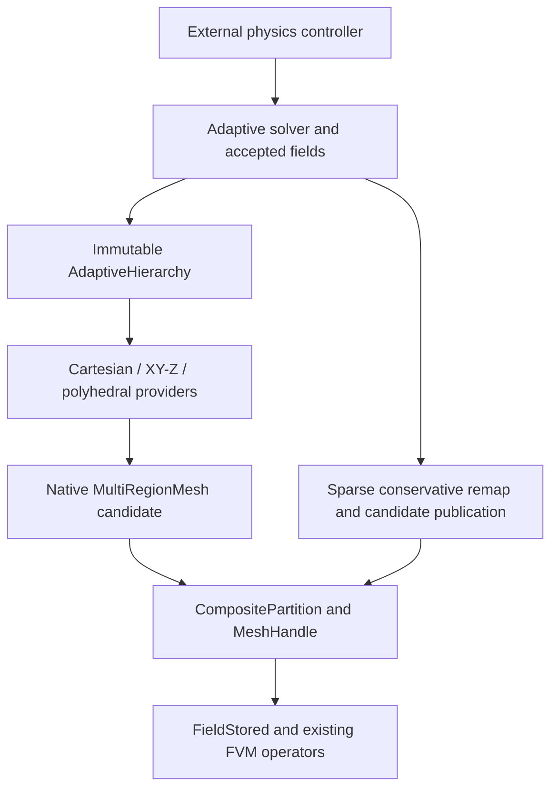

# AMR for extruded, polyhedral, and mixed-region meshes

AMR hierarchy, ancestry, overlap and adaptation modules live in
`src/geometry/mesh/AMR` and namespace `SimpleFluid::Meshes::AMR`.
Mode-selected geometry lives in `SimpleFluid::PLIC`; native mesh providers remain
in `SimpleFluid::Meshes`. FVM transport and solver consumers use the public PLIC
headers, with backend implementations confined to PLIC's private directories.

**Status: Stages 1–6 are implemented with bounded numerical verification;
Stage 7 is implemented with focused flow verification and incomplete overall
qualification; Stages 8–9 remain proposed.** This document owns the design and
qualification boundaries. The [roadmap](../../TODO.md#phase-23--amr-for-native-extruded-polyhedral-and-mixed-region-meshes)
tracks remaining work. Geometry adaptation and physical-flow qualification are
separate deliverables.

The [VoF transport and state-ownership contract](vof_transport.md) remains the
numerical baseline: mass-compatible momentum, microscopic carrier budgets,
physical-residual acceptance and population identity must survive every
extension. The [verification contracts](../verification/vof_solver_contracts.md)
identify reproducible checks. Status below summarizes recorded campaigns;
documentation consolidation is not a new execution of those tests.

## Qualification status

| Stage | Implemented and covered by focused checks | Remaining boundary |
| --- | --- | --- |
| 1. Common hierarchy | Independent topology/partition/geometry/state observations, native partition binding, stale-plan rejection and immutable trial/cache isolation; serial/MPI including asserted empty owners | Construction binding alone does not migrate an accepted solver state |
| 2. Geometry and remap | Actual convex clips, moments, represented coverage, native-owner authentication, sparse conservative paired amounts and tiny positive phases | Utility coverage alone does not qualify a flow solver; complete-family catalogs remain a bounded bootstrap |
| 3. Whole products | Exact XY/Z construction, split-order identity, complete inverse families, native MPI and conservative remap | Nonperiodic initial extrusions; factored storage is not distributed planner/RSS scaling |
| 4. Convex polyhedra | Actual occupied octants, shared face/edge overlays, saved-parent recovery, sparse exact native providers and physical remap | Canonical planning remains bounded and replicated; nonconvex cells are excluded |
| 5. Local/mixed products | Shared base/run storage, typed participants, closed face/edge/vertex grading, native tiles and conservative remap | Unsupported crossed patch groupings reject; contacts have separate domains and no implicit exchange law; storage reports are nonadditive |
| 6. Distributed state | Detached owner-local closure, typed ancestry, sparse native/state migration, accepted/history frames, final packet-cost admission and asserted empty owners | Initial complete-source bootstrap, unsupported topology changes, sparse ALE and production scaling remain outside qualification |
| 7. General flow | Ordinary default and independent inventories; PLIC/transport, physical-residual pressure/momentum, rollback and selected serial/MPI checks; optional modes have separate coverage | Scoped default-policy accuracy/physical horizons and cleanup sensitivity remain open. Wider mesh/contrast, coupled cleanup-remap and production scaling are separate claims |
| 8–9 | No general-mesh reacting/representation integration or certified nonconvex flow is claimed | Implement and qualify the separate stages below |

The finite modes have focused component coverage. The
[scoped qualification matrix](../verification/vof_solver_contracts.md#stage-7-scope-and-priorities)
separates mandatory default-policy accuracy/physical horizons from capability
extensions, conditional optimization/performance and strict-mode robustness.
Production performance is required for a performance claim, not the bounded
numerical baseline. Historical
rational-route results are recorded in [ExactVoF](exact_vof.md#verification-and-historical-qualification)
and cannot establish a pass or speedup for the primary FP implementation.

The separate Release balance fixture
`DistributedAdaptiveBalance.MeasuredOperationsDrivePinnedHierarchyMigration`
has a recorded topology/geometry numbering failure before balancing. It was
excluded explicitly from the later six-method balance selection. Passing
migration checks do not close this unresolved fixture.

Optional rational-route predicate acceleration is documented in
[ExactGeometry](exact_geometry.md#measures-coverage-and-predicate-acceleration).
The [primary FP policy](#floating-point-geometry-and-arithmetic) owns numerical
geometry and acceptance. Documentation changes provide no new runtime evidence.

The objective is one immutable adaptive hierarchy with provider-specific
Cartesian, XY-base × Z-product, and polyhedral ancestry. All providers continue
through native `MultiRegionMesh`, `CompositePartition`, `MeshHandle`, and
`FieldStored`. The optimized Cartesian algorithms remain available through the
existing `CartesianAMR` interface. No new geometric-library dependency is
selected here; external algorithm references explain proposed approaches only.

## Existing support and proposed scope

| Mesh or operation | Existing native capability | Adaptive capability and gate |
| --- | --- | --- |
| Dyadic Cartesian blocks | Immutable balanced `CartesianAMR`, canonical subfaces, adaptive VoF/flow; Stage 1 common hierarchy seam and source-validated native partition bindings | Existing Cartesian behavior retained; Stage 2 adds separate certified geometry/remap utilities |
| Direct `SemiStructuredXY_Z` handle | Serial native execution; direct MPI construction rejects | Use the composite route for distributed adaptation, stage 3 |
| Composite native/independent extrusion | MPI ownership; triangle, quadrilateral, and polygonal prisms | Common-Z whole-column refinement, then local products, stages 3 and 5 |
| Explicit planar-faced polyhedra | Native incidence, variable face loops, partitioned FVM | Certified convex refinement/coarsening, stage 4 |
| Concave explicit cells | Representation of admissible closed polyhedral surfaces | Certified decomposition before adaptation/VoF, stage 9 |
| Mixed native regions | Conforming, nested planar coarse/fine, and translated periodic joins | Independent ancestry with cross-region closure, stage 5 |
| Analytic cylindrical / `SweptRZ` providers | Native geometry and existing supported motion | Retain as static topology participants; refinement or incompatible neighboring splits reject until provider-specific refiners/joins qualify |
| Distributed shard input | Legacy partition planning assembles shards at a root | Stage 6 detached owner-local closure and migration after bounded complete-source bootstrap; bounded correctness, memory and work-accounting gates qualified |
| Extruded/polyhedral VoF and reacting gas | No support implied by native geometry | General geometric transport/flow, then physical coupling, stages 7 and 8 |

The relevant seams are [`CartesianAMR::adapt`](../../src/geometry/mesh/AMR/CartesianAMR.hh),
[`MultiRegionMesh::Region`](../../src/geometry/mesh/MultiRegionMesh.hh),
[`MeshHandle::initialize_semi_structured`](../../src/geometry/MeshHandle.tcc), and
[`ExtrudedTopology::cell_type`](../../src/geometry/mesh/ExtrudedRegionProviders.cc).
The last already represents larger polygonal bases as `POLYHEDRON`; AMR still
needs its own simplicity, convexity, and child-quality admission checks.
The present [`AdaptiveVoF`](../../src/FVM/AdaptiveVoF.hh) and
[`AdaptiveVoFSolver`](../../src/solvers/AdaptiveVoFSolver.hh) explicitly retain
`CartesianAMR`; their box stencils and directional transport are not generic.

The initial extensions use a fixed physical domain, one shared timestep, and
geometry frozen during each physical step. Time subcycling needs conservative
flux registers; simultaneous ALE and topology change needs a separate contract.
Neither capability follows from this design.

## Native hierarchy, identities, and ownership



`AdaptiveHierarchy` is the abstract provider seam implemented in Stage 1.
Concrete Cartesian, whole-product and convex-polyhedral implementations own
immutable native geometry and ancestry. The Cartesian implementation retains its
optimized numerical backend. Stage 5 adds a mixed assembly over local product
states and supported hierarchy adapters. Provider
splits, inverse families and physical resolution metrics remain distinct from
solver refinement policy. Native region dispatch follows
[`RegionGeometryView`](../../src/geometry/mesh/MultiRegionMesh.hh), rather than
erasing every cell query.

Stable region identity, material membership, provider-fragment ordinal,
canonical field GID, and rank-local field order are distinct. Materials and
physical patch labels are inherited explicitly; neither region names nor MPI
ownership determine them. A physical region can contain several provider
fragments and span ranks. Unchanged fragments may share their const providers.
The current composite prefix ordinals can change when an earlier region grows,
so they cannot serve as persistent ancestry or physical boundary identity.

The implemented Stage 1 interface is declared in
[`AdaptiveHierarchy.hh`](../../src/geometry/mesh/AMR/AdaptiveHierarchy.hh):

```cpp
class AdaptiveHierarchy {
public:
    virtual ~AdaptiveHierarchy();
    virtual HierarchyObservation observation() const noexcept = 0;
    virtual const SP<const MultiRegionMesh>& native_geometry() const noexcept = 0;
    virtual AdaptiveCellKey cell_key(uint64_t cell) const = 0;
    virtual uint64_t cell_material(uint64_t cell) const = 0;
    virtual size_t cell_fragment(uint64_t cell) const = 0;
};
```

`HierarchyObservation` retains exact hierarchy, topology and partition identity
tokens independently of generation values, effective resident geometry identity
and epoch, and communicator identity. `AdaptiveCellKey` admits
`CartesianCellAncestry`, factor-specific `ProductCellAncestry` and explicit
`ConvexCellAncestry` provenance; the latter
identifies supplied convex cells without claiming a polyhedral refiner. Physical
region identity, material membership and fragment
ordinals remain separate. `CartesianAMR::plan_adaptation()` and
`apply_adaptation()` retain and validate the exact source observation.

`CartesianAMR::with_partition()` binds an actual completed native partition after
collective source/epoch/communicator validation. Its weak origin observer preserves
exact source identity without retaining global partition scratch. Bound hierarchy,
FVM and solver construction use native ownership; this is not live migration of
an existing solver's accepted state. The detached Stage 6 path below provides live repartition/migration separately
from this original binding API.
Both canonical and resident geometry must retain their captured epochs. Supported
resident ALE motion invalidates a binding; restoring coordinates does not revive
an earlier observation. The Cartesian numerical backend remains unchanged.

Product hierarchy candidates are implemented in Stage 3; general mixed-region
refinement and a solver `RegridTrial` remain later stages. Stage 2 accepts
caller-supplied convex provenance and explicit certified ancestry overlap relations. Their data must contain geometry/partition state separately from
solver inventories and controller revisions.

Plans pin the exact source identity, communicator, provider observations, and
topology/partition/geometry stamps. Solver trials additionally pin accepted
state and controller revisions. Population schema is an independent semantic
identity: unchanged hierarchy and field dimensions do not validate population
indices or a prepared source trial after solver reinitialization.
Ownership-only changes advance partition
generation independently of topology. Geometry epochs remain the numeric-cache
revision described by [`MeshHandle::geometry_epoch`](../../src/geometry/MeshHandle.hh).
Keys must have checked, collision-free equality; a hash alone is not identity.
Provider layout and revision checks retain the existing
[`IsoRegion::validate_static`](../../src/geometry/mesh/RegionProviders.hh) contract.

## Implemented certified geometry and sparse remap

[`ConvexCellGeometry<Ordinary>`](../../src/geometry/PLIC/ConvexGeometry.hh) is the
native AMR cell representation. It retains a floating-point convex shell and
source incidence, validates outward faces, convexity and closed manifold
topology, and uses the ordinary clipping provider. Rational source preparation
is not required. The explicit Exact specialization remains available behind
the public PLIC interface for optional exact algorithms.
`GeometryHalfspace` means `normal dot (x-anchor) <= offset`; a local anchor and
separate finite offset retain translated microscopic cuts that a rounded point
on the plane cannot encode. Clips retain both sides, section geometry and local
volume/first moments. No positive represented piece is removed to satisfy a
tolerance or resource cap; invalid, unresolved or unrepresentable geometry rejects.
Bulk product overlap factors into actual XY polygon area times Z overlap; tilted
phase cuts retain the full three-dimensional intersection.

Ordinary clipping finalizes requested children through private drafts. Crossings
reuse recovered source identities, and face cleanup removes only repeated
references; coordinate proximity does not merge distinct points. Before measuring,
each requested child must have a connected boundary with two opposite directed
incidences per edge. Shared cap winding comes from the inherited face boundary.
The finalizer retains each child's positive, zero, negative or unresolved measure
status until joint admission, then measures any requested section. Derived bounds,
displayed points and moment caches belong to the finalized construction. Inside-only
intersection still constructs and measures only its requested child.

Contacts remain classified from parent/cut evidence and retain their face, edge
or point section. Strict vertices on both sides prohibit treating an inverted or
unresolved child as contact. A failed measured strict tetrahedral split may
retry once near a retained source vertex. The side with the smaller maximum
original cut distance selects that vertex; coordinate-order ties keep the
choice independent of cut reversal and vertex numbering. Compensated frame differences must prove
that every inherited parent coordinate is exactly representable in the candidate
frame. The retry reconstructs shared crossings from that unchanged parent and
the original cut distances; it never reuses the malformed child's coordinates.
Both requested children, their section and lazy moments use the rebuilt frame,
while authenticated replay retains the original parent/cut recipe. Failed attempts
remain charged to the existing work/storage caps.

This retry preserves the parent coordinates, but its new crossings still follow
Ordinary rounded arithmetic. It does not certify tiny-feature relative volume,
area or moment accuracy. Existing reconstruction, phase and transport acceptance
gates remain authoritative. Numerical-only packets, private partition witnesses,
lossy frame changes and other unsupported failures do not acquire this retry.
There is no coordinate perturbation or small-volume omission.

`GeometryValue<Mode>` follows its selected arithmetic contract. Ordinary values
carry a scalar and report additional binary64 narrowing error, without claiming
a tracked construction enclosure. Bounded values retain enclosures. Exact
published values retain conversion uncertainty and a separate nonzero marker;
their underlying rational storage stays private to the optional backend.
Checked narrowing rejects disappearance of a known nonzero value.

[`AdaptiveOverlapPlan`](../../src/geometry/mesh/AMR/AdaptiveOverlap.hh) takes explicit
source/target bindings and unchanged/refine/coarsen relations. It certifies actual
intersection geometry, per-cell disjointness and complete coverage using retained
boundary identities and finite volume/moment gates.
Catalogs may contain only the complete ancestry families needed locally. This is
not a global key directory or distributed refinement planner.

[`ConservativeAMRRemap`](../../src/FVM/ConservativeAMRRemap.hh) binds the exact
native endpoint identities, maps, epochs and plan observations. Sparse owner
exchange authenticates every supplied source and target certificate cell,
including inactive remote siblings: represented native shell geometry must agree,
and region/material/typed ancestry metadata must match its owner's binding by
lossless bytes. Native shell extraction retains outward orientation and admitted
edge-vertex incidence. Analytic curved providers and translated periodic
joins reject instead of being approximated by a planar node hull.
Sparse and constructed providers expose retained cell geometry; raw display-node
shell export rejects for those providers, so wider coordinates and construction
ancestry cannot silently be replaced by a rounded display hull.

The caller supplies physical gas and carrier volumes independently, plus accepted
geometry declarations. `Plic` requires a valid mixed-cell plane; `PureGas` and
`PureCarrier` explicitly declare accepted rounded-pure geometry. Only an explicitly
empty geometric minority with positive physical volume within the actual-cell
consistency bound may use bulk-overlap weights. A missing mixed-cell plane rejects;
a resolved positive tiny clip retains its spatial placement. Paired number/moles
use identical carrier weights. Signed/nonnegative extensives, phase densities and
zero-carrier consistency remain checked, with no clipping, carrier floor or
coverage normalization. Output is replaced only after all collective gates pass.

Dimensionless ratios and checked mantissa/exponent products avoid intermediate
overflow and silent underflow. Global signed/L1 budgets use per-budget integer
binary exponents, supported double communication and deterministic compensated
scalar accumulation; diagnostics retain their scale instead of overflowing a
physical double total. Physical tolerances remain independent of remap scaling.

The original Stage 2 native owner certificate exchange padded local/imported
shells to the global maximum shell payload width, which could inflate storage
for heterogeneous large shells. The current general remap API also uses bounded
variable-length owner packets through `exchange_owner_packets`, without a global
solution array. The separate
[detached Stage 6 path](#distributed-execution-and-memory-bounds) adds the sharded
typed ancestry directory and owner-local hierarchy planning. The Stage 2
utilities alone add no new refinement provider; Stage 3 supplies the
whole-product provider below. Neither stage adds a general-mesh VoF solver or
live accepted-state repartition. The optimized Cartesian numerical/remap path
remains separate.

## XY/Z products

An extruded cell key is `(BaseCellKey, AxialIntervalKey)`. The base key records
its original polygon and refinement template/path; the interval key records its
original Z interval and dyadic path. Side ancestry is base-edge segment × axial
interval; cap ancestry is base-cell leaf × axial plane. Shared coordinates come
from the same ancestral construction. XY-then-Z and Z-then-XY refinement must
produce identical final product keys and geometry.

The Stage 3 implementation is [`ExtrudedAMR`](../../src/geometry/mesh/AMR/ExtrudedAMR.hh).
Its `ExtrudedAMRGrid` supplies represented root XY nodes/base loops, boundary edge
labels, Z edges, optional compatible triangle reference edges, physical region and
material IDs, depth and quality limits. `adapt(refine_base, refine_z, coarsen_base,
coarsen_z)` and the plan/apply pair construct immutable candidates collectively.
`base_keys()`, `base_edge_keys()` and `interval_keys()` expose independent ancestry;
`BaseEdgeKey::Kind` separates `Root` edges from `TemplateInterior` edges, so
identical creator/ordinal values cannot alias a boundary edge and an interior
refinement seam. Child paths retain that namespace through further refinement.
`cell_geometry(gid)` queries retained ordinary cell geometry on demand. Root embedding,
conformity, complete immediate sibling families and stale source observations are
checked before publication. Failed candidates preserve the source hierarchy.

The existing `ExtrudedGeometry` now optionally retains
[`ExtrudedConstruction<Ordinary>`](../../src/geometry/PLIC/ExtrudedConstruction.hh).
Represented roots and immutable affine mean recipes define base points and common
Z coordinates, evaluated in ordinary wider floating point. Native cell/face
volumes, areas and centroids derive from that retained construction. Display/VTU
nodes may round independently and never define overlap geometry or change the
parent domain. Admission requires a valid distinct display layout, convex cells,
and representable signed native center-to-face/axial metric differences. Root
edge recipes retain side-support identity through refinement and shared views.
The construction provider does not replace retained geometry with display polygons.

`has_construction()` identifies this capability, and
`certified_cell_geometry()` returns a retained actual cell on demand.
`ConvexCellGeometry::from_native_cell()` dispatches to that authoritative provider;
`native_cell_shell()` rejects constructed geometry rather than exporting its
rounded node hull. Versioned construction descriptors bind the full extrusion
topology, recipes and active addresses. Native partition packets and configuration
signatures retain those descriptors. The raw recipe API rejects invalid parents,
nonfinite roots, incompatible active layouts, malformed packets and foreign
retained topology. The raw `make()`/`decode()` contract certifies the DAG, layout,
individual convex cells, metric viability and packet framing; it assumes an
already valid, certified embedded base. It does not establish global embedding
of arbitrary raw provider input. `ExtrudedAMR` certifies root embedding explicitly
and preserves it through recipe ancestry and conformity closure. Native packet
decode preserves that descriptor rather than independently admitting an arbitrary
mesh. These are direct provider contracts, separate from refinement.

`ExtrudedAMR::with_partition()` binds an actual completed native partition after
source/revision/communicator validation. Its observation identifies the effective
resident geometry. Fields, traversal and remap use that resident handle; manually
substituting a canonical geometry observation does not authenticate a partition.
This is a construction binding, not live accepted-state migration.

Owner authentication tags represented native shells separately from retained
constructed geometry. `encode_certificate()` and `decode_certificate()` retain
wider scalar coordinates, source supports and topology without rational
construction or display-node substitution. Product keys encode both factors
by exact bytes. Every supplied source/target certificate and inactive sibling
still authenticates against its owner's geometry and ancestry/material binding.
`MeshToMeshTransfer` and planar ALE reject constructed providers until their
node-hull/geometry-transform paths gain an authoritative construction contract.

The compact claim concerns provider, hierarchy and partition descriptor storage:
base/edge/point recipes plus common axial data, with retained cell geometry
created only on demand. `storage_counts()` and `storage_report()` separate those
retained allocations from maps and temporary certificates. The Stage 3 remap
bootstrap may explicitly assemble bounded complete-family catalogs for a query;
it does not retain a global base×layers shell cache or weaken Stage 2's exact
source/target coverage checks. The separate [detached Stage 6 path](#distributed-execution-and-memory-bounds)
provides owner lookup, complete-family authority and variable-length packets;
this does not remove the original bootstrap API's bounded-catalog boundary. Repeated
refine/coarsen histories and layer-count changes have dedicated storage tests;
the qualification summary above retains their scope and limits.

Across two snapshots, product ancestry has a factor partial order: refinement
requires each base/Z factor to remain equal or descend, with at least one strict
change; coarsening reverses that relation. Explicit `ProductIntersection` handles
opposite strict factor directions, such as refined base/coarsened Z. It never
pretends those cells have a single scalar parent. Within one active catalog,
comparable base paths and comparable Z paths imply positive product overlap even
when their directions cross; those active combinations reject before geometric
surrogate shells can hide the conflict. Explicit ancestry pairs are enumerated
on demand. The target-selected overload treats an empty target list as zero
records; the unfiltered overload enumerates all requested snapshot relations.

Parents and sibling families are factor-specific. XY coarsening requires the
complete base sibling family over compatible axial intervals; Z coarsening
requires complete interval siblings over compatible base leaves. There is no
single octree-style parent for every independently refined product cell.

Stage 3 is limited to nonperiodic whole products with a conforming base repeated through
common Z layers. Deterministic triangle bisection uses compatible root refinement edges
and conformity closure. XY changes affect whole columns; Z bisection affects a
selected interval across the entire base. This directly retains the layout of
[`SemiStructuredIndexer`](../../src/geometry/mesh/SemiStructuredIndexer.hh).
Hanging base edges cannot be inserted into its whole-edge adjacency contract.
Strictly convex quads use four children: with edge midpoint `m_i` and the
deterministic mean `c` of the four vertices, child `i` is `(v_i,m_i,c,m_(i-1))`
in cyclic order. Construct shared boundary midpoints once; require every child
to pass convexity, positive-area, and quality checks. Larger strictly convex
bases triangulate from the boundary vertex with the smallest stable key, then
use triangle bisection. Save the original polygon, template, and complete
inverse family for coarsening. Template depth is not a claim that every
physical length has halved.

Stage 5 represents local refinement as connected base patches × contiguous Z
runs, sharing identical base templates and axial data and combining adjacent
runs with identical layouts. Reuse the product representation of
[`CompositeRegionFragment::ExtrudedProduct`](../../src/parallel/CompositePartition.hh).
Avoid one provider per 3D cell. Arbitrary layer-local patterns cannot promise
one global O(base + layers) representation; storage also includes unique local
templates, product descriptors, and their interface ancestry.
[`LocalProductAMR`](../../src/geometry/mesh/AMR/LocalProductAMR.hh) retains independent
base/interval keys and an interned axial selection for each active base leaf.
Connected compatible base components form templates; contiguous intervals form
run views. Factor marks name source product keys. XY or Z coarsening requires
complete immediate factor siblings on the unchanged other factor. Saved exact
construction recipes preserve the original domain through inverse families.
This implemented local-product extension does not change the Stage 3
whole-column adaptation contract.

`SemiStructMeshTopo` shares immutable base connectivity. Exact product providers
share base construction/metrics and an axial coordinate DAG independently of
axial selections, with lightweight layer/indexer and contiguous-run views.
`ProductKeyView` shares base/Z key vectors rather than copying ancestry into
every run. State-local interning and merging of compatible adjacent runs avoid
a global strong cache. Native packets catalog each unique base topology, exact
base, axial value table and axial selection once, then retain per-run references
and view descriptors. Display nodes do not replace authoritative constructions.

Refined wall vertices remain on the original polygonal boundary. Projection to
an analytic cylinder, domain-volume renormalization, and unrequested remeshing
would change the physical domain and are outside this contract.

## Convex polyhedral refinement and shared topology

Stage 4 admits planar-faced convex cells only after oriented-halfspace,
non-self-intersection, closure, and quality certification. Split the actual
parent with its three axis-aligned bounding-box midpoint planes, yielding up
to eight nonempty convex children. Store the occupied octants, construction
version, and parent/child ancestry; do not require eight children or replace
the physical cell by its box. Each child's coordinate spans are bounded by
half the corresponding parent box spans.

[`PolyhedralAMR`](../../src/geometry/mesh/AMR/PolyhedralAMR.hh) implements this stage for
one native region without joins and one physical region ID; per-root materials
and physical patch labels are retained independently. Input must already be a
valid embedded native planar-convex mesh with complete canonical root residency.
Root import certifies each actual
ordered atomic cell shell and declared shared-face incidence; it is not arbitrary
global mesh admission. Mixed native regions/joins remain Stage 5 and reject.

`PolyhedralAMRGrid` supplies the native snapshot, optional per-root physical
region/material arrays, depth/quality limits and explicit `maximum_cells` and
`maximum_face_tiles` bootstrap budgets. The cell budget checks conservative upper
refinement growth with overflow protection. The face budget bounds overlay pairs
within shared ancestral surfaces before large expansion. Exhaustion rejects the
whole candidate before publication. A final lossless exact canonical descriptor
comparison enforces collective root/candidate identity even when ordinary
explicit meshes have equal layout and different coordinates.

`adapt(refine, coarsen)` uses source leaf ordinals and persistent parent keys.
Only the complete recorded immediate family in the original source is eligible
for coarsening; grandchildren, chained eligibility and refine/coarsen conflicts
reject. Plan/apply retain the exact source observation. No-op calls retain the
snapshot, while successful changes publish the hierarchy and native geometry
together after every check succeeds. `with_partition()` binds the actual native
resident observation, separately advancing ownership without changing ancestry.

Canonical planning constructs a bounded replicated explicit hierarchy using a
local `SerialComm`. Distributed fields use `CompositeMeshSource`, native
partitioning and a real retained partition binding. The ordinary direct MPI
constructor's rejection of globally explicit regions remains intact. Sparse
resident providers do not prove scalable per-rank hierarchy storage: canonical
root/planning geometry is still replicated, under the explicit budgets above.

Closed-volume halfspace clipping is the relevant geometric primitive; the
[CGAL clipping contract](https://doc.cgal.org/6.1.1/Polygon_mesh_processing/group__PMP__corefinement__grp.html)
distinguishes clipping a bounded volume from merely splitting its surface.
The native cutter uses the ordinary PLIC provider, retained incidence and finite
volume/moment acceptance gates. That reference is algorithm background, not a new dependency or
qualification claim.

Construct one canonical subdivision of every parent face from both incident
cells' cut patterns before assembling children. Both sides reference exactly
the same atomic polygons with opposite incidence. Every new edge vertex must
be propagated into all incident face loops; coordinate-tolerance matching of
independently assembled children is insufficient. Coarse neighbors traverse
the resulting atomic subfaces. This internal conforming face overlay is new
explicit topology surgery, distinct from arbitrary mortar/AMI interpolation
and from extending the cross-provider interface API.

Certify positive finite child measures, planar simple faces, oriented closed
manifolds, containment, pairwise interior disjointness, parent volume and first
moment recovery, and complete parent-shell coverage. Discard only proven empty
intersections. A positive sliver that violates quality or representability
rejects the candidate; its volume cannot disappear. Retained midpoint
constructions need not coincide with independently rounded display coordinates. Native display/metric viability
remains an explicit admission limit; no unspecified retry changes the split.

Coarsening restores the saved parent geometry after its complete recorded
immediate sibling set is present, without grandchildren or changed material
membership. Retain boundary tiles still required by finer neighbors. Never
recover a parent through a convex hull. This geometry hierarchy has no solver
refinement policy. A future solver integration must separately protect mixed
interfaces, reconstruction neighborhoods, motion forecasts, wakes and promotions.

[`PolyhedralComplex<Ordinary>`](../../src/geometry/PLIC/PolyhedralComplex.hh) groups
faces by stable `Root` or `Cut` surface ancestry, with canonical orientation and
physical patch declarations. A cut surface is identified by its creator parent
and axis, not a rounded plane or coordinate tolerance. Opposite incident patterns
contribute to one canonical atomic overlay; same-side overlap, missing coverage or
inconsistent surface/patch declarations reject. Canonical tile identities ignore
loop start and redundant admitted collinear edge segmentation. Every retained edge vertex
is propagated to incident loops, and the reconstructed atomic cell shell must
match its immutable canonical geometry. Coarsening therefore restores the saved
parent shape while retaining covering tiles required by a surviving fine neighbor.

`ConvexCellGeometry::from_native_cell_atomic()` imports authoritative atomic faces
in native traversal order, including constructed cells. It does not assume that a
canonical domain certificate's face count/order equals its tiled native topology.
The ordinary domain certificate remains the geometry used by conservative remap.

The constructed `ExplicitRegionProvider` overload keeps the raw record constructor
and record representation available. Constructed cells use `POLYHEDRON` connectivity
when atomic tiling changes face counts. The compiled adapter authenticates native
records against the retained ordinary complex; native face area comes from the retained
area conversion, not the norm of already rounded area-vector components. Legacy
record range checks remain explicit admission requirements.

Versioned native packets retain requested cells plus incident-owner geometric
support, their faces/nodes, and only metric records for remaining outer neighbors.
This geometric support closure does not enlarge field halos. Retained cells are available only
for fully resident cells. Empty/sparse providers keep the global catalog and
boundary schema independently of residency; their public factory requires the
complete schema explicitly, even when the global schema is empty. Unnamed
exteriors retain invalid boundary IDs and empty names; topological exterior
status is independent of labelling. Omitting a sparse factory schema rejects. Complete descriptor bytes participate in configuration
identity. All supplied source/target remap catalog cells, including inactive
siblings, still authenticate against their actual native owners without coverage
normalization. Constructed-shard distributed reassembly is explicitly rejected until
Stage 6 can preserve its authoritative semantics; ordinary legacy shard merge
continues through its existing path.

[`UnstructuredMesh`](../../src/geometry/mesh/UnstructuredMesh.hh) supplies ordered
face loops and manifold incidence, but its signed moments and face-loop checks
do not certify a new nonoverlapping refinement partition. Likewise,
[`evaluate_mesh_quality`](../../src/geometry/MeshQuality.hh) uses absolute normal
distances: add signed visibility/convexity checks and shell-intersection tests.
Positive volume alone is insufficient.

Use cell-local coordinates and dimensionally scaled absolute/relative length,
area, volume, and first-moment tolerances. Construct shared coordinates once
from canonical ancestry; use adaptive predicates or a certified fallback for
ambiguous signs. Inconclusive emptiness, intersection, or coverage rejects;
tolerances must neither erase positive measures nor renormalize coverage.

Coverage compares intersections with the actual represented, boundary-clipped
query geometry. A nominal spacing product or AABB volume is not the volume of
that query. Use local-coordinate differences and compensated positive summation.
New kernels need bounds for their own clipping/predicate arithmetic, not the
Cartesian box helper's bound transplanted unchanged or a tolerance proportional
to global origin. Retain rejection of genuine missing, doubled, or empty
coverage at large offsets.

## Mixed-region closure and boundaries

The verified Stage 5 implementation below is a
geometry/native-field/remap extension; it does not enable a general VoF or flow
solver. Same-fluid joins keep one connected native pressure domain. Contacts
retain separate native meshes and external coupling maps; coincident geometry
never creates a pressure join implicitly. Physical region, material, patch,
fragment and persistent ancestry identities remain separate.

[`MixedAMRGrid`](../../src/geometry/mesh/AMR/MixedAMR.hh) accepts zero or more
`LocalProductAMR` states, supported `CartesianAMR`, `ExtrudedAMR` and
`PolyhedralAMR` hierarchy adapters, and retained static native participants. An
optional first-product convenience entry is not a required dummy participant.
`MixedPatchJoin` names participants and physical patch names, so accepted
adaptation transactions rebuild joins from candidate native patches rather than
requiring callers to update changing run ordinals. Typed marks distinguish
product XY/Z factors, Cartesian block parents and saved convex parent families.
No-op transactions retain observations; real topology changes advance topology
and partition generations from the source. Plans pin the exact source
observation; rejected candidates leave the source unchanged.

Adaptive participant imports retain each exact hierarchy observation and its
canonical geometry identity/epoch. Both canonical and resident provider guards
must be valid before rewrapping regions; a fresh `IsoRegion` cannot revive a
moved source or discard its affine transform. Later participant motion makes
Mixed observations visibly stale and rejects geometry queries, plans and
adaptation. Returning to old coordinates through a new epoch does not restore
compatibility. This retained dependency metadata is O(participants) and is
included in the assembly metadata storage breakdown.

Each provider retains independent ancestry. Provider-local admission includes
closed face, edge and vertex neighbors. Comparable dyadic base-edge and axial
traces allow at most one generation difference, even when a larger physical
span ratio is configured; unrelated template levels are not compared as physical
lengths. Exact directional AABB spans enforce the configured physical ratio.
Whole and local product `contact_violations()` queries derive contacts from base-edge prefixes,
shared vertices/T-junctions and closed axial addresses without a persistent
expanded cell/certificate catalog. Mixed assembly rejects a violating local
state before native publication when provider-local closure is unsupported.
The initial sixteen-cell fixture retains its nineteen-cell local XY and
seventeen-cell local Z candidates. Repeated boundary-touching marks
can reject atomically instead of silently publishing excessive gradation.

Cross-participant closure compares exact physical AABB spans in each direction
against the configured ratio, using actual canonical same-fluid adjacency,
including low-level `grid.interfaces` joins; named joins are not a bypass gate. Supported coarse incident
cells refine under provider depth/quality checks and explicit mixed cell,
interface-tile and closure-round bounds. Native shared-node incidence checks
internal supported edge/vertex neighbors. Across different providers, a
conservative span envelope over each canonical joined face's closed AABB
neighborhood certifies possible corner scales. Authoritative exact cell/face
bounds select candidates; unrelated interior cells are excluded. If that
seam-local envelope cannot prove the bound, the transaction rejects. This can
reject an overcomplex contact requiring a sharper local seam proof. It does not weld
coincident independent/contact domains or claim arbitrary mixed-corner closure.
Contact incidence/pair work has an explicit bootstrap allocation/check budget. Conservative expansion preflight can
reject before a provider allocates a large candidate. Static refinement requests
and exhausted/incompatible closure reject the complete transaction. Static
canonical participants keep native provider identity/epoch, local ordinals and physical
membership. Their presence does not imply PLIC support for analytic curved or
nonconvex cells: conservative remap requires every participating cell to have a
qualified planar convex certificate, or rejects before publishing output.

The existing [`NonconformingInterface`](../../src/geometry/mesh/ConservativeInterface.hh)
retains its one-fine-region contract. The new
`MultiProviderNonconformingInterface` declares one participant per fine provider,
with an explicit list of distinct complete `FineNativePatch` records. A provider
may contribute several native patch IDs to a single coarse-face mapping; their
physical labels are not merged. Each record retains its native patch count and
complete face-ID membership. The descriptor maps each selected whole coarse face
to native `RegionFace` tiles across those providers. Exact face certificates prove coplanarity, containment, disjointness,
area and first-moment coverage and opposing orientation. A one-tile equality join
uses the same path for run caps. No mortar polygon or synthetic flux face is
created. Crossed XY/Z traces without a complete nested native tiling reject;
this implementation does not promise arbitrary anisotropic seam closure.
Even a locally graded state can have an unsupported crossed run grouping:
a fine native patch spanning several Z ranges may need partial use under
different coarse providers. Complete-patch rules still reject that grouping.
The raw contact diagnostic therefore covers some states that are not admissible
native assemblies; it is a diagnosis gate, not permission to bypass native
coverage or publish unjoined fields.
`RegionInterfaceDirectory` remains derived lookup data, never ancestry authority.

Every canonical fine tile stores one integrated flux, in its retained native
owner orientation. Coarse incidence visits all covering tiles.
[`restrict_face_flux`](../../src/geometry/mesh/MultiRegionMesh.hh) sums signed
integrated fluxes using retained native addresses, independently of area ratios
or floating-point vector dot products. Prolongation uses the same discrete sign
and positive area ratios; an unrepresentable ratio rejects explicitly. A
range-only `hypot` fallback rescues finite nonzero area vectors whose ordinary
squared norm underflows or overflows, preserving ordinary-range arithmetic.
A genuinely zero vector retains zero scalar area; this does not admit a
zero-area face to a new join.

Versioned native packets retain an independent per-region native patch-count
catalog captured from complete source topology. Interface declarations cannot
redefine a complete fine patch by omitting tiles and decrementing their own
counts. Decoding checks complete procedural topology counts, available explicit
face records and global entity bounds. Sparse explicit shards keep the catalog
without acquiring remote geometry; repacketization and configuration signatures
preserve it. Grouped fine-patch membership adds explicit O(interface tiles)
metadata to this bounded bootstrap; it is not compressed into a universal
base-plus-layers seam bound. Each native patch must be completely and uniquely
covered, and absent/duplicated patch or face declarations reject. A sparse packet
is a descriptor from a validated source, not an independent proof admitting an
arbitrary global embedded mesh.

Constructed joins are enabled only for interfaces qualified by the exact nested
path. Unrelated ordinary legacy joins do not invalidate qualified constructed
joins elsewhere. Authoritative canonical face certificates close joined cells,
including an ordinary coarse provider whose face is tiled by constructed fine
providers. Display-node hulls are not a fallback. Materials and physical patch
labels remain inherited rather than being inferred from region names or rank.
Ambiguous duplicate persistent keys reject collectively; the assembler does not
renumber physical regions to hide missing provider-root provenance.

`MixedContactDomains` retains separate connected assemblies and explicit contact
patch references. It validates references but supplies no contact constitutive
law or numerical exchange operator. Existing connected-fluid admission remains
in force. Structured translated-periodic joins keep their existing matching
subdivision and image-vector rules. New exact local-product/polyhedral joins
are nonperiodic; translated/rotated constructed and nonconforming periodic joins
remain unsupported until separately qualified. Analytic curved subdivision
remains unsupported.

Stage 5 canonical assembly and complete-family overlap catalogs are explicitly
bounded replicated bootstrap work. Ancestry-family indexes enumerate overlap
relations, including independent product-factor directions and empty target
selections; they do not search every source/target geometry pair. Native
partition providers remain sparse, but that does not qualify per-rank hierarchy
scaling. The separate [detached Stage 6 path](#distributed-execution-and-memory-bounds)
implements exact sparse native reassembly and owner-to-owner migration; it does
not convert these original APIs into distributed planners.

`MixedAMR::storage_breakdown()` exposes uniquely accounted native assembly
providers/derived lookups and owned mixed metadata (participant arrays, joins
and interfaces) separately from retained participant reports. Those reports overlap
through shared providers and must not be summed. Local-product/whole-product
reports include their planner state; Cartesian/polyhedral reports explicitly
exclude private planner ancestry. Resident partition geometry is separate, and
partition maps/control-block/allocator overhead are not a complete accounting.
These are capacity estimates, not a whole-process retained-memory total or RSS
measurement. The separate Stage 6 reports distinguish actual distributed
payload, capacity estimates and normalized process RSS; the qualification
summary above retains that bounded scope.

## Conservative remap and physical resolution

Exploit unchanged leaves, ancestor/descendant containment, and complete sibling
unions to find donors. Do not run a global all-pairs intersection search. For
source cell `i`, target cell `j`, and old PLIC gas halfspace `H_i`, retain the
intersection geometry needed to compute

$$
V_{ij}=|C_i\cap C_j|,\qquad G_{ij}=|C_i\cap C_j\cap H_i|.
$$

Bulk XY/Z overlap factors into polygon intersection area × interval overlap.
A tilted PLIC phase cut requires the actual 3D clipped volume; multiplying a
single section area by height is not equivalent. Target gas volume is the sum
of `G_ij`; conservative amounts use the fraction of their declared carrier in
each intersection. Restriction sums extensives; intensive values derive from
transferred extensives and target measures. Detect missing/excess coverage,
absent carriers, and nonfinite weights rather than normalizing errors away.

Keep sparse donor residual closure, nonnegative inventory bounds, and signed
momentum from [`AdaptiveVoF::remap`](../../src/FVM/AdaptiveVoF.cc). Low-Mach remap
transfers separate liquid/resolved/dispersed mass or moles, population number,
dissolved/donor stock, phase energies, and physical momentum including drift.
Constant-density `MixtureMass` is not a replacement for that state. Recover EOS
variables only after conservative transfer and retain occupancy, energy,
inventory, and physical continuity acceptance gates. New interior face fluxes
require reconstruction/projection; retained integrated fluxes restrict by sign.

Canonical phase inventories can remain positive when the published fraction
rounds to zero or one. Compute low-Mach carrier storage from retained phase
volumes and accepted source/flux increments, never solely from `(1-f)*V`.
Preserve the existing bounded-remnant remap rule: when phase geometry cannot
locate a phase because the published fraction is pure (`f<=0` or `f>=1`), but
the corresponding retained phase volume is positive and within its consistency
bound, distribute its paired inventories through the same bulk-cell overlap
before recombination. Do not classify the
carrier as absent, give number/moles inconsistent weights, or use this fallback
for a material geometric mismatch. Each new provider must qualify that rule
with its own represented-geometry error bound and retain rejection above it.

Reuse sparse application, quantity semantics, coverage reporting, and stale-map
checks from [`MeshToMeshTransfer`](../../src/fields/MeshToMeshTransfer.hh).
Its present [setup](../../src/fields/MeshToMeshTransfer.tcc) supports neither
general polyhedron/polyhedron nor extrusion/extrusion intersections and
replicates source geometry. It is not the proposed geometry builder. A scalar
bulk-overlap transpose does not supply reverse PLIC transfer weights.

Use physical directional spans and face-normal distances to select resolution
and stability. `V^(1/3)` hides thin or long cells. A conservative cell-diameter
bound is acceptable for general polyhedra; XY and Z resolution remain separate.
Retain 24–32 cells across a 1 cm resolved bubble as an initial target, subject
to anisotropy and stencil guards. This is not DNS or application qualification;
measure shape, curvature, transport, and coupled-solution convergence.

## General VoF and flow backend

**Ordinary floating-point arithmetic is the default for general VoF.**
`GeneralVoFOptions::arithmetic_mode` is the single writable selector:
`ArithmeticMode::Ordinary`, `BoundedCertification`, or `Exact`. The solver,
reconstruction and remap inherit the accepted phase state's mode. Both finite
modes retain independent binary64 gas/carrier inventories; the compatibility
`inventory_policy()` getter derives `Finite` for them and `ExperimentalExact`
for explicit `Exact`. Mode agreement is collective and reusable geometry,
state and packets cannot mix modes. No failure triggers a backend fallback. Focused component coverage is implemented; full coupled-flow,
complete-horizon performance and application qualification remain open.

The Cartesian backend retains its specialized reconstruction and directional
transport. General flow currently admits source-free, closed physical boundaries
and nonperiodic geometry. Periodic swept images, low-Mach thermodynamics,
material/species sources and drift need their own qualification in Stage 8.

`PLIC::PolyhedralReconstruction<Mode>` requires sample geometry in its selected mode. A necessary
neighborhood support/model screen precedes fitting; insufficient support emits
a refinement request and rejects atomically. The normal fit uses physical-cell volumes, with enclosures in certification
mode, and every angular evaluation refits the target offset. A
nearby minority support anchor and an outward signed bracket preserve offset
precision. Conditioning, optimizer convergence, target-volume accuracy and model
defect remain separate gates. See the [resolution policy](#resolution-before-additional-precision).

Canonical face triangulations share node traces and owner-oriented controls.
Bounded signed swept pieces and recipient pullbacks establish physical phase
transfers with donor coverage, non-overlap, occupancy and phase-error checks.
Complete authenticated complement ancestry can certify a partition; independently
constructed pieces require their own coverage evidence. Shared wall constraints
use the complete authenticated incident catalog. Certified cross and triple
products establish their rank; a normalized common tangent constructs motion
along two independent walls without subtracting nearly parallel projections.
No angular tolerance merges distinct walls, and unresolved rank rejects.
Unsupported or ambiguous
geometry rejects under the existing work and storage caps.

Tetrahedral measures intersect four equivalent vertex-anchored determinant
enclosures. This retains short-edge dependencies in thin swept intersections;
their first moments use the same bounded volume and the tetrahedral centroid
identity. Positive volume and downstream phase accuracy still require their
original bounds. If the usual general-polyhedron volume enclosure cannot
establish positivity, bounded vertex-anchored decompositions supply additional
enclosures for the same shell. Their intersection must establish positivity
within the existing work caps; no uncertain face triangle is dropped. Lazy
moments use the same decomposition and a common physical reference.
An ambiguous clip sign may also reuse a source-face vertex when three shared,
independent support equations prove that it is the same point. Every incidence
must be authenticated or have a singleton-zero residual; coordinate proximity
does not establish identity. The immutable parent and its coordinate bounds
remain unchanged.
Global bounded-point import retains a valid sealed construction identity before
converting coordinates to a local frame. Admitted faces keep weak references
to their original point identities, so separate swept tetrahedra can recognize
a reused uncertain input point without comparing coordinate boxes. Physical
translation clears these identities; public relative-coordinate import and
numerical packet decoding do not create them. Identity lookup and retained
storage consume the existing caps.
Three noncollinear shared source-face points can certify that a target support
and query support are the same affine plane. This establishes zero distance
independently of winding; signed-side decisions still require their own proof.
Two independent shared supports can also certify line incidence: two distinct
source-face edge endpoints on both supports prove that their entire intersection
line lies in the queried plane, including target points beyond the segment.
Source-face scalar-triple evaluations may refine a nonzero ambiguous sign while
retaining shared edge factors. A certified signed normal ratio restores the
original support orientation, frame and distance scale before clipping uses
the refined bounds. A nearby point is never declared incident by tolerance.
For two supports sharing a proved source edge, an affine coordinate on the
target support can factor the query residual through another original point.
This retains the small nonzero residual between nearly coincident swept
planes. The original query-distance units, signed affine coordinate, bounded
work and independent enclosure checks are preserved.
Two retained independent supports can similarly identify a line through two
original points. Query distances along that line use signed affine endpoint
weights, without restricting the target to the endpoint segment or changing
its coordinate enclosure.
When rounded coordinates do not resolve that coefficient, two other retained
supports can supply a bounded 2-by-2 affine solve. Each equation retains its
original plane units, the determinant must exclude zero, and the solved
coefficient intersects the coordinate-derived bound. Endpoint refinement is
nonrecursive and all searches use the existing work and storage caps.
Recipient overlays retain an atom unchanged when outward local bounds certify
that it and a signed swept piece have no common positive-volume interior.
This includes zero-volume contact, but does not assert that their surfaces are
disjoint. Zero-coefficient atoms remain available to later pieces, and both
pair visits and output buffers retain the original resource accounting.
Surviving candidates apply all source halfspaces in a deterministic order that
prioritizes nominally broad faces of thin swept pieces. The approximate area
score schedules work only; classification and measures remain bounded. If the
complete intersection is certified empty, intermediate complements reunite
into the original atom with its original coefficient and measure. Preprocessing,
comparisons and discarded constructions remain charged to the existing caps.
Strict opposite endpoint distances certify a unique intersection in the open
edge. This construction certificate replaces a redundant interval-fraction
endpoint check; full coordinate uncertainty, range checks and subsequent
topology and measure gates remain in force.
Cut-cap winding follows the directed boundary of the retained outward faces.
Internal edges cancel in opposite pairs; unmatched edges must form one closed
cycle and every cap edge must oppose its adjacent retained-face edge. The
complement uses the reversed cap. Numerical section area and centroid queries
retain their quantitative checks.

Strict opposite signs on a certified full-dimensional parent also prove that
both clipped children have positive interior. When integration cannot supply
a positive numerical lower bound, this construction permits intersection of
the volume enclosure with the nonnegative domain only. The lower bound stays
zero; the complete upper bound and error remain available to phase accounting.
No fragment is removed or given an invented positive minimum. Convex coordinate
bounds likewise enclose first moments. Independent imports remain subject to
strict quantitative admission, and centroids, divisions, phase accuracy and
conservation retain their numerical gates. Numerical packet export requires
a positive quantitative volume bound; a local construction proof alone is not
exported as an unchecked positivity flag.

Canonical phase transfers are shared by both incident cells. Accumulation and
once-rounded publication use cancellation-resistant sums and explicit,
scale-aware per-phase arithmetic/conversion bounds from the actual terms and
operation counts. There is no cell-volume minority floor or magnitude-based
phase deletion: independent representable microscopic phases remain supported
by the current inventory arithmetic. This does not establish spatial resolution
of their interface; admission follows the
[resolution policy](#resolution-before-additional-precision) below.
Sub-range rounding is governed by the stated finite-precision arithmetic policy,
not a requirement to retain below-binary64 physical inventory indefinitely.
Material capacity, positivity, conservation or occupancy errors reject. Any
permitted arithmetic repair is bounded and canonical-face conservative; cell
clipping, inventory renormalization and tolerance inflation cannot hide errors.
Numerical occupancy and accumulated rounding provenance remain explicit finite
bounds; regrid must not erase them by granting a fresh allowance. Finite transport
and remap carry each donor's admitted occupancy bound by its geometric bulk
share. They separately record the signed fitting redistribution
`A = (G-g)*(piece_g/g-piece_bulk/B) + (C-c)*(piece_c/c-piece_bulk/B)`, where
`B,g,c` are source geometric measures and `G,C` are independent physical phases.
The uniform source discrepancy and `A` together explain the recipient's physical
phase sum minus geometric bulk. This known model contribution is not relabeled
as arithmetic uncertainty, and no old recipient-local allowance substitutes for
incoming donor evidence. Pure labels use their common bulk share and therefore
have structural zero redistribution. Historical fitting-allocation bounds remain
separate diagnostics and are not added twice to an inherited occupancy bound.

The shared geometric label map is a bounded geometric consistency service,
not the authoritative physical inventory. `geometric_phases()`,
`geometric_gas_fractions()` and solver fractions are fitting/CSF views; they may
round to zero or one while an independent physical minority remains positive.
With omitted declarations, fresh input with one exactly zero phase and a
positive other phase supplies proven pure geometry. Finite transport keeps that
hint when the same pure geometry carries an independent minority trace label.
Authenticated positive minority geometry from a mixed or opposite pure donor
invalidates the hint regardless of its amount; no bulk-scaled minority cutoff
can establish geometric absence. A nonzero initial minority is never declared
pure by magnitude; explicit declarations, including `Infer`, and adopted capsule
geometry remain
authoritative. Exceeding the retained declaration's bound requires inference or
rejection, without erasing an inventory or relaxing the plane-model gate.

Finite `plan_remap` transfers independent phases and declared weighted channels
through pinned source/target observations and bounded overlaps. Ownership-only
migration carries the represented phase values and error history. Topology
changes publish each target once after source conservation, recipient occupancy,
positivity and provenance admission. Regrid/repartition preserve the physical
clock and map momentum/pressure histories; a failed operation leaves the entire
accepted publication intact.

The flow workspace uses physical face geometry, center displacements,
wall-normal pressure/capillary balance and normal viscous traction. Projection
propagates errors through the actual FP operations, cached coefficients and
represented face changes. Sparse closure routes corrections within the original
face and incident-cell allowances, using compensated defects and verified forest
parent/depth relations. Physical pressure/divergence targets and the shared
iteration budget remain independent gates. An unresolved FP trial rejects.

When cell centers do not sample a coordinate direction, the finite projector
supports an affine pressure variation across a straight closed slab in that
direction. Each cell must have opposing axial exterior caps; all other face
normals must have zero component in that direction. The wall pressure gradient
is `(physical_mass / volume) * predictor_velocity / dt`. Its cap pressures supply
the balancing traction while the published boundary flux remains impermeable.
Initialization uses the supplied predictor, without applying gravity. Cell-center
pressure retains its sampled gauge value; the finite projection provenance also
retains the wall-minus-cell pressure offsets. Both virtual wall-flux cancellation
and accepted normal speed divided by cell span must meet the original physical
projection threshold. Tangential and fully sampled pressure operators retain
their existing contracts. Nonzero motion in an unqualified unsampled direction
rejects collectively rather than relying on zero face divergence alone.

The default transport, remap, momentum, projection and closure use unsuffixed
entry points (`plan_transport`, `plan_remap`, `solve`, `project`) defined in their
owning `.cc` files. Immutable topology and geometry preparation are shared with
identity/epoch/map invalidation; candidate fields and ledgers stay private.
Application-storage caps retain their configured scope, and do not bound backend,
allocator, Krylov or whole-process RSS.

Native source preparation uses ordinary PLIC cells and source supports. Optional
exact conversion is described in [ExactGeometry](exact_geometry.md#native-authority-and-the-fp-import-boundary).
Explicit rational reconstruction/inventory and transport contracts have separate
owners: [ExactVoF](exact_vof.md) and [ExactTransport](exact_transport.md).

Let `Phi_f` be the owner-oriented projected volume transported over one step
[m3], `s_cf` its outward incidence sign for cell `c`, and `DeltaG_c`, `DeltaC_c`
the signed physical gas/carrier source increments [m3]. One canonical flux
ledger must satisfy

$$
G_c^\mathrm{new}=G_c^\mathrm{old}-\sum_f s_{cf}F_{g,f}+\Delta G_c,
\qquad F_{g,f}+F_{c,f}=\Phi_f,
\qquad \Delta G_c+\Delta C_c=\sum_f s_{cf}\Phi_f.
$$

The carrier has the analogous update, so total occupancy remains the fixed
cell volume. Qualify source-free transport first; the existing Phase 22 Stage 3
nonzero physical volume sources need a verified geometric/source update satisfying
this ledger. Do not assign skew faces to a dominant Cartesian axis or reuse
the Cartesian Weymouth–Yue correction. The present directional backend retains
its frozen indicator and source correction; the unsplit backend must derive
its own source update. Fractions and phase inventories share the accepted
ledger, but geometric and momentum time integration remain distinct.

### Phase budgets and compatible momentum

Every donor must cover outgoing gas and complementary carrier with its actual
extensive inventory, including microscopic positive traces below PLIC offset
resolution. The Cartesian sweeps repair only roundoff-sized excess on the
shared canonical face partition, preserve total transported face volume,
recompute the complement, and recheck owned donor budgets collectively.
Cancellation-resistant minority-phase updates preserve the unexported tail;
there is no cell-fraction or inventory clipping. The unsplit backend needs its
own donor decomposition and capacity proof with an explicit arithmetic bound;
the directional helper alone does not qualify it. A material excess rejects.
Apply each corrected canonical subface once, with no second area weighting.

Retain the implicit upwind momentum contract in
[`ConservativeVoFTransport`](../../src/solvers/details/ConservativeVoFTransport.hh).
For the source-free, nondrifting case each component solves

$$
M_c^{\mathrm{new}}u_c^{\mathrm{new}}
+\sum_f s_{cf}F_{m,f}u_{\mathrm{upwind}(f)}^{\mathrm{new}}
=P_c^{\mathrm{old}}.
$$

`M_new` is final extensive mixture mass [kg] and `F_m` is signed integrated
face mass [kg]. Their identity `M_new + sum(s*F_m) = M_old` gives the implicit
equation its constant-velocity, passive-bound and conservation properties up to
the physical residual and roundoff. Reusing
phase swept volumes with explicit accepted-old donor velocity is incompatible
with the existing split phase update and is not a permitted adapter shortcut.

Incompressible flow derives mass from fixed phase densities and the corrected
phase-volume ledger. Low-Mach flow instead uses final liquid/species/population
inventories and their actual mass fluxes. Its velocity is the continuous/liquid
velocity, with physical momentum `P = M*u + sum(m_k*w_k)`, where `m_k` is the
physical gas mass of population `k`. Account for
drift face/cell impulses separately. Use physical source impulses, never species
molar flux inferred from geometric volume or source velocity inferred from a
tiny fraction. Passive velocity bounds apply to the source-free, force-free
fixture, not general forced or drifting flow.

This reuse retains first-order implicit upwind diffusion and the momentum solve
cost. Geometric PLIC accuracy does not establish second-order momentum/species
accuracy; qualify temporal and spatial convergence separately.

### Microscopic carriers and numerical acceptance

Passive quantities retain final carrier storage plus outgoing carrier flux in
their implicit equation. For positive physical rows, optional left
equilibration divides directly by the diagonal, without reciprocal formation,
a carrier floor, or inventory deletion. An attainable inner relative tolerance
and the unchanged Belos true-residual contract govern the scaled solve. Final
acceptance still uses the compensated residual of the original unscaled amount
and canonical face-flux equation at the requested physical tolerance. A global
maximum-diagonal bound must not become an unattainable mandatory inner target.

Retain bounded physical-defect corrections, overflow-safe norm/RHS scaling,
compensated accumulation and one shared initial/correction iteration budget.
Exhaustion or invalid data rejects. Positivity, global extensive budgets and
pressure/divergence acceptance remain independent; signed quantities use
absolute-amount conservation scales. Qualify subnormal carriers and forced
correction/exhaustion, not just ordinary capacities or scaled Krylov convergence.

### Curvature and flow qualification

Use physical-coordinate surface fitting for curvature with explicit conditioning
and stencil gates. Qualify nonorthogonal pressure correction, balanced surface
tension, hydrostatic equilibrium, viscosity, and geometry-based timestep bounds
before claiming flow support. Cartesian height columns cannot be manufactured
from cell boxes. Initially retain one timestep for all active leaves.

Use independently integrated mixed-cell fractions and finite-duration pressure,
phase-volume and parasitic-velocity checks; binary cell-center masks can have
zero curvature. Demonstrate actual phase passage across seams. Existing curved
moving-seam coverage is at moderate density contrast; high-contrast static
coverage protects a uniformly fine interface neighborhood. The high-contrast
curved-seam gate remains open: retain the disabled strict Cartesian oracle and
equivalent new-provider criteria without relaxing pressure or velocity gates.

## Transactions, reacting-gas sources, and checkpoint boundaries

The [general reacting-gas source contract](../modeling/reacting_gas_sources.md)
requires supplied reaction extents, finite reactant inventories, and independent
thermal input. Stage 8 must qualify that interface on each admitted geometry.
Current hydrogen-specific controller coverage does not establish general
reaction-network or multispecies support.

Prepare geometry, partition/maps, remapped state, operators, coupling maps, and
registry changes privately. Pin source stamps and revisions throughout; catch
rank-local failures and reduce status before subsequent collectives. Publish
only after all geometry, coverage, quality, conservation, EOS, and continuity
gates pass, using preallocated nonthrowing swaps. A failed candidate leaves the
accepted hierarchy, fields, time, ledgers, diagnostics, and output untouched.
It also leaves any earlier valid retained trial and its immutable face ledger
intact; later preview work must not overwrite that trial through scratch aliases.

Incompressible fraction and velocity remain accepted physical state. Low-Mach
extensive inventories and phase-pressure histories belong to private candidate
or immutable accepted snapshots; its temperature, fractions, densities and
population radius/volume are derived views. Retained phase volumes/pressures
during representation relaxation remain physical history, not recomputable
workspace. Native publication assigns every owned value before ghost
synchronization. Mutable solver workspaces never own or alias retained
snapshots, histories or immutable trial flux ledgers.

Topology changes rebuild graphs/maps/importers, gauges, reconstruction/curvature,
apertures, geometry caches, pressure operators/preconditioners, interface and
contact/transfer maps, and output topology. Ownership changes invalidate local
map-dependent state; geometry-only changes retain their existing numeric-cache
rules. Old immutable snapshots remain valid; stale plans/trials reject access
to a replacement snapshot. No rejected regrid produces a physical step/history.

Geometry metadata reuse requires the exact retained hierarchy identity, native
maps/layout, and topology/partition/geometry observations, with a cache hit on
every rank before skipping collective construction. Fraction-dependent geometry
stays call-local; exchange vectors are instance owned. Preserve sparse queries
and compute only consumed neighborhoods. New providers declare actual physical
stencil support; Cartesian patch radii are not universal halo rules. Refinement
guards cover those stencils plus motion across qualified seams/periodic joins.

Reuse a transport numerical operator only after exact collective equality of
final capacities, signed carrier fluxes and equilibration policy. A shared graph
is insufficient. RHS/source/positivity checks remain per quantity, and failed
refresh cannot leave a valid cache key. Projection may reuse graph/storage but
refreshes mobility and susceptibility and invalidates its preconditioner on
assembly. No workspace owns canonical inventories or phase-pressure history.

[`ReactingVoFCoupler`](../../src/solvers/ReactingVoFCoupler.hh) remains the
external shared owner of the solver and registry/kinetic ledgers. Geometry and
FVM layers acquire no reverse solver/controller ownership. Stage 8 replaces
box-based apertures, film integrals, birth support, donor selection, and bubble
resolution measures with actual polyhedra. Interface patches retain unique
ownership and sparse remote sampling/deposition. Regrid preserves birth/event
IDs and accepted ledgers but invalidates reservations, topology-dependent
component labels/origins, and cached geometry for fresh inspection.

Resolve required population names against the current low-Mach schema
collectively at each source-preparation boundary, including after same-mesh
reinitialization or remap. Publish the complete binding only on success;
reordered schemas retain semantic destinations, missing names reject before
indexing, and reinitialization invalidates prior trials independently of mesh
identity. Do not let a hierarchy cache retain stale population indices.

Preserve closure-specific support on native faces. `ConstantSlip` is a liquid
carrier closure, so empty-population liquid retains its specified drift and
pure resolved gas has zero drift. Radius-dependent closures evaluate only
paired positive number/mole moments; empty radius and volume remain zero.
At a populated/empty front use the populated side's evaluated drift; when both
sides are populated use the qualified distance interpolation. Compute post-source
moments as accepted moments plus signed source increments, then require that
result to be finite, nonnegative, and either both zero or both positive before
deriving support. This includes birth and complete depletion. Transport and
source-drift timestep selection use the same face rule and canonical geometry.
Source-created populations receive an evaluated closure during source
preparation; populations received by transport get their own local closure on
subsequent preparation.

Active checkpoints and pending Phase 22 Stage 4 representation relaxation continue to
block topology change, as in [`AdaptiveVoFSolver::Impl::regrid`](../../src/solvers/AdaptiveVoFSolver.cc).
[`LowMachState`](../../src/solvers/VoFLowMach.hh) carries liquid/resolved pressures
and dispersed pressure/volume history; the
[representation packets](../../src/solvers/details/AdaptiveVoFRepresentation.cc) retain
phase `V`, `pV`, energy, and momentum. Ordinary remap/EOS reconstruction must not
erase those histories or substitute pressure from new curvature. Physical
relaxation remains a physical step, with no synthetic heat or source event.

Exact same-cell repartition during pending relaxation is a later independent
gate: migrate every state/history field and pending flag without interpolation.
Mesh-inclusive checkpoints are another later gate because current checkpoints
save published fields, not the complete context. They must retain hierarchy,
partition/maps, context, controller registry/ledgers, and output/history cursors;
restore must invalidate prepared trials with a fresh monotone state revision.

## Distributed execution and memory bounds

The distributed execution path imports accepted bootstrap state into
`DistributedAdaptiveHierarchy`, then releases the original hierarchy and its
active geometry catalog. Bootstrap adapters may inspect a complete accepted
source; this remains a bounded import operation. Subsequent split, family
coarsening, closure, directory lookup, migration and native publication operate
on detached owner-local records and explicit bounded messages. They do not call
the legacy global `adapt` path. Existing Cartesian, extruded, local-product,
polyhedral and Mixed APIs remain bounded bootstrap/reference implementations.

Persistent keys identify physical region and typed construction ancestry
independently of current numeric GIDs. Material remains separately retained
binding metadata, checked against the owner alongside the key. A sharded full-key directory
records owner, revision and current GID; prefix assignment supplies current map
addresses without a replicated active-key catalog. Owned records, full requested
ghosts, outer metric-only neighbors, directory authority shards and locally
needed saved-parent capsules have separate lifetimes and accounting. Saved
families follow an actual active descendant anchor. Product base and axial
families remain independent, including a parent synthesized on a newly refined
other factor. Procedural descriptors share immutable root/base/axis/view parts;
cell addresses do not retain one convex shell per procedural field cell.

Face authorities compare complete persistent support identity and exact
geometry. Shared face tiles and propagated exact edge points receive sparse
IDs; closed face/edge/vertex contact proofs drive bounded physical-span and
comparable-trace closure. Registered incidence and contact provenance define this proof: it does not
perform arbitrary spatial search for unregistered embedded contacts. Every
failure occurs before candidate publication.
Line authorities intern exact endpoint identities once per line; edge
subscriptions retain references to those endpoints. Contact closure encodes
one immutable cell geometry and comparable-trace record per actual destination
authority, then sends point incidences referring to that record. Authorities
decode each such record once. Domain, physical point, cell ownership, duplicate
incidence, complete replies and malformed-message checks remain independent of
this sharing. Pair and trace comparisons consume one cumulative work budget
throughout the closure call.

Consumed owner-message rounds whose destinations are all local transfer packet
ownership directly after admitting actual vector and payload capacities. Remote
rounds retain the bounded peer transport. Dead support overlays, canonical
tiles, expanded provider leaves and packed requests are released before later
decode/response phases; storage is never treated as released while retained.
The contact builder also destroys each cell's encoding and destination scratch
before returning its temporary byte lease. Geometry still shared with a source
keeps its charge. Diagnostics separate the peak admitted live estimate from the
cumulative admitted byte charges; neither the cumulative object counters nor the
pair/trace work budget resets between cells or rounds. The tile-authority input
retains support faces without materializing unused full cell shells.
These representation changes retain all configured byte, object, contact and
round limits. Construction can still reject when unique required state or
remaining transport/work exceeds them.
In particular, the current transient `native_draft().owned` representation
retains full cell certificates and support-face collections. Their unique
capacity can exceed the lease even when the retained hierarchy itself is
compact. Removing packet replicas does not resolve that boundary; larger owned
selections require procedural or lazy draft certificates, or a bounded
publication design, before they can be qualified under the same limits.

`AdaptiveClosureOptions::statistics` optionally records rank-local counts and
the completed or rejected prefix. Setting
`SIMPLEFLUID_ADAPTIVE_DIAGNOSTICS=1` emits compact authority, closure and exchange
phase records, including planned transport bounds and actual buffer sizes and
capacities when allocated. These application estimates exclude allocator/MPI
storage and do not establish process RSS or physical qualification. The explicit
`DistributedAdaptiveClosure.DISABLED_QualificationSetupOnly` reproduction
constructs the unchanged Q2 tensor or filtered-sphere geometry and native draft
without phase initialization or time advancement; select its resolution and
case with `SIMPLEFLUID_SETUP_N` and `SIMPLEFLUID_SETUP_KIND=q2|three_dimensional|sphere`.

Procedural interfaces admit only nested whole native faces; crossed traces
must close compatibly or reject. Explicit convex providers may rebuild certified
atomic topology. A sparse native index retains local procedural fragments,
explicit polyhedral shards and native ordinal routes, not a replicated region
entry per global active fragment. Full ghost shell packages and outer metric
neighbors are fetched from authenticated actual owners.

Mixed import retains only needed original-root join capsules, including aliases
needed by ancestors absent from a current interior leaf's faces. Those capsules
survive migration and inverse coarsening without the old MixedData. Joined
supports clear physical boundary labels; unjoined physical patch remainders
retain their labels. Domain identity separates contacts from same-fluid joins.
Standalone Cartesian periodic images are represented explicitly. Mixed periodic
frames reject until common point-equivalence provenance is qualified; periodic
product/polyhedral contact support is not implied.

The exact adaptive/native path certifies every participating convex planar
cell and interface. Unsupported analytic or nonconvex native models use a
separate FrozenNative whole-model ownership-only path that preserves accepted
native incidence, authoritative metrics, images and node aliases without convex-hull
conversion. A weak source-observation token permits the original hierarchy and
providers to expire. Procedural source recipes reconstruct metrics without a
duplicate per-cell/node geometry cache; explicit source loops and native data
remain authoritative. Nonidentity affine frames, self-periodic incidence and
already sparse bootstrap sources reject. Its typed provenance does not bypass the strict exact sparse
factory. Whole topology remap still requires all participating cells to admit
certified geometry; an untouched unsupported cell does not grant a partial
remap exemption. Nonconvex refinement and analytic curved clipping are outside
this stage.

Plans pin source identity, topology/partition revisions and actual native mesh,
epoch and typed owned-map ordering. Candidate native geometry and extensive
history publication are separate transaction steps. Gas and carrier extensive amounts migrate independently, with named
accepted/history frames and declared number/mole pair metadata. Each declared
history has its own carrier and reconstruction declaration; ownership-only transfer preserves
bits and flags. Topology remap does not advance physical time or recompute
pressure, and another topology remap requires an explicit target reconstruction.
Caller-declared full ghost keys extend the default owner halo within the same
budget; this is not a general reconstruction/PLIC qualification.

Measured compute work separates reconstruction, interface and population cost
from one-time migration penalties. Proposal acceptance is rechecked using actual
prepared native and state owner-stream bytes, including their explicit record
and peer framing. These counts exclude directory/halo/MPI transport internals.
Component capacities, unique shared-part bytes and declared estimates are
reported separately from process RSS; partial peak-buffer reports are not a
whole-transaction allocator bound. Sparse ALE is not supported. These bounded
correctness and memory/work-accounting gates leave production scaling open.
This capability makes no application,
centimeter-bubble, general-flow or scalable speedup claim. The qualification table above and focused gates below define its support boundary.

## Certified nonconvex extension

Certified nonconvex union geometry alone does not qualify flow. The current
operators require positive centroid-to-face normal distances; a non-star cell
cannot satisfy that visibility contract, and even a star-shaped cell's volume
centroid need not lie in its kernel. Stage 9 must distinguish a computational
point from the physical volume centroid and qualify operators for that choice,
or explicitly restrict initial flow support to a certified centroid-visible
subset. Geometry certification does not imply an implemented MPFA or mimetic
operator.


Stage 9 first handles star-shaped cells using a certified interior kernel point
and canonical constrained triangulations of their boundary faces. Certify the
resulting positive, disjoint tetrahedral/convex pieces and retain the original
shell for coarsening. A centroid, vertex average, or signed integration fan is
not proof of a valid kernel or decomposition.

For non-star-shaped cells, add boundary-conforming constrained tetrahedral or
convex decomposition, allowing documented interior vertices and canonical
boundary subdivisions. Reject self-intersecting shells first. Verify union,
disjointness, shell equality, and volume/first moments before using the pieces.
[CGAL's convex-decomposition manual](https://doc.cgal.org/6.1.1/Convex_decomposition_3/index.html)
is a reference for decomposing bounded polyhedra, not a selected dependency or
a substitute for this boundary-preservation certificate. Unsupported cells
continue to reject until this entire path is qualified.

After either certified decomposition, clip every convex piece by the same
parent AABB midpoint planes. Within each octant, assemble connected volume
components using positive-area face adjacency, canceling paired canonical
internal-face tiles and validating each resulting boundary. Component counts
are variable; keys retain `(parent, octant, component provenance)`, with
deterministic provenance from sorted constituent piece keys. Retain certified
pieces for subsequent clipping and the saved parent shell for coarsening.
Unchanged decomposition faces are internal integration partitions, never
artificial material or flow boundaries. Reject nonmanifold or unresolved
assemblies. Multiple PLIC patches remain distinct for curvature/film transfer;
one area centroid cannot replace disconnected interfaces. Preserve the physical
shell without boundary projection or domain renormalization.

## Implementation stages and focused acceptance

Stages 1–6 have bounded verification; Stage 7 has focused flow coverage with
complete physical qualification still open; Stages 8–9 remain proposed. Distributed correctness and memory/work accounting do not establish
production scaling, which remains open. Existing tests are starting points for later extensions, not evidence
that they work. Run focused Debug serial tests,
then affected MPI cases at 2 and 4 ranks where they establish the intended seam
and ownership conditions. Choose additional ranks or deliberately sparse
partitions when needed for a specific ownership regime, and assert observed
empty-owner counts; rank labels or root-block counts do not prove emptiness.
The [durable MPI protocol](../verification/vof_solver_contracts.md#focused-debug-workflow)
includes fixtures with more ranks than global cells. Broader performance
matrices require a specific scaling question.

| Stage | Deliverable | Required focused gates |
| --- | --- | --- |
| 1. Common contracts / Cartesian adapter | Immutable hierarchy/provider seam and distinct stamps | Preserve corrected Cartesian numerics; separate schema/state/geometry identity; stable-key and stale-plan checks; independent partition generation; cache/snapshot isolation; no implicit connectivity materialization |
| 2. Geometry kernels / ancestry overlaps | Certified clips, sections, moments, and nested overlap records | Analytic cube/tetra/prism/skew cuts; tangency/complements; represented coverage at scale/translation extremes and rejection of real gaps; tiny positive remnants; bulk and tilted-PLIC conservation; invalid geometry rejection |
| 3. Whole-product XY/Z AMR | Common Z, whole-column triangles, then convex polygon templates | Split-order key identity; complete factor siblings; exact refine/coarsen recovery; patch inheritance; convexity/quality gates; O(base + layers) storage; native composite MPI |
| 4. Convex polyhedral AMR | AABB-plane cuts, canonical internal overlays, saved parents | Variable child counts; face/edge propagation; orientation and manifold closure; union/first moments; unrelated neighbor cuts; transactional sliver rejection; exact parent recovery |
| 5. Mixed-region / layer-local closure | Product runs, independent ancestry, nested joins, then validated multi-provider tiles | Crossed-trace closure/rejection; one canonical subface flux; periodic matching; contact isolation; physical gradation; no duplicated/gapped tiles; compact repeated seams |
| 6. Distributed migration | Distributed closure/planning and owner-to-owner topology/state migration | Serial/partition-equivalent keys and budgets; split siblings; asserted empty ownership; unique ownership; stale/rank-divergent failures without deadlock; bounded per-rank memory; no root union |
| 7. General VoF / flow | Polyhedral reconstruction, unsplit phase budgets, compatible implicit momentum and physical-residual solves | Oblique planes and skew/coarse-fine/rank transport; microscopic phase/complement budgets; constant velocity and passive momentum bounds; microscopic/subnormal carrier oracle and original residual; correction-budget rejection/reuse; hydrostatics and finite-duration capillarity with independent mixed fractions; retain open high-contrast curved-seam gate; viscous modes and regrid momentum |
| 8. Reacting-gas / representation integration | Nonzero volume sources, closure/schema support, actual film/birth geometry, complete coupled transactions | Phase mass/species/energy/physical momentum and source-divergence closure; tiny retained carriers; empty/depleted front speed and timestep parity; same-mesh schema reorder/removal; remote deposition and donor competition; immutable retained trials after failure; pending-history rejection and checkpoint replay |
| 9. Certified nonconvex extension | Kernel-certified star cells, then constrained general decomposition | Invalid/self-intersecting shell rejection; disjoint union and shell/moment equality; canonical boundary splits; disconnected phase patches; saved-parent recovery; repeat geometry, VoF, and coupling gates on each admitted class |

Use [`testCartesianAMR`](../../src/geometry/unitTests/testCartesianAMR.cc),
[`testMultiRegionMesh`](../../src/geometry/unitTests/testMultiRegionMesh.cc),
[`testCompositePartition`](../../src/parallel/unitTests/testCompositePartition.cc),
and [`testCompositePartitionOperators`](../../src/FVM/unitTests/testCompositePartitionOperators.cc)
for native topology and ownership contracts. Numerical references include
[`testAdaptiveVoF`](../../src/FVM/unitTests/testAdaptiveVoF.cc),
[`testAdaptiveVoFThreeDimensional`](../../src/FVM/unitTests/testAdaptiveVoFThreeDimensional.cc),
[`testConservativeVoFTransport`](../../src/solvers/unitTests/testConservativeVoFTransport.cc),
[`testAdaptiveVoFSolver`](../../src/solvers/unitTests/testAdaptiveVoFSolver.cc),
[`testAdaptiveVoFLowMach`](../../src/solvers/unitTests/testAdaptiveVoFLowMach.cc),
[`testReactingVoFCoupler`](../../src/solvers/unitTests/testReactingVoFCoupler.cc),
and [`testBubbleRepresentation`](../../src/solvers/unitTests/testBubbleRepresentation.cc).
Retain the Phase 22 Stage 4 positive-surface-tension pressure-history oracle
when extending representation geometry. Keep raw commands, manifests and results in local validation artifacts;
maintain qualification scope and unresolved gates here. Support claims change
only after the corresponding stage gates pass.

## Floating-point preparation

The committed backend shares immutable native topology between accepted and
trial states, with indexed cell/node incidence. Mutable phase arrays and cell
state remain private. PLIC prepares geometry once per reconstruction call;
flow workspaces reuse geometry-only least-squares stencils while refreshing
field values and boundary data. Native identity, epoch and maps invalidate
preparation. Unsampled coordinate directions have zero derivative; nonconstant
fields still need conditioned stencils in sampled directions. Constant finite
fields have exactly zero gradient, and nonfinite inputs reject collectively.

<a id="proposed-floating-point-geometry-for-finite-vof"></a>

## Floating-point geometry and arithmetic

**Status: ordinary FP is the default, bounded certification is explicit, and
full coupled-flow and performance qualification remain open.**
Finite numerical values and points carry their arithmetic mode. Ordinary
results are marked uncertified; a zero radius does not claim exactness, and
certificate-only bound access rejects them. Bounded mode retains values,
enclosures and source provenance without rational construction/measure fallback. Physical tolerances,
exact-API guarantees and resource caps are retained. Arbitrary subcell-phase
fit success is no longer required. Automatic refinement and full physical
resolution/convergence qualification are not implemented.

Conservative VoF requires consistent face transfers, bounded phase amounts and
sufficient geometric accuracy. It does not generally require rational measures
of every intermediate polyhedron. In the source-free finite-volume formulation,
one estimated phase transfer is shared by adjacent cells with opposite signs;
the estimate and the accumulation have separate accuracy obligations. See the
[isoAdvector formulation, section 1.1](https://pmc.ncbi.nlm.nih.gov/articles/PMC5180117/).
Moment-of-fluid reconstruction explicitly adds centroids to ordinary VoF volume
data; first moments are not an independently evolved requirement of basic PLIC.
See [Dyadechko and Shashkov](https://laro.lanl.gov/esploro/outputs/journalArticle/Reconstruction-of-multi-material-interfaces-from-moment/9916364204103761).
These references motivate the distinction, not a new dependency or a claim that
their mesh support or accuracy qualifies this backend.

<a id="finite-arithmetic-policy-and-permitted-exact-work"></a>

### Primary floating-point policy

`ArithmeticMode::Ordinary` uses scalar finite geometry, compensated sums and
actual residual checks against the configured physical tolerances. Interval
admission, enclosure intersections and certification retries are disabled.
`ArithmeticMode::BoundedCertification` uses bounded floating-point geometry and
accounting after the necessary mesh/stencil support screen. It has a separate numerical
representation; rational coordinates, measures and whole-partition replay are
not its acceptance fallback. Component coverage does not establish full flow
qualification or physical mesh convergence. The following rules also constrain
future extensions.

The following enclosure-routing rules apply to `BoundedCertification`.
Ordinary mode retains the physical/model and resource requirements, using
scalar residuals without claiming these interval certificates:

1. Check physical resolution before attempting progressively more expensive
   reconstruction. Underresolved features request refinement and recheck, or
   reject atomically. Extra precision cannot satisfy this admission gate.
2. Use locally scaled fixed-width FP constructions, compensated sums and propagated
   error bounds for intersections, support distances, volumes, required moments,
   PLIC fits, face transfers and finite inventory/residual calculations.
   Canonical ownership determines shared values; independently recomputing an
   equivalent value on each side is not a conservation mechanism.
3. For arithmetic ambiguity in a resolved case, allow a bounded retry with
   wider FP or a fixed, bounded expansion whose error/environment assumptions
   are qualified. Retries count against the existing work and storage caps.
   Do not convert the construction, volume, moment or ledger to rational form.
4. Use certified FP predicates with retained source provenance for topology
   decisions. An unresolved predicate rejects; the current numerical kernel
   has no exact fallback.
5. If those bounded calculations cannot establish the required sign, range,
   nonnegativity or error budget, reject collectively with an arithmetic
   diagnostic. Do not silently retry the whole geometry operation or timestep
   through the exact backend, switch inventory policy, or increase resource
   limits. An arithmetic failure alone is not proof of spatial underresolution.

Both finite modes retain binary64 public values and wide/scaled working
arithmetic with compensated accumulation. Certification additionally requires
its qualified IEEE environment and error-free residual assumptions; unresolved
certification rejects. Ordinary mode checks finite scalar results and physical
residuals without interval-width admission.

The native source importer consumes ordinary represented geometry and source
incidence. Optional rational imports are described separately in
[ExactGeometry](exact_geometry.md#native-authority-and-the-fp-import-boundary).
Numerical FP work, source import and any
selected reference oracle require separate attribution. Discrete entity keys,
owner identity, incidence signs and exactly-once routing retain their ordinary
identity guarantees independently of numerical coordinates.

### Finite-path numerical representation

| Quantity or condition | Primary FP treatment | Required guarantee |
| --- | --- | --- |
| Cell, clipped and swept phase volumes | Local-coordinate FP integration with compensated accumulation and derived construction/arithmetic bounds; cache immutable measures | Fit and transfer errors satisfy the existing physical targets and independent per-phase budgets; all users share compatible canonical values |
| First moments and centroids | FP integration about local anchors, evaluated only when reconstruction, remapping or physical operators need it | Bounds use the appropriate volume/length scales and handle translation, cancellation and small denominators; basic VoF does not acquire a new moment-conservation requirement |
| Intersection coordinates and backward trajectories | Shared FP constructions with propagated error and source/support provenance; no persistent rational vertices | Canonical shared edges/faces remain coherent; bounded FP calculations must establish the decision, otherwise reject |
| PLIC offsets and volume matching | Check mesh resolution first, then use bracketed FP fitting with conservatively bounded support extrema and phase-aware residuals | Underresolved features request refinement or rejection; admitted fits retain signed support and physical error targets without exact-volume root finding or deleting phase mass |
| Donor/recipient volume-equality certificates | Structural partition evidence plus bounded geometric/ledger closure residuals | Establish containment, ownership and non-overlap; retain occupancy and constant-state compatibility, with no unexplained source or residual normalization |
| Repeated first-moment cover checks | Omit routine recomputation only where an adequate coverage proof already implies the moment property; retain independent reference/debug checks | The implication is proved for the actual piece class and arithmetic policy; moments needed elsewhere are still evaluated |
| Transient inventory products, sums, face-rate closure and residual ratios in `Finite` mode | Scaled FP arithmetic, compensated sums and propagated bounds; no unconditional rational lifts or rational history | Preserve independent phases, finite publication, source-free closure, physical residual thresholds and zero-reference handling; unresolved range/budgets reject rather than silently underflow or switch policy |

The first-moment implication has a precise scope. For bounded, positive-volume
pieces contained in a donor, with disjoint interiors and exact volume
completeness, the uncovered set has zero measure and the first moments agree.
Equal volume alone does not prove coverage: gaps and overlaps can cancel.
With only an FP volume residual, this is an error-bound argument rather than
exact equality; moment error can be bounded by a local extent times the
uncovered volume only after the containment/disjointness hypotheses have been
established. Signed overlays, multiple coverage, or unauthenticated fragments
cannot use this implication without an additional proof.

Structural certificates should establish complementary splits, oriented shared
boundaries and non-overlapping ownership once, and compose across authenticated
immutable geometry. Reusing such evidence can avoid replaying all fragment-pair
intersections and moments. It does not authorize accepting arbitrary fragments
from a volume sum or dropping the current checks before the replacement proof
exists. Exact reference comparisons validate the replacement; they are not a
hidden runtime fallback in the finite path. A certificate must identify whether
it proves an exact partition or bounds a numerical construction.

The finite swept-donor path uses `BoundedConvexPartition`, an immutable donor
set whose disjointness is validated before any assignment. It retains the
actual geometry objects and constructs a common complementary split tree for
each swept simplex. Every outside fragment remains in the remainder; a nonempty
remainder rejects. The complete witness tree proves coverage, while one original
parent/donor intersection per used donor supplies the measured transfer. The
validated disjoint donor set proves that this intersection equals that donor's
witness union up to shared zero-volume boundaries. Temporary subdivision does
not introduce additional transfer-measure requirements. A private certificate
binds the parent identity and the exact complete set of measured output identities,
replacing geometric cover replay for those outputs. Subsets, duplicates, mixed
batches and changed descendants cannot use that certificate; generic validation
retains its existing physical-budget policy. Weak member identities avoid retaining
other outputs' ancestry graphs after those outputs are released.
Overlapping input donors reject before construction, so processing order
cannot hide multiple ownership. Donor tags do not certify signed multiplicity:
the signed face-chain and recipient overlay checks remain independent.

Immutable local coordinate bounds are computed with each shell and follow
numerical rebasing. Outward transformed bounds reject separated intersections
before and during clipping; touching bounds prove only zero-volume contact,
and overlapping bounds prove nothing. Subset ancestry and opposite branches
of the same private split also replace geometric containment/overlap tests.
All certificate traversal and construction remain resource-bounded. Translation
starts a new ancestry root, and packet decoding does not inherit sender-local
certificates. Independently built recipient arrangements and decoded geometry
retain generic validation wherever no authenticated construction proof exists.

Finite transport v4 packets reconstruct their geometry from independently
registered native cells and canonical sweep controls. The registry binds all
four transaction pins, arithmetic mode, dependency order and the replayed
numerical shell. A donor atom must descend from its declared donor; naming that
donor only as a cutting-plane dependency is insufficient. Numerical-only legacy
packets cannot become construction authority. Replay rebuilds local provenance;
it does not import sender-local certificate pointers. Missing sweep roots use
canonical face/node control exchanges, including on empty owners.

Generated crossings retain authenticated source-edge and support incidence
through complementary cuts and replay. Nearby coordinates alone do not prove
identity. Ordinary compensated predicates bound evaluation on represented inputs;
they do not certify that rounded construction coordinates represent the intended
intersection. A resolved negative measured volume therefore still rejects.

Each Ordinary predicate captures the current thread's work owner and statistics
at entry. Every charged operation keeps its capacity check and counter update;
there is no speculative block precharge. An accumulator retains only its sum,
so separate calls observe the current owner, including an explicitly substituted
nested provider scope. Allocation and pair-work guards retain their existing
boundaries.

Read-only provenance comparisons borrow immutable ancestor owner slots while a
named strong owner pins the chain. Weak sources are locked into an owner before
borrowing; retained candidates, edges and ownership-returning APIs still acquire
strong ownership. Numerical-only, arithmetic-mode and represented-native-source
checks remain unchanged. Borrowing does not turn matching rounded coordinates
into construction authority.

The fixed two-term construction sum and four-term barycentric distance sum in
Ordinary swept aggregation accept already computed contributions under one
checked round-to-nearest scope. Terms are validated and added in order, and the
caller's complete floating-point environment is restored on return or exception.
Standalone predicate and accumulator entries still validate independently;
validation is never cached across calls. The scope contains no callback or
unrelated caller arithmetic. Removed environment probes reduce actual executed
work counts; no fictitious charges replace them. Existing byte, operation and
pair caps, strict compilation and numerical acceptance gates remain in force.

Immutable geometry allocation accounting counts shared owners and their buffers
once per construction work scope. Strong pins prevent address reuse from hiding
later allocations. Charges for distinct owners, bookkeeping and temporary buffers
remain cumulative; rejected admission poisons that scope. This is tracked payload
accounting, not RSS or a numerical-error ledger. It retains allocations until the
scope ends and does not enlarge byte, pair or atom limits.

For independently intersected finite pieces, containment and pairwise interior
disjointness are checked before completeness. If independent measure intervals
cannot establish the original closure budget, bounded complementary subtraction
may instead prove that the parent has an empty geometric remainder. Every
positive outside fragment is retained, and all clips and proof storage share the
original operation, pair and byte caps. Ambiguous signs and a nonempty remainder
reject; this proof does not reduce any piece's measure uncertainty or relax
downstream phase and inventory budgets.
The subtraction witnesses are private geometry-only shells: strict signs on both
sides of each cut of a full-dimensional convex parent prove positive interiors,
and closed oriented cap construction preserves the shell. Every outside witness
is retained even when its numerical volume would be unresolved. Witnesses cannot
supply public volumes, moments, measured intersections or MPI packets, and cannot
escape the completeness check. The originally supplied donor/transfer pieces
retain their measured positivity and error bounds.

Finite intersection constructs and measures only its requested inside piece.
It retains the same input sign, crossing and section-topology checks, but does
not require a volume certificate for an unused outside piece. Complementary
clipping, phase splitting and geometric remainder proofs still construct both
sides; retained transfers and every positive remainder keep their original
measure and acceptance requirements.
Before clipping an intersection, opposing halfspaces on an authenticated common
support can prove disjoint interiors directly. Plane identity, identical or
reversed input expressions, or an imported support key establish the common
plane; certified normal orientation establishes opposition. Nearby coordinates
or a rounded plane match cannot supply this proof. Face-pair searches consume
the existing pair-work cap, and unresolved orientation retains ordinary clipping.

New crossing vertices retain their incident plane equations. Up to three fixed
interval-isolation sweeps intersect their coordinate enclosures with those
equations, propagating shared support relationships before further clipping.
Only a coefficient interval excluding zero can be used as a divisor. The
contractor retains source uncertainty, rejects inconsistent enclosures, and
charges its arithmetic to the existing operation cap. It neither snaps points
to rounded planes nor changes previously published geometry or inventories.
If an independently evaluated support residual remains ambiguous, a retained
incident equation can eliminate one coordinate algebraically before bounded
evaluation. The resulting residual enclosure is intersected with the original
one. This preserves correlations for nearly parallel supports without inferring
coplanarity from a small value; unresolved signs and inconsistent enclosures
still reject under the same work cap.

### Invariants retained by the FP implementation

- Each face has one owner-canonical phase-transfer record, consumed with opposite
  signs on its two sides and consistently across MPI replicas. Identity, routing,
  incidence and exactly-once application remain discrete guarantees.
- Canonical coarse/fine subfaces have compatible flux sums. Phase fluxes and total
  volume flux must remain compatible under derived arithmetic bounds and the
  authenticated transported occupancy/fitting provenance; source-free
  constant-state and pure-phase preservation remain required. A future moving-mesh
  extension must additionally satisfy its mesh-relative flux and old/new-volume
  geometric conservation law; this backend adds no ALE support.
- Donors cannot export more of either phase than they own, and recipients cannot
  exceed their admitted capacity. Any limiting or roundoff repair changes the
  shared transfer ledger conservatively and stays within a justified arithmetic
  allowance. Independent cell clipping, renormalization, or allocation of every
  closure residual to an arbitrary phase is forbidden. The separately declared
  [cleanup policy](../modeling/phase_cleanup.md) may change inventories only after
  raw acceptance, with cumulative budgets and original physical drift gates;
  it is never an arithmetic repair or an extra conservation allowance.
- Momentum and transported quantities use compatible physical mass/carrier
  ledgers. Preserve the existing positivity, physical-residual and iteration
  gates, boundary/source accounting, and collective participation of empty owners.
- Topology and orientation decisions need reliable predicates. A predicate that
  is exact for an already rounded vertex does not certify the original
  construction. Retain original inputs or construction provenance and propagate
  their uncertainty through later queries. Use bounded FP evaluation; unresolved constructions reject without
  rationalizing the vertices or replaying exact coverage.
- Rejection remains collective and atomic. Native geometry, topology, partition,
  maps, policy, units and provenance pin caches and certificates; a failed trial
  or refresh cannot mutate accepted state or leave reusable partial evidence.

### Error budgets and policy boundaries

Geometric approximation, FP arithmetic/publication, physical solver residuals
and model/discretization error are distinct. Derive local arithmetic bounds from
the actual operations, conditioning, coordinate scales and construction history;
propagate them through reconstruction, transfer, MPI accumulation, publication
and remap. A bound is evidence about error, not permission to enlarge a physical
tolerance. Once adequate spatial resolution has been established, an arithmetic
bound that cannot establish the original acceptance target permits only the
bounded retries above, then rejection; no exact volume, moment or ledger retry
is required or permitted within this finite path. A physical resolution failure
calls for refinement or rejection as specified below. An interval containing zero
is not proof of exact zero. Repeated steps and regrids cannot reset accumulated
error provenance or create a new unexplained allowance.

Accepted phase amounts remain independent extensive inventories. Resolution
failure must not erase them or turn a geometric approximation into a mass sink.
In BoundedCertification, the recipient gate applies the unchanged reconstruction
volume tolerance independently to each incoming phase's positive lower enclosure,
before binary64 publication. It admits current-step geometry/ledger arithmetic
error only. Ordinary receipt admission checks scalar validity and nonnegative
amounts; its geometry, occupancy and physical-residual gates do not claim interval
certification. A large donor or dominant phase cannot supply the error
allowance for a newly small receipt. Final binary64 narrowing and transported
historical error are recorded separately; this gate is neither a cumulative
physical-horizon ceiling nor a phase-amount cutoff. Failure requests atomic
arithmetic rejection and does not, by itself, establish spatial underresolution.
Finite transport and remap distinguish accepted phase amounts from the fitted
geometric partition. For each source, let `delta_g` and `delta_c` be accepted
minus fitted whole-phase volumes, and let `s_g`, `s_c`, `s_b` be the fragment
shares of the raw gas, carrier and bulk geometry. The signed redistribution
`A = delta_g * (s_g - s_b) + delta_c * (s_c - s_b)` explains how source fitting
defect moves with the phase labels. The old source occupancy follows `s_b`;
receiver admission bounds the unexplained residual after subtracting `A`.
This provenance is derived from source data, never from the magnitude of the
observed recipient defect. It cannot fund the separate incoming-phase accuracy
gate. Transported phase-input, fitting and accumulated rounding history retain
their categories through repartition and remap.

For admitted states, phase-aware bounds and stable arithmetic still matter;
small carrier amounts or zero-reference residuals are numerical accounting
cases, not evidence that a phase interface is physically resolved.

### Resolution before additional precision

Successful reconstruction of the former `1e-18` unit-cell phase case is no
longer a production acceptance requirement. The corresponding dedicated success
regression, and the still-smaller phase-fit success cases, are replaced by
ordinary-volume fitting coverage. Historical results remain historical; they
must not force the finite backend to reconstruct arbitrary subcell features.

A physical resolution criterion must relate estimated feature thickness/scale,
curvature, stencil support and geometric uncertainty to local mesh spacing and
the required interface accuracy. Absolute phase volume or FP representability
alone is not that criterion. Changing units must not change the decision, and a
tiny cut fraction from a well-resolved interface grazing a cell corner does not
automatically require refinement. The implemented preflight is a necessary
neighborhood-support screen: mixed reconstruction needs at least four stencil
cells, a full-rank conditioned arrangement and a directional signal above its
uncertainty. Each phase reaching `minimum_phase_support_fraction` (default `0.5`)
somewhere in the target/stencil makes angular improvement eligible; absence alone
does not reject a usable gradient. This is not a target-cell cutoff. Pure geometry
declarations remain distinct from independent trace inventory. The selected
orientation/model retains its applicable angular convergence, strict offset and
`maximum_model_residual` checks; see [PLIC admission](../modeling/plic.md#entry-and-resolution-admission). Thickness/curvature and application convergence qualification remain
open; passing this screen alone does not establish them.

`PolyhedralResolutionAssessment` records the reason, local span, suggested
half-span and stencil support. `PolyhedralResolutionRequired` rejects unresolved
reconstruction; `GeneralVoF::resolution_requests()` exposes owned keyed
requests collectively. The caller can refine/reinitialize the relevant
interface neighborhood and reevaluate before accepting the reconstructed
state. If refinement cannot meet the criterion,
is unavailable, or exhausts its limits, reject with an actionable resolution
diagnostic and retain accepted state atomically. Refining an already underresolved
reconstruction does not recover missing initial interface information;
reinitialization or independent convergence evidence may be required.

The bounded arithmetic routing above applies only to otherwise resolved
constructions; passing an arithmetic check does not qualify an underresolved
interface. Shared-face conservation, independent phase accounting
and boundedness remain required during refinement/remap and rejection; no phase
hidden clipping, renormalization, unaccounted mass deletion or implicit model change is
authorized.
The screen and refinement-request API are implemented. Automatic adaptation,
exhausted-refinement control and independent physical convergence evidence
remain the responsibility of a future controller or the caller.

The primary FP contract retains spatial resolution admission, independent
inventories, shared conservative transfers, positivity and physical residual
thresholds. Bitwise equality of independently summed global totals is not an
acceptance requirement. Explicit rational-API guarantees are owned by
[ExactVoF](exact_vof.md), [ExactTransport](exact_transport.md) and
[ExactGeometry](exact_geometry.md); they do not add arbitrary-precision duties
to the FP path.

A contribution smaller than an individual FP output can be represented through
scaled/compensated accumulation and an aggregate uncertainty bound; this is not
permission to declare it zero or delete accepted inventory. An uncertain sign
must not be clamped to obtain a nonnegative phase amount. If a conservative,
nonnegative transfer cannot be established within the existing per-phase error
budget, reject the trial. A cell-volume-relative cutoff is not a substitute for
this accounting, particularly when the other phase dominates the cell volume.

Geometry evaluation policy is separate from phase inventory policy. Default
`PolyhedralReconstruction` and `GeneralVoF` use the selected finite arithmetic mode
values, error evidence and distinct provenance. Explicit `VoF::Exact` APIs and
`ExperimentalExact` retain rational authority. The finite path publishes
independent binary64 phase amounts once; it retains transported error history
separately from the current-step receipt gate. Wrapping a rounded FP value
in `GeometryMeasure<Exact>` makes it exact only for that rounded value, not for the
original construction, and cannot manufacture a coverage or owner certificate.
Keep rational measure/construction objects out of finite-path caches and MPI
payloads; exchange canonical FP values, their error evidence and discrete identity.
Do not silently adopt an exact-policy state or capsule into the finite path.
Optional PLIC angular trials may backtrack only on typed unresolved arithmetic.
Required current-normal qualification uses a fixed finite-difference retry list;
conditioning, observability and final fit requirements remain independent gates.
All attempted evaluations consume the same work budget. Invalid input/topology,
resource exhaustion and model failures are not recoverable arithmetic trials.
Retries must not erase history, enlarge resource caps or hide malformed input.
Changes to work/storage accounting semantics need an explicit contract as well
as unchanged limit values.

### Remaining FP qualification

The [Stage 7 roadmap](../../TODO.md#stage-7--general-vof-and-flow-qualification)
and single [FP acceptance matrix](../verification/vof_solver_contracts.md#floating-point-acceptance-gates)
own the prioritized gates; the [regime table](../verification/vof_solver_contracts.md#mesh-density-courant-and-cleanup-regimes)
bounds support claims. Ordinary SweptPartition with automatic cleanup is the
mandatory baseline. No current-tree pass is implied by historical component results.

- **Mandatory default policy:** cleanup-enabled full50; independent motion and
  mesh/time convergence; relevant hydrostatic, capillary and viscous horizons;
  original conservation/positivity/physical residuals; MPI/empty-owner consistency;
  cleanup sensitivity/accounting; bounded work/storage and atomic rejection.
  Qualify geometry, volumes and moments actually consumed by the current path,
  with independent references and correct identity/epoch invalidation.
- **Capability extensions:** opt-in backends/arithmetic, wider meshes and density
  contrasts, high-contrast curved seams, automatic adaptation, cleanup-enabled
  coupled AMR/remap and broader physical models need their declared gates before
  support is claimed. Refinement requests alone do not implement a controller.
- **Conditional optimization/performance:** replacement coverage certificates,
  lazy moments and approximate aggregate admission require their proofs/debits
  only if adopted. Existing subtraction and required metric checks remain valid.
  After numerical qualification, matched complete Release work/time/RSS/MPI
  evidence is required for a speedup or scaling claim. Mandatory bounded-resource
  admission does not require a production-performance campaign.
- **Strict-mode robustness:** successful zero-cutoff microscopic full50 completion
  and wider plane representations are optional. Preserve the captured failure,
  standalone replay, collective rejection and accepted state; the failed horizon
  remains failed. A cleanup-enabled pass cannot qualify the raw variant.

All finite numerical paths retain zero rational construction/measure/ledger
operations, separate native-import/reference attribution, unchanged physical
tolerances and resource caps. Ordinary scalar admission and explicit enclosure
certification remain distinct; no failure silently switches policy. Cleanup's
declared changes remain inside original physical drift gates. Arbitrary
subcell-phase fit success and unadopted optimizations are not baseline obligations.
