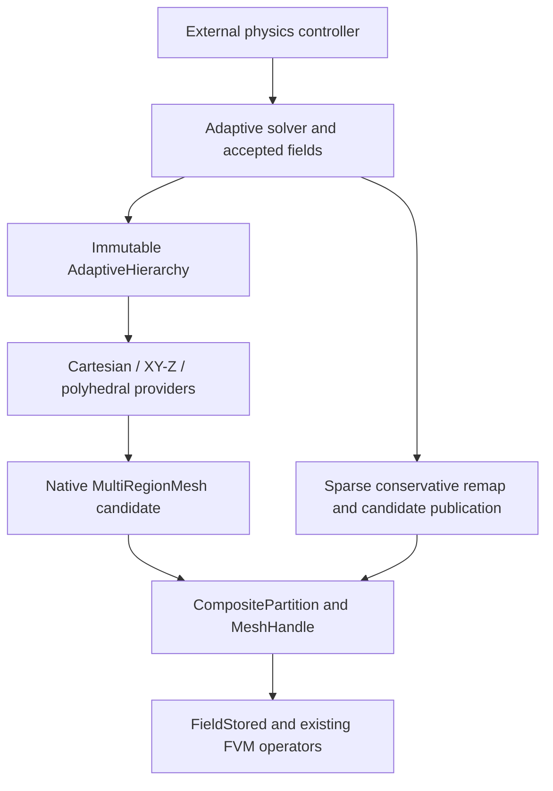

# AMR for extruded, polyhedral, and mixed-region meshes

AMR hierarchy, ancestry, overlap and adaptation modules live in `src/geometry/mesh/AMR/` and namespace `SimpleFluid::Meshes::AMR`.

## Design Overview
The AMR architecture provides a unified framework for adaptive meshes, supporting Cartesian, extruded (XY-Z), and polyhedral grid types. Its core design principles are:

*   **Unified Hierarchy:** Provides an abstraction seam via `AdaptiveHierarchy` for provider-specific implementations (e.g., `CartesianAMR`, `ExtrudedAMR`, `PolyhedralAMR`).
*   **Owner-Local Consistency:** Supports local closure and migration instead of relying on global directories, facilitating distributed operations.
*   **Geometric Decoupling:** Geometric algorithms (like PLIC/clipping) interface with the framework through standardized `ConvexCellGeometry` contracts.

### Integration
The framework integrates with core solvers and FVM consumers through:
- **Native Providers:** `SimpleFluid::Meshes` and provider-specific AMR grids.
- **Geometric Interfaces:** `SimpleFluid::PLIC` for geometric transport/clipping.

For detailed status, roadmap, and current validation coverage, please refer to:
*   **Active Roadmap:** [TODO.md](../../TODO.md#current-priorities)
*   **Verification Contracts:** [vof_solver_contracts.md](../verification/vof_solver_contracts.md)

## Native Hierarchy and Identities

## Architectural Components

- **AdaptiveHierarchy:** The abstract seam for hierarchical providers, defining methods for querying mesh structure, materials, and fragments.
- **Provider Implementations:**
    - `ExtrudedAMR`: Handles extruded products using base and axial ancestry.
    - `PolyhedralAMR`: Manages planar-faced convex polyhedra via oriented halfspace clipping and canonical subdivision.
    - `MixedAMRGrid`: Facilitates mixed-region assemblies through conservative interfaces and nonconforming join operators.

For implementation details on specific algorithms, refer to:
- **PLIC/Clipping:** [plic.md](../modeling/plic.md)
- **VoF/Flow Algorithms:** [adaptive_vof.md](../modeling/adaptive_vof.md)
