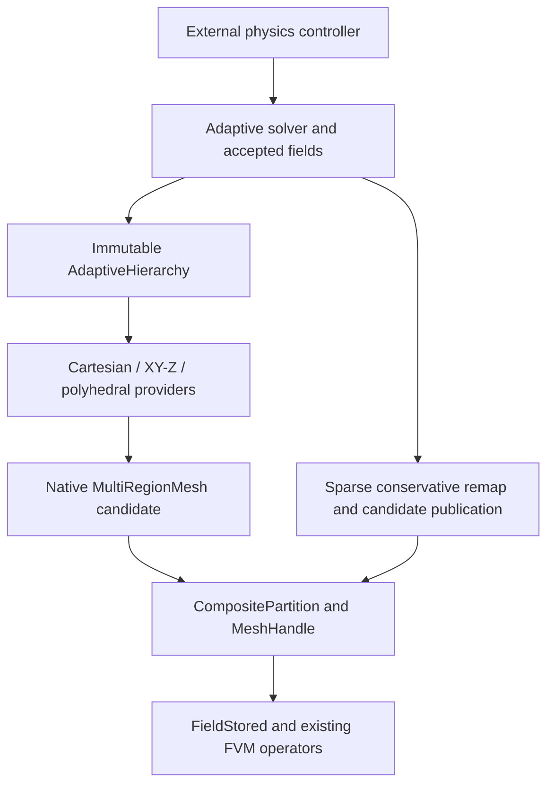

# AMR for extruded, polyhedral, and mixed-region meshes

**Status: Stage 1 is implemented; Stages 2–9 remain proposed.** This document
defines the implemented common hierarchy/Cartesian boundary and the remaining
implementation sequence and acceptance contracts. It does not extend the
supported mesh families of the existing solvers or record dated validation results.
Geometry adaptation and numerical VoF qualification are separate deliverables.

The existing [VoF transport and state-ownership contract](vof_transport.md) is
the numerical baseline for these extensions. Its corrected mass-compatible
momentum, microscopic carrier budgets, physical-residual acceptance, and
population identity rules are requirements to preserve, not work deferred until
the new geometry is available. The [durable verification contracts](../verification/vof_solver_contracts.md)
identify the retained regressions; [review follow-up evidence](../verification/vof_review_followup.md)
records measured results and qualification limits separately from this design.
The [Stage 1 verification record](../verification/general_amr.md) covers hierarchy
observations, native partition bindings, cache isolation and solver transactions.

The objective is one immutable adaptive hierarchy with provider-specific
Cartesian, XY-base × Z-product, and polyhedral ancestry. All providers continue
through native `MultiRegionMesh`, `CompositePartition`, `MeshHandle`, and
`FieldStored`. The optimized Cartesian algorithms remain available through the
existing `CartesianAMR` interface. No new geometric-library dependency is
selected here; external algorithm references explain proposed approaches only.

## Existing support and proposed scope

| Mesh or operation | Existing native capability | Adaptive capability and gate |
| --- | --- | --- |
| Dyadic Cartesian blocks | Immutable balanced `CartesianAMR`, canonical subfaces, adaptive VoF/flow; Stage 1 common hierarchy seam and source-validated native partition bindings | Existing Cartesian behavior retained; general clips/overlaps remain Stage 2 |
| Direct `SemiStructuredXY_Z` handle | Serial native execution; direct MPI construction rejects | Use the composite route for distributed adaptation, stage 3 |
| Composite native/independent extrusion | MPI ownership; triangle, quadrilateral, and polygonal prisms | Common-Z whole-column refinement, then local products, stages 3 and 5 |
| Explicit planar-faced polyhedra | Native incidence, variable face loops, partitioned FVM | Certified convex refinement/coarsening, stage 4 |
| Concave explicit cells | Representation of admissible closed polyhedral surfaces | Certified decomposition before adaptation/VoF, stage 9 |
| Mixed native regions | Conforming, nested planar coarse/fine, and translated periodic joins | Independent ancestry with cross-region closure, stage 5 |
| Analytic cylindrical / `SweptRZ` providers | Native geometry and existing supported motion | Retain as static topology participants; refinement or incompatible neighboring splits reject until provider-specific refiners/joins qualify |
| Distributed shard input | Root assembles geometry before partition planning | Distributed closure and owner-to-owner migration, stage 6 |
| Extruded/polyhedral VoF and radiolysis | No support implied by native geometry | General geometric transport/flow, then physical coupling, stages 7 and 8 |

The relevant seams are [`CartesianAMR::adapt`](../../src/geometry/CartesianAMR.hh),
[`MultiRegionMesh::Region`](../../src/geometry/mesh/MultiRegionMesh.hh),
[`MeshHandle::initialize_semi_structured`](../../src/geometry/MeshHandle.tcc), and
[`ExtrudedTopology::cell_type`](../../src/geometry/mesh/ExtrudedRegionProviders.cc).
The last already represents larger polygonal bases as `POLYHEDRON`; AMR still
needs its own simplicity, convexity, and child-quality admission checks.
The present [`AdaptiveVoF`](../../src/FVM/AdaptiveVoF.hh) and
[`AdaptiveVoFSolver`](../../src/solvers/AdaptiveVoFSolver.hh) explicitly retain
`CartesianAMR`; their box stencils and directional transport are not generic.

The initial extensions use a fixed physical domain, one shared timestep, and
geometry frozen during each physical step. Time subcycling needs conservative
flux registers; simultaneous ALE and topology change needs a separate contract.
Neither capability follows from this design.

## Native hierarchy, identities, and ownership



`AdaptiveHierarchy` is the abstract provider seam implemented in Stage 1.
Its concrete Cartesian implementation owns immutable native geometry and ancestry
and selects the existing optimized Cartesian numerical backend. Composition of
multiple region hierarchy providers and interface ancestry remains proposed for
later mixed-hierarchy stages. Those providers will supply admissible split/coarsen
operations, local closure rules, overlap relations and physical resolution metrics.
The proposed region dispatch follows
[`RegionGeometryView`](../../src/geometry/mesh/MultiRegionMesh.hh), rather than
erasing every cell query.

Stable region identity, material membership, provider-fragment ordinal,
canonical field GID, and rank-local field order are distinct. Materials and
physical patch labels are inherited explicitly; neither region names nor MPI
ownership determine them. A physical region can contain several provider
fragments and span ranks. Unchanged fragments may share their const providers.
The current composite prefix ordinals can change when an earlier region grows,
so they cannot serve as persistent ancestry or physical boundary identity.

The implemented Stage 1 interface is declared in
[`AdaptiveHierarchy.hh`](../../src/geometry/AdaptiveHierarchy.hh):

```cpp
class AdaptiveHierarchy {
public:
    virtual ~AdaptiveHierarchy();
    virtual HierarchyObservation observation() const noexcept = 0;
    virtual const SP<const MultiRegionMesh>& native_geometry() const noexcept = 0;
    virtual AdaptiveCellKey cell_key(uint64_t cell) const = 0;
    virtual uint64_t cell_material(uint64_t cell) const = 0;
    virtual size_t cell_fragment(uint64_t cell) const = 0;
};
```

`HierarchyObservation` retains exact hierarchy, topology and partition identity
tokens independently of generation values, effective resident geometry identity
and epoch, and communicator identity. `AdaptiveCellKey` currently admits only
`CartesianCellAncestry`; physical region identity, material membership and fragment
ordinals remain separate. `CartesianAMR::plan_adaptation()` and
`apply_adaptation()` retain and validate the exact source observation.

`CartesianAMR::with_partition()` binds an actual completed native partition after
collective source/epoch/communicator validation. Its weak origin observer preserves
exact source identity without retaining global partition scratch. Bound hierarchy,
FVM and solver construction use native ownership; this is not live migration of
an existing solver's accepted state. Live repartition/migration remains Stage 6.
Both canonical and resident geometry must retain their captured epochs. Supported
resident ALE motion invalidates a binding; restoring coordinates does not revive
an earlier observation. The Cartesian numerical backend remains unchanged.

Provider-specific product/polyhedral ancestry, geometric candidates with sparse
ancestry overlap records, and a general solver `RegridTrial` remain proposed for
later stages. Their data must contain geometry/partition state separately from
solver inventories and controller revisions.

Plans pin the exact source identity, communicator, provider observations, and
topology/partition/geometry stamps. Solver trials additionally pin accepted
state and controller revisions. Population schema is an independent semantic
identity: unchanged hierarchy and field dimensions do not validate population
indices or a prepared source trial after solver reinitialization.
Ownership-only changes advance partition
generation independently of topology. Geometry epochs remain the numeric-cache
revision described by [`MeshHandle::geometry_epoch`](../../src/geometry/MeshHandle.hh).
Keys must have checked, collision-free equality; a hash alone is not identity.
Provider layout and revision checks retain the existing
[`IsoRegion::validate_static`](../../src/geometry/mesh/RegionProviders.hh) contract.

## XY/Z products

An extruded cell key is `(BaseCellKey, AxialIntervalKey)`. The base key records
its original polygon and refinement template/path; the interval key records its
original Z interval and dyadic path. Side ancestry is base-edge segment × axial
interval; cap ancestry is base-cell leaf × axial plane. Shared coordinates come
from the same ancestral construction. XY-then-Z and Z-then-XY refinement must
produce identical final product keys and geometry.

Parents and sibling families are factor-specific. XY coarsening requires the
complete base sibling family over compatible axial intervals; Z coarsening
requires complete interval siblings over compatible base leaves. There is no
single octree-style parent for every independently refined product cell.

Stage 3 starts with one nonperiodic conforming triangular base repeated through
common Z layers. Deterministic triangle bisection uses compatible root refinement edges
and conformity closure. XY changes affect whole columns; Z bisection affects a
selected interval across the entire base. This directly retains the layout of
[`SemiStructuredIndexer`](../../src/geometry/mesh/SemiStructuredIndexer.hh).
Hanging base edges cannot be inserted into its whole-edge adjacency contract.
Strictly convex quads use four children: with edge midpoint `m_i` and the
deterministic mean `c` of the four vertices, child `i` is `(v_i,m_i,c,m_(i-1))`
in cyclic order. Construct shared boundary midpoints once; require every child
to pass convexity, positive-area, and quality checks. Larger strictly convex
bases triangulate from the boundary vertex with the smallest stable key, then
use triangle bisection. Save the original polygon, template, and complete
inverse family for coarsening. Template depth is not a claim that every
physical length has halved.

Stage 5 represents local refinement as connected base patches × contiguous Z
runs, sharing identical base templates and axial data and combining adjacent
runs with identical layouts. Reuse the product representation of
[`CompositeRegionFragment::ExtrudedProduct`](../../src/parallel/CompositePartition.hh).
Avoid one provider per 3D cell. Arbitrary layer-local patterns cannot promise
one global O(base + layers) representation; storage also includes unique local
templates, product descriptors, and their interface ancestry.
Current `ExtrudedTopology` includes layer count, and each `ExtrudedGeometry`
owns its XY coordinates/base metrics; existing full-template interning does not
share these across arbitrary runs. Stage 5 must introduce immutable shared
`BaseTopology`/`BaseMetrics` with lightweight product/indexer and axial views,
or account for duplicated bases explicitly rather than claiming that bound.

Refined wall vertices remain on the original polygonal boundary. Projection to
an analytic cylinder, domain-volume renormalization, and unrequested remeshing
would change the physical domain and are outside this contract.

## Convex polyhedral refinement and shared topology

Stage 4 admits planar-faced convex cells only after oriented-halfspace,
non-self-intersection, closure, and quality certification. Split the actual
parent with its three axis-aligned bounding-box midpoint planes, yielding up
to eight nonempty convex children. Store the occupied octants, construction
version, and parent/child ancestry; do not require eight children or replace
the physical cell by its box. Each child's coordinate spans are bounded by
half the corresponding parent box spans.

Closed-volume halfspace clipping is the relevant geometric primitive; the
[CGAL clipping contract](https://doc.cgal.org/6.1.1/Polygon_mesh_processing/group__PMP__corefinement__grp.html)
distinguishes clipping a bounded volume from merely splitting its surface.
The proposed implementation still requires repository-native topology,
predicates, conservation checks, and a separately reviewed dependency decision.

Construct one canonical subdivision of every parent face from both incident
cells' cut patterns before assembling children. Both sides reference exactly
the same atomic polygons with opposite incidence. Every new edge vertex must
be propagated into all incident face loops; coordinate-tolerance matching of
independently assembled children is insufficient. Coarse neighbors traverse
the resulting atomic subfaces. This internal conforming face overlay is new
explicit topology surgery, distinct from arbitrary mortar/AMI interpolation
and from extending the cross-provider interface API.

Certify positive finite child measures, planar simple faces, oriented closed
manifolds, containment, pairwise interior disjointness, parent volume and first
moment recovery, and complete parent-shell coverage. Discard only proven empty
intersections. A positive sliver that violates quality or representability
rejects the candidate; its volume cannot disappear. Midpoints that cannot be
represented distinctly also reject. No unspecified retry changes the split.

Coarsening restores the saved parent geometry after its complete recorded
immediate sibling set is present, without grandchildren or changed material
membership. Retain boundary tiles still required by finer neighbors. Never
recover a parent through a convex hull. Solver policy initially permits only
uniform pure-phase families outside protected reconstruction, interface,
motion-forecast, wake, and promotion neighborhoods.

[`UnstructuredMesh`](../../src/geometry/mesh/UnstructuredMesh.hh) supplies ordered
face loops and manifold incidence, but its signed moments and face-loop checks
do not certify a new nonoverlapping refinement partition. Likewise,
[`evaluate_mesh_quality`](../../src/geometry/MeshQuality.hh) uses absolute normal
distances: add signed visibility/convexity checks and shell-intersection tests.
Positive volume alone is insufficient.

Use cell-local coordinates and dimensionally scaled absolute/relative length,
area, volume, and first-moment tolerances. Construct shared coordinates once
from canonical ancestry; use adaptive predicates or a certified fallback for
ambiguous signs. Inconclusive emptiness, intersection, or coverage rejects;
tolerances must neither erase positive measures nor renormalize coverage.

Coverage compares intersections with the actual represented, boundary-clipped
query geometry. A nominal spacing product or AABB volume is not the volume of
that query. Use local-coordinate differences and compensated positive summation.
New kernels need bounds for their own clipping/predicate arithmetic, not the
Cartesian box helper's bound transplanted unchanged or a tolerance proportional
to global origin. Retain rejection of genuine missing, doubled, or empty
coverage at large offsets.

## Mixed-region closure and boundaries

Same-fluid joins retain one connected pressure problem and one canonical
integrated flux per fine subface. Coarse incidence visits every covering tile;
[`MultiRegionMesh::restrict_face_flux`](../../src/geometry/mesh/MultiRegionMesh.hh)
sums signed integrated fluxes without multiplying by area fractions again.
Material/contact boundaries retain their physical laws and separate coupling
maps. Coincident faces must not create fluid connectivity. Descendant patch
labels and material membership survive both refinement and repartitioning.

Each region keeps independent ancestry. Closure exchanges actual interface
subdivision traces and the reconstruction neighborhoods needed across joins.
It combines provider-local balance, physical size-gradation/quality limits,
and complete sibling requirements until a collective fixed point. Scalar
levels from unrelated roots or anisotropic factors are not comparable physical
sizes. Detect unsupported closure and budget/max-level exhaustion before maps
or fields are published.
Initial triangle bases remain conforming; comparable dyadic Z/base-edge traces
allow at most one generation difference, including required edge/vertex neighbors.

The existing [`NonconformingInterface`](../../src/geometry/mesh/ConservativeInterface.hh)
accepts nested planar convex tilings. Its fine faces belong to one
`fine_region`; `partial_coarse_patch` selects whole coarse faces, and the fine
patch must be completely covered. A single coarse face's tiles cannot currently
be spread over several fine regions. Crossed XY-edge and Z-interval splits on
opposite sides are nonnested: impose compatible closure/grouping or reject.

A later part of stage 5 introduces validated multi-provider canonical-subface
descriptors when those limits prevent useful local products. Prefer factored
base-edge × interval descriptions for repeated side seams; retain explicit
sparse records for irregular tiles. Require full containment, unique coverage,
orientation, gap/overlap checks, and canonical ownership before enabling them.
[`RegionInterfaceDirectory`](../../src/geometry/mesh/MultiRegionMesh.hh) remains
a derived incidence/indexing cache; it is not the ancestry authority.

Existing structured translated-periodic joins retain matching subdivisions and
incident-cell image vectors in reconstruction, pressure stabilization, transport,
and component connectivity. Initial extruded/polyhedral extensions are
nonperiodic: `ExtrudedTopology` rejects axial periodicity, and translation
metadata currently belongs only to `StructuredPatchInterface`. New periodic
descriptors for those providers require separate qualification before use;
nonconforming periodic joins need an additional gate. Rotated transforms and
curved faces are outside these stages.

## Conservative remap and physical resolution

Exploit unchanged leaves, ancestor/descendant containment, and complete sibling
unions to find donors. Do not run a global all-pairs intersection search. For
source cell `i`, target cell `j`, and old PLIC gas halfspace `H_i`, retain the
intersection geometry needed to compute

$$
V_{ij}=|C_i\cap C_j|,\qquad G_{ij}=|C_i\cap C_j\cap H_i|.
$$

Bulk XY/Z overlap factors into polygon intersection area × interval overlap.
A tilted PLIC phase cut requires the actual 3D clipped volume; multiplying a
single section area by height is not equivalent. Target gas volume is the sum
of `G_ij`; conservative amounts use the fraction of their declared carrier in
each intersection. Restriction sums extensives; intensive values derive from
transferred extensives and target measures. Detect missing/excess coverage,
absent carriers, and nonfinite weights rather than normalizing errors away.

Keep sparse donor residual closure, nonnegative inventory bounds, and signed
momentum from [`AdaptiveVoF::remap`](../../src/FVM/AdaptiveVoF.cc). Low-Mach remap
transfers separate liquid/resolved/dispersed mass or moles, population number,
dissolved/donor stock, phase energies, and physical momentum including drift.
Constant-density `MixtureMass` is not a replacement for that state. Recover EOS
variables only after conservative transfer and retain occupancy, energy,
inventory, and physical continuity acceptance gates. New interior face fluxes
require reconstruction/projection; retained integrated fluxes restrict by sign.

Canonical phase inventories can remain positive when the published fraction
rounds to zero or one. Compute low-Mach carrier storage from retained phase
volumes and accepted source/flux increments, never solely from `(1-f)*V`.
Preserve the existing bounded-remnant remap rule: when phase geometry cannot
locate a phase because the published fraction is pure (`f<=0` or `f>=1`), but
the corresponding retained phase volume is positive and within its consistency
bound, distribute its paired inventories through the same bulk-cell overlap
before recombination. Do not classify the
carrier as absent, give number/moles inconsistent weights, or use this fallback
for a material geometric mismatch. Each new provider must qualify that rule
with its own represented-geometry error bound and retain rejection above it.

Reuse sparse application, quantity semantics, coverage reporting, and stale-map
checks from [`MeshToMeshTransfer`](../../src/fields/MeshToMeshTransfer.hh).
Its present [setup](../../src/fields/MeshToMeshTransfer.tcc) supports neither
general polyhedron/polyhedron nor extrusion/extrusion intersections and
replicates source geometry. It is not the proposed geometry builder. A scalar
bulk-overlap transpose does not supply reverse PLIC transfer weights.

Use physical directional spans and face-normal distances to select resolution
and stability. `V^(1/3)` hides thin or long cells. A conservative cell-diameter
bound is acceptable for general polyhedra; XY and Z resolution remain separate.
Retain 24–32 cells across a 1 cm resolved bubble as an initial target, subject
to anisotropy and stencil guards. This is not DNS or application qualification;
measure shape, curvature, transport, and coupled-solution convergence.

## General VoF and flow backend

Stage 7 adds an independent backend using actual polyhedron clips, section
polygons, phase apertures, and physical-neighbor stencils. Solve each PLIC
offset from clipped volume. Qualify inferred normals against oblique planar
interfaces on skew cells; a volume-fraction least-squares gradient alone is
not assumed planar-exact. Reject insufficient or ill-conditioned stencils.
Keep the current Cartesian reconstruction and optimized directional algorithm.

The proposed unsplit transport prototype uses canonical face triangulations,
consistently traced shared vertices, signed swept-volume simplices, and a
correction matching the projected integrated face flux. Partition swept pieces
by actual donor cells and then by their PLIC planes. Shared swept surfaces must
agree; independently normal-extruded face prisms can double-count transport.
This follows the algorithm direction in
[Owkes and Desjardins, sections 3.2–3.5](https://ctflab.mae.cornell.edu/papers/Owkes%2C%20Desjardins.%202014.%20A%20computational%20framework%20for%20conservative%2C%20three-dimensional%2C%20unsplit%2C%20geometric%20transport%20with%20application%20to%20the%20volume-of-fluid%20%28VOF%29%20method.pdf);
their unstructured discussion is a starting point, not a qualified implementation.

Let `Phi_f` be the owner-oriented projected volume transported over one step
[m3], `s_cf` its outward incidence sign for cell `c`, and `DeltaG_c`, `DeltaC_c`
the signed physical gas/carrier source increments [m3]. One canonical flux
ledger must satisfy

$$
G_c^\mathrm{new}=G_c^\mathrm{old}-\sum_f s_{cf}F_{g,f}+\Delta G_c,
\qquad F_{g,f}+F_{c,f}=\Phi_f,
\qquad \Delta G_c+\Delta C_c=\sum_f s_{cf}\Phi_f.
$$

The carrier has the analogous update, so total occupancy remains the fixed
cell volume. Qualify source-free transport first; the existing Phase 22 Stage 3
nonzero physical volume sources need a verified geometric/source update satisfying
this ledger. Do not assign skew faces to a dominant Cartesian axis or reuse
the Cartesian Weymouth–Yue correction. The present directional backend retains
its frozen indicator and source correction; the unsplit backend must derive
its own source update. Fractions and phase inventories share the accepted
ledger, but geometric and momentum time integration remain distinct.

### Phase budgets and compatible momentum

Every donor must cover outgoing gas and complementary carrier with its actual
extensive inventory, including microscopic positive traces below PLIC offset
resolution. The Cartesian sweeps repair only roundoff-sized excess on the
shared canonical face partition, preserve total transported face volume,
recompute the complement, and recheck owned donor budgets collectively.
Cancellation-resistant minority-phase updates preserve the unexported tail;
there is no cell-fraction or inventory clipping. The unsplit backend needs its
own donor decomposition and capacity proof with an explicit arithmetic bound;
the directional helper alone does not qualify it. A material excess rejects.
Apply each corrected canonical subface once, with no second area weighting.

Retain the implicit upwind momentum contract in
[`ConservativeVoFTransport`](../../src/solvers/details/ConservativeVoFTransport.hh).
For the source-free, nondrifting case each component solves

$$
M_c^{\mathrm{new}}u_c^{\mathrm{new}}
+\sum_f s_{cf}F_{m,f}u_{\mathrm{upwind}(f)}^{\mathrm{new}}
=P_c^{\mathrm{old}}.
$$

`M_new` is final extensive mixture mass [kg] and `F_m` is signed integrated
face mass [kg]. Their identity `M_new + sum(s*F_m) = M_old` gives the implicit
equation its constant-velocity, passive-bound and conservation properties up to
the physical residual and roundoff. Reusing
phase swept volumes with explicit accepted-old donor velocity is incompatible
with the existing split phase update and is not a permitted adapter shortcut.

Incompressible flow derives mass from fixed phase densities and the corrected
phase-volume ledger. Low-Mach flow instead uses final liquid/species/population
inventories and their actual mass fluxes. Its velocity is the continuous/liquid
velocity, with physical momentum `P = M*u + sum(W_H2*n_k*w_k)`. Account for
drift face/cell impulses separately. Use physical source impulses, never species
molar flux inferred from geometric volume or source velocity inferred from a
tiny fraction. Passive velocity bounds apply to the source-free, force-free
fixture, not general forced or drifting flow.

This reuse retains first-order implicit upwind diffusion and the momentum solve
cost. Geometric PLIC accuracy does not establish second-order momentum/species
accuracy; qualify temporal and spatial convergence separately.

### Microscopic carriers and numerical acceptance

Passive quantities retain final carrier storage plus outgoing carrier flux in
their implicit equation. For positive physical rows, optional left
equilibration divides directly by the diagonal, without reciprocal formation,
a carrier floor, or inventory deletion. An attainable inner relative tolerance
and the unchanged Belos true-residual contract govern the scaled solve. Final
acceptance still uses the compensated residual of the original unscaled amount
and canonical face-flux equation at the requested physical tolerance. A global
maximum-diagonal bound must not become an unattainable mandatory inner target.

Retain bounded physical-defect corrections, overflow-safe norm/RHS scaling,
compensated accumulation and one shared initial/correction iteration budget.
Exhaustion or invalid data rejects. Positivity, global extensive budgets and
pressure/divergence acceptance remain independent; signed quantities use
absolute-amount conservation scales. Qualify subnormal carriers and forced
correction/exhaustion, not just ordinary capacities or scaled Krylov convergence.

### Curvature and flow qualification

Use physical-coordinate surface fitting for curvature with explicit conditioning
and stencil gates. Qualify nonorthogonal pressure correction, balanced surface
tension, hydrostatic equilibrium, viscosity, and geometry-based timestep bounds
before claiming flow support. Cartesian height columns cannot be manufactured
from cell boxes. Initially retain one timestep for all active leaves.

Use independently integrated mixed-cell fractions and finite-duration pressure,
phase-volume and parasitic-velocity checks; binary cell-center masks can have
zero curvature. Demonstrate actual phase passage across seams. Existing curved
moving-seam coverage is at moderate density contrast; high-contrast static
coverage protects a uniformly fine interface neighborhood. The high-contrast
curved-seam gate remains open: retain the disabled strict Cartesian oracle and
equivalent new-provider criteria without relaxing pressure or velocity gates.

## Transactions, radiolysis, and checkpoint boundaries

Prepare geometry, partition/maps, remapped state, operators, coupling maps, and
registry changes privately. Pin source stamps and revisions throughout; catch
rank-local failures and reduce status before subsequent collectives. Publish
only after all geometry, coverage, quality, conservation, EOS, and continuity
gates pass, using preallocated nonthrowing swaps. A failed candidate leaves the
accepted hierarchy, fields, time, ledgers, diagnostics, and output untouched.
It also leaves any earlier valid retained trial and its immutable face ledger
intact; later preview work must not overwrite that trial through scratch aliases.

Incompressible fraction and velocity remain accepted physical state. Low-Mach
extensive inventories and phase-pressure histories belong to private candidate
or immutable accepted snapshots; its temperature, fractions, densities and
population radius/volume are derived views. Retained phase volumes/pressures
during representation relaxation remain physical history, not recomputable
workspace. Native publication assigns every owned value before ghost
synchronization. Mutable solver workspaces never own or alias retained
snapshots, histories or immutable trial flux ledgers.

Topology changes rebuild graphs/maps/importers, gauges, reconstruction/curvature,
apertures, geometry caches, pressure operators/preconditioners, interface and
contact/transfer maps, and output topology. Ownership changes invalidate local
map-dependent state; geometry-only changes retain their existing numeric-cache
rules. Old immutable snapshots remain valid; stale plans/trials reject access
to a replacement snapshot. No rejected regrid produces a physical step/history.

Geometry metadata reuse requires the exact retained hierarchy identity, native
maps/layout, and topology/partition/geometry observations, with a cache hit on
every rank before skipping collective construction. Fraction-dependent geometry
stays call-local; exchange vectors are instance owned. Preserve sparse queries
and compute only consumed neighborhoods. New providers declare actual physical
stencil support; Cartesian patch radii are not universal halo rules. Refinement
guards cover those stencils plus motion across qualified seams/periodic joins.

Reuse a transport numerical operator only after exact collective equality of
final capacities, signed carrier fluxes and equilibration policy. A shared graph
is insufficient. RHS/source/positivity checks remain per quantity, and failed
refresh cannot leave a valid cache key. Projection may reuse graph/storage but
refreshes mobility and susceptibility and invalidates its preconditioner on
assembly. No workspace owns canonical inventories or phase-pressure history.

[`RadiolyticVoFCoupler`](../../src/solvers/RadiolyticVoFCoupler.hh) remains the
external shared owner of the solver and registry/kinetic ledgers. Geometry and
FVM layers acquire no reverse solver/controller ownership. Stage 8 replaces
box-based apertures, film integrals, birth support, donor selection, and bubble
resolution measures with actual polyhedra. Interface patches retain unique
ownership and sparse remote sampling/deposition. Regrid preserves birth/event
IDs and accepted ledgers but invalidates reservations, topology-dependent
component labels/origins, and cached geometry for fresh inspection.

Resolve required population names against the current low-Mach schema
collectively at each source-preparation boundary, including after same-mesh
reinitialization or remap. Publish the complete binding only on success;
reordered schemas retain semantic destinations, missing names reject before
indexing, and reinitialization invalidates prior trials independently of mesh
identity. Do not let a hierarchy cache retain stale population indices.

Preserve closure-specific support on native faces. `ConstantSlip` is a liquid
carrier closure, so empty-population liquid retains its specified drift and
pure resolved gas has zero drift. Radius-dependent closures evaluate only
paired positive number/mole moments; empty radius and volume remain zero.
At a populated/empty front use the populated side's evaluated drift; when both
sides are populated use the qualified distance interpolation. Compute post-source
moments as accepted moments plus signed source increments, then require that
result to be finite, nonnegative, and either both zero or both positive before
deriving support. This includes birth and complete depletion. Transport and
source-drift timestep selection use the same face rule and canonical geometry.
Source-created populations receive an evaluated closure during source
preparation; populations received by transport get their own local closure on
subsequent preparation.

Active checkpoints and pending Phase 22 Stage 4 representation relaxation continue to
block topology change, as in [`AdaptiveVoFSolver::Impl::regrid`](../../src/solvers/AdaptiveVoFSolver.cc).
[`LowMachState`](../../src/solvers/VoFLowMach.hh) carries liquid/resolved pressures
and dispersed pressure/volume history; the
[representation packets](../../src/solvers/AdaptiveVoFRepresentation.inc) retain
phase `V`, `pV`, energy, and momentum. Ordinary remap/EOS reconstruction must not
erase those histories or substitute pressure from new curvature. Physical
relaxation remains a physical step, with no synthetic heat or source event.

Exact same-cell repartition during pending relaxation is a later independent
gate: migrate every state/history field and pending flag without interpolation.
Mesh-inclusive checkpoints are another later gate because current checkpoints
save published fields, not the complete context. They must retain hierarchy,
partition/maps, context, controller registry/ledgers, and output/history cursors;
restore must invalidate prepared trials with a fresh monotone state revision.

## Distributed execution and memory bounds

The current [`MeshPartitioner::make_plan`](../../src/parallel/CompositePartition.tcc)
distributed-source branch gathers shards, calls `merge_partitions` at a root,
and plans that serial union. It may serve as a bounded bootstrap for earlier
geometry stages; it does not satisfy scalable AMR migration. Stage 6 is required
before describing the new adaptation/repartition path as distributed at scale.

Exchange marks and shared face/edge decisions through canonical authorities;
perform closure, owner lookup, and migration between ranks that need the data.
Partition weights include PLIC/reconstruction, interface, and population work;
the objective also includes interface communication and migration cost.
Report weights, measured imbalance, and ownership changes, beyond bare cell counts.
Transfer ancestry, sparse explicit geometry, carrier inventories, and histories
together. Rebuild halos from canonical adjacency and actual reconstruction
support. A partition cut never becomes a physical boundary. Empty ranks join
every collective; duplicate/missing owners, shard disagreement, mixed plans,
or stale observations reject collectively before publication.

Per-rank storage should scale with owned/ghost leaves, local ancestry branches,
resident explicit faces/vertices, needed stencils, and overlap records, plus
documented compact root/templates/interface metadata. Whole products retain
O(base + layers) geometry; local products add unique templates and run/seam
descriptors. Permit no global solution replication, whole-mesh flattening,
expanded global explicit topology, or retained global cell-to-rank arrays.
Account separately for maps, transient migration buffers, and shared objects;
measure memory on empty and unevenly loaded ranks as well as mean storage.
Separate metadata payload from process peak RSS, using the platform-normalized
probe and declared units. Performance needs a numerically matched baseline with
actual ownership, solver work and configuration recorded; Debug timings or cache
reuse alone do not establish production scaling.

## Certified nonconvex extension

Stage 9 first handles star-shaped cells using a certified interior kernel point
and canonical constrained triangulations of their boundary faces. Certify the
resulting positive, disjoint tetrahedral/convex pieces and retain the original
shell for coarsening. A centroid, vertex average, or signed integration fan is
not proof of a valid kernel or decomposition.

For non-star-shaped cells, add boundary-conforming constrained tetrahedral or
convex decomposition, allowing documented interior vertices and canonical
boundary subdivisions. Reject self-intersecting shells first. Verify union,
disjointness, shell equality, and volume/first moments before using the pieces.
[CGAL's convex-decomposition manual](https://doc.cgal.org/6.1.1/Convex_decomposition_3/index.html)
is a reference for decomposing bounded polyhedra, not a selected dependency or
a substitute for this boundary-preservation certificate. Unsupported cells
continue to reject until this entire path is qualified.

After either certified decomposition, clip every convex piece by the same
parent AABB midpoint planes. Within each octant, assemble connected volume
components using positive-area face adjacency, canceling paired canonical
internal-face tiles and validating each resulting boundary. Component counts
are variable; keys retain `(parent, octant, component provenance)`, with
deterministic provenance from sorted constituent piece keys. Retain certified
pieces for subsequent clipping and the saved parent shell for coarsening.
Unchanged decomposition faces are internal integration partitions, never
artificial material or flow boundaries. Reject nonmanifold or unresolved
assemblies. Multiple PLIC patches remain distinct for curvature/film transfer;
one area centroid cannot replace disconnected interfaces. Preserve the physical
shell without boundary projection or domain renormalization.

## Implementation stages and focused acceptance

Stage 1 is implemented and verified within its Cartesian boundary; Stages 2–9
are proposed and each has its own exit gate. Existing tests are starting
points, not evidence that the extension works. Run focused Debug serial tests,
then affected MPI cases at 2 and 4 ranks where they establish the intended seam
and ownership conditions. Choose additional ranks or deliberately sparse
partitions when needed for a specific ownership regime, and assert observed
empty-owner counts; rank labels or root-block counts do not prove emptiness.
The [durable MPI protocol](../verification/vof_solver_contracts.md#focused-debug-workflow)
includes fixtures with more ranks than global cells. Broader performance
matrices require a specific scaling question.

| Stage | Deliverable | Required focused gates |
| --- | --- | --- |
| 1. Common contracts / Cartesian adapter | Immutable hierarchy/provider seam and distinct stamps | Preserve corrected Cartesian numerics; separate schema/state/geometry identity; stable-key and stale-plan checks; independent partition generation; cache/snapshot isolation; no implicit connectivity materialization |
| 2. Geometry kernels / ancestry overlaps | Certified clips, sections, moments, and nested overlap records | Analytic cube/tetra/prism/skew cuts; tangency/complements; represented coverage at scale/translation extremes and rejection of real gaps; tiny positive remnants; bulk and tilted-PLIC conservation; invalid geometry rejection |
| 3. Whole-product XY/Z AMR | Common Z, whole-column triangles, then convex polygon templates | Split-order key identity; complete factor siblings; exact refine/coarsen recovery; patch inheritance; convexity/quality gates; O(base + layers) storage; native composite MPI |
| 4. Convex polyhedral AMR | AABB-plane cuts, canonical internal overlays, saved parents | Variable child counts; face/edge propagation; orientation and manifold closure; union/first moments; unrelated neighbor cuts; transactional sliver rejection; exact parent recovery |
| 5. Mixed-region / layer-local closure | Product runs, independent ancestry, nested joins, then validated multi-provider tiles | Crossed-trace closure/rejection; one canonical subface flux; periodic matching; contact isolation; physical gradation; no duplicated/gapped tiles; compact repeated seams |
| 6. Distributed migration | Distributed closure/planning and owner-to-owner topology/state migration | Serial/partition-equivalent keys and budgets; split siblings; asserted empty ownership; unique ownership; stale/rank-divergent failures without deadlock; bounded per-rank memory; no root union |
| 7. General VoF / flow | Polyhedral reconstruction, unsplit phase budgets, compatible implicit momentum and physical-residual solves | Oblique planes and skew/coarse-fine/rank transport; microscopic phase/complement budgets; constant velocity and passive momentum bounds; microscopic/subnormal carrier oracle and original residual; correction-budget rejection/reuse; hydrostatics and finite-duration capillarity with independent mixed fractions; retain open high-contrast curved-seam gate; viscous modes and regrid momentum |
| 8. Radiolytic / representation integration | Nonzero volume sources, closure/schema support, actual film/birth geometry, complete coupled transactions | Phase mass/species/energy/physical momentum and source-divergence closure; tiny retained carriers; empty/depleted front speed and timestep parity; same-mesh schema reorder/removal; remote deposition and donor competition; immutable retained trials after failure; pending-history rejection and checkpoint replay |
| 9. Certified nonconvex extension | Kernel-certified star cells, then constrained general decomposition | Invalid/self-intersecting shell rejection; disjoint union and shell/moment equality; canonical boundary splits; disconnected phase patches; saved-parent recovery; repeat geometry, VoF, and coupling gates on each admitted class |

Use [`testCartesianAMR`](../../src/geometry/unitTests/testCartesianAMR.cc),
[`testMultiRegionMesh`](../../src/geometry/unitTests/testMultiRegionMesh.cc),
[`testCompositePartition`](../../src/parallel/unitTests/testCompositePartition.cc),
and [`testCompositePartitionOperators`](../../src/FVM/unitTests/testCompositePartitionOperators.cc)
for native topology and ownership contracts. Numerical references include
[`testAdaptiveVoF`](../../src/FVM/unitTests/testAdaptiveVoF.cc),
[`testAdaptiveVoFThreeDimensional`](../../src/FVM/unitTests/testAdaptiveVoFThreeDimensional.cc),
[`testConservativeVoFTransport`](../../src/solvers/unitTests/testConservativeVoFTransport.cc),
[`testAdaptiveVoFSolver`](../../src/solvers/unitTests/testAdaptiveVoFSolver.cc),
[`testAdaptiveVoFLowMach`](../../src/solvers/unitTests/testAdaptiveVoFLowMach.cc),
[`testRadiolyticVoFCoupler`](../../src/solvers/unitTests/testRadiolyticVoFCoupler.cc),
and [`testBubbleRepresentation`](../../src/solvers/unitTests/testBubbleRepresentation.cc).
Retain the Phase 22 Stage 4 positive-surface-tension pressure-history oracle
when extending representation geometry. Keep dated results in validation records;
support claims change only after the corresponding stage gates pass.
