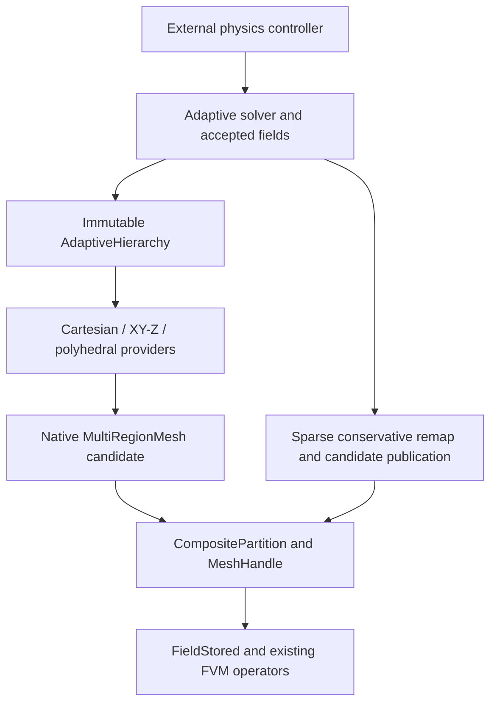

# AMR for extruded, polyhedral, and mixed-region meshes

AMR hierarchy, ancestry, overlap and adaptation modules live in
`src/geometry/mesh/AMR` and namespace `SimpleFluid::Meshes::AMR`.
Generic exact geometry and native mesh providers remain in `SimpleFluid::Meshes`;
FVM transport and solver consumers remain in their own modules.

**Status: Stages 1–6 are implemented with bounded numerical verification;
Stage 7 is implemented with focused flow verification and incomplete overall
qualification; Stages 8–9 remain proposed.** This document owns the design and
qualification boundaries. The [roadmap](../../TODO.md#phase-23--amr-for-native-extruded-polyhedral-and-mixed-region-meshes)
tracks remaining work. Geometry adaptation and physical-flow qualification are
separate deliverables.

The [VoF transport and state-ownership contract](vof_transport.md) remains the
numerical baseline: mass-compatible momentum, microscopic carrier budgets,
physical-residual acceptance and population identity must survive every
extension. The [verification contracts](../verification/vof_solver_contracts.md)
identify reproducible checks. Status below summarizes recorded campaigns;
documentation consolidation is not a new execution of those tests.

## Qualification status

| Stage | Implemented and covered by focused checks | Remaining boundary |
| --- | --- | --- |
| 1. Common hierarchy | Independent topology/partition/geometry/state observations, native partition binding, stale-plan rejection and immutable trial/cache isolation; serial/MPI including asserted empty owners | Construction binding alone does not migrate an accepted solver state |
| 2. Geometry and remap | Actual convex clips, moments, represented coverage, native-owner authentication, sparse conservative paired amounts and tiny positive phases | Utility coverage alone does not qualify a flow solver; complete-family catalogs remain a bounded bootstrap |
| 3. Whole products | Exact XY/Z construction, split-order identity, complete inverse families, native MPI and conservative remap | Nonperiodic initial extrusions; factored storage is not distributed planner/RSS scaling |
| 4. Convex polyhedra | Actual occupied octants, shared face/edge overlays, saved-parent recovery, sparse exact native providers and physical remap | Canonical planning remains bounded and replicated; nonconvex cells are excluded |
| 5. Local/mixed products | Shared base/run storage, typed participants, closed face/edge/vertex grading, native tiles and conservative remap | Unsupported crossed patch groupings reject; contacts have separate domains and no implicit exchange law; storage reports are nonadditive |
| 6. Distributed state | Detached owner-local closure, typed ancestry, sparse native/state migration, accepted/history frames, final packet-cost admission and asserted empty owners | Initial complete-source bootstrap, unsupported topology changes, sparse ALE and production scaling remain outside qualification |
| 7. General flow | Finite-default inventories; explicit experimental exact policy; PLIC, unsplit transport, physical-residual pressure/momentum, rollback/regrid and selected serial/MPI flow checks | Complete physical, long-horizon, high-contrast curved-seam and production-scale qualification remains open |
| 8–9 | No general-mesh radiolytic/representation integration or certified nonconvex flow is claimed | Implement and qualify the separate stages below |

The finite-default ten-step skew coarse/fine passage fixture has completed its
original 0.02 s endpoint and unchanged inventory, momentum, positivity and
divergence gates in serial and at two/four ranks. This supersedes the early
resource failures for that fixture. Selected hydrostatic and solver transaction
checks also have passing recorded coverage. The latest geometry-optimization
campaigns excluded the long reflected-cylinder and viscous methods; earlier
bounded passes and timeouts do not establish their qualification on every later
source. The optional exact policy has focused policy/API/history/remap coverage,
but no full physical, long-horizon, storage/RSS or scaling qualification.

The separate Release balance fixture
`DistributedAdaptiveBalance.MeasuredOperationsDrivePinnedHierarchyMigration`
has a recorded topology/geometry numbering failure before balancing. It was
excluded explicitly from the later six-method balance selection. Passing
migration checks do not close this unresolved fixture.

The separately staged integer-sign and certified floating-point filter candidate
has recorded focused correctness and complete coarse/fine runs in serial/MPI2/MPI4.
It remains a pending integration, distinct from the committed support-plane
cache. Its design is specified below; those candidate results are not a claim
that its source is already part of the committed backend.

The objective is one immutable adaptive hierarchy with provider-specific
Cartesian, XY-base × Z-product, and polyhedral ancestry. All providers continue
through native `MultiRegionMesh`, `CompositePartition`, `MeshHandle`, and
`FieldStored`. The optimized Cartesian algorithms remain available through the
existing `CartesianAMR` interface. No new geometric-library dependency is
selected here; external algorithm references explain proposed approaches only.

## Existing support and proposed scope

| Mesh or operation | Existing native capability | Adaptive capability and gate |
| --- | --- | --- |
| Dyadic Cartesian blocks | Immutable balanced `CartesianAMR`, canonical subfaces, adaptive VoF/flow; Stage 1 common hierarchy seam and source-validated native partition bindings | Existing Cartesian behavior retained; Stage 2 adds separate certified geometry/remap utilities |
| Direct `SemiStructuredXY_Z` handle | Serial native execution; direct MPI construction rejects | Use the composite route for distributed adaptation, stage 3 |
| Composite native/independent extrusion | MPI ownership; triangle, quadrilateral, and polygonal prisms | Common-Z whole-column refinement, then local products, stages 3 and 5 |
| Explicit planar-faced polyhedra | Native incidence, variable face loops, partitioned FVM | Certified convex refinement/coarsening, stage 4 |
| Concave explicit cells | Representation of admissible closed polyhedral surfaces | Certified decomposition before adaptation/VoF, stage 9 |
| Mixed native regions | Conforming, nested planar coarse/fine, and translated periodic joins | Independent ancestry with cross-region closure, stage 5 |
| Analytic cylindrical / `SweptRZ` providers | Native geometry and existing supported motion | Retain as static topology participants; refinement or incompatible neighboring splits reject until provider-specific refiners/joins qualify |
| Distributed shard input | Legacy partition planning assembles shards at a root | Stage 6 detached owner-local closure and migration after bounded complete-source bootstrap; bounded correctness, memory and work-accounting gates qualified |
| Extruded/polyhedral VoF and radiolysis | No support implied by native geometry | General geometric transport/flow, then physical coupling, stages 7 and 8 |

The relevant seams are [`CartesianAMR::adapt`](../../src/geometry/mesh/AMR/CartesianAMR.hh),
[`MultiRegionMesh::Region`](../../src/geometry/mesh/MultiRegionMesh.hh),
[`MeshHandle::initialize_semi_structured`](../../src/geometry/MeshHandle.tcc), and
[`ExtrudedTopology::cell_type`](../../src/geometry/mesh/ExtrudedRegionProviders.cc).
The last already represents larger polygonal bases as `POLYHEDRON`; AMR still
needs its own simplicity, convexity, and child-quality admission checks.
The present [`AdaptiveVoF`](../../src/FVM/AdaptiveVoF.hh) and
[`AdaptiveVoFSolver`](../../src/solvers/AdaptiveVoFSolver.hh) explicitly retain
`CartesianAMR`; their box stencils and directional transport are not generic.

The initial extensions use a fixed physical domain, one shared timestep, and
geometry frozen during each physical step. Time subcycling needs conservative
flux registers; simultaneous ALE and topology change needs a separate contract.
Neither capability follows from this design.

## Native hierarchy, identities, and ownership



`AdaptiveHierarchy` is the abstract provider seam implemented in Stage 1.
Concrete Cartesian, whole-product and convex-polyhedral implementations own
immutable native geometry and ancestry. The Cartesian implementation retains its
optimized numerical backend. Stage 5 adds a mixed assembly over local product
states and supported hierarchy adapters. Provider
splits, inverse families and physical resolution metrics remain distinct from
solver refinement policy. Native region dispatch follows
[`RegionGeometryView`](../../src/geometry/mesh/MultiRegionMesh.hh), rather than
erasing every cell query.

Stable region identity, material membership, provider-fragment ordinal,
canonical field GID, and rank-local field order are distinct. Materials and
physical patch labels are inherited explicitly; neither region names nor MPI
ownership determine them. A physical region can contain several provider
fragments and span ranks. Unchanged fragments may share their const providers.
The current composite prefix ordinals can change when an earlier region grows,
so they cannot serve as persistent ancestry or physical boundary identity.

The implemented Stage 1 interface is declared in
[`AdaptiveHierarchy.hh`](../../src/geometry/mesh/AMR/AdaptiveHierarchy.hh):

```cpp
class AdaptiveHierarchy {
public:
    virtual ~AdaptiveHierarchy();
    virtual HierarchyObservation observation() const noexcept = 0;
    virtual const SP<const MultiRegionMesh>& native_geometry() const noexcept = 0;
    virtual AdaptiveCellKey cell_key(uint64_t cell) const = 0;
    virtual uint64_t cell_material(uint64_t cell) const = 0;
    virtual size_t cell_fragment(uint64_t cell) const = 0;
};
```

`HierarchyObservation` retains exact hierarchy, topology and partition identity
tokens independently of generation values, effective resident geometry identity
and epoch, and communicator identity. `AdaptiveCellKey` admits
`CartesianCellAncestry`, factor-specific `ProductCellAncestry` and explicit
`ConvexCellAncestry` provenance; the latter
identifies supplied convex cells without claiming a polyhedral refiner. Physical
region identity, material membership and fragment
ordinals remain separate. `CartesianAMR::plan_adaptation()` and
`apply_adaptation()` retain and validate the exact source observation.

`CartesianAMR::with_partition()` binds an actual completed native partition after
collective source/epoch/communicator validation. Its weak origin observer preserves
exact source identity without retaining global partition scratch. Bound hierarchy,
FVM and solver construction use native ownership; this is not live migration of
an existing solver's accepted state. The detached Stage 6 path below provides live repartition/migration separately
from this original binding API.
Both canonical and resident geometry must retain their captured epochs. Supported
resident ALE motion invalidates a binding; restoring coordinates does not revive
an earlier observation. The Cartesian numerical backend remains unchanged.

Product hierarchy candidates are implemented in Stage 3; general mixed-region
refinement and a solver `RegridTrial` remain later stages. Stage 2 accepts
caller-supplied convex provenance and explicit certified ancestry overlap relations. Their data must contain geometry/partition state separately from
solver inventories and controller revisions.

Plans pin the exact source identity, communicator, provider observations, and
topology/partition/geometry stamps. Solver trials additionally pin accepted
state and controller revisions. Population schema is an independent semantic
identity: unchanged hierarchy and field dimensions do not validate population
indices or a prepared source trial after solver reinitialization.
Ownership-only changes advance partition
generation independently of topology. Geometry epochs remain the numeric-cache
revision described by [`MeshHandle::geometry_epoch`](../../src/geometry/MeshHandle.hh).
Keys must have checked, collision-free equality; a hash alone is not identity.
Provider layout and revision checks retain the existing
[`IsoRegion::validate_static`](../../src/geometry/mesh/RegionProviders.hh) contract.

## Implemented certified geometry and sparse remap

[`ConvexCellGeometry`](../../src/geometry/ConvexCellGeometry.hh) retains an
immutable exact convex shell from represented binary64 inputs. It certifies
outward planar faces, convexity and closed manifold topology before clipping.
`GeometryHalfspace` means `normal dot (x-anchor) <= offset`; a local anchor and
separate finite offset retain translated microscopic cuts that a rounded point
on the plane cannot encode. Clips retain both exact sides, section geometry,
per-parent-face apertures and local volume/first moments. Positive pieces never
vanish through a geometric tolerance; invalid or unrepresentable geometry rejects.
Bulk product overlap factors into actual XY polygon area times Z overlap; tilted
phase cuts retain the full three-dimensional intersection.

`CertifiedGeometryValue` gives a finite converted value and outward error bound.
Positive volume must remain representable. A nonzero first moment below the output
range may have a zero-straddling outward interval with `exact_nonzero` retained;
the exact internal moment remains available for further geometry. Checked narrowing
rejects disappearance of a known nonzero value. Binary64-format moment queries
exercise this contract even when the host's `long double` has a wider range.

[`AdaptiveOverlapPlan`](../../src/geometry/mesh/AMR/AdaptiveOverlap.hh) takes explicit
source/target bindings and unchanged/refine/coarsen relations. It certifies actual
intersection geometry, per-cell disjointness and complete coverage exactly.
Catalogs may contain only the complete ancestry families needed locally. This is
not a global key directory or distributed refinement planner.

[`ConservativeAMRRemap`](../../src/FVM/ConservativeAMRRemap.hh) binds the exact
native endpoint identities, maps, epochs and plan observations. Sparse owner
exchange authenticates every supplied source and target certificate cell,
including inactive remote siblings: actual native shell geometry must agree
exactly, and region/material/typed ancestry metadata must match its owner's binding
by lossless bytes. Native shell extraction uses certified outward orientation and
exact edge-vertex propagation. Analytic curved providers and translated periodic
joins reject instead of being approximated by a planar node hull.

The caller supplies physical gas and carrier volumes independently, plus accepted
geometry declarations. `Plic` requires a valid mixed-cell plane; `PureGas` and
`PureCarrier` explicitly declare accepted rounded-pure geometry. Only an explicitly
empty geometric minority with positive physical volume within the actual-cell
consistency bound may use bulk-overlap weights. A missing mixed-cell plane rejects;
a resolved positive tiny clip retains its spatial placement. Paired number/moles
use identical carrier weights. Signed/nonnegative extensives, phase densities and
zero-carrier consistency remain checked, with no clipping, carrier floor or
coverage normalization. Output is replaced only after all collective gates pass.

Dimensionless ratios and checked mantissa/exponent products avoid intermediate
overflow and silent underflow. Global signed/L1 budgets use per-budget integer
binary exponents, supported double communication and deterministic compensated
scalar accumulation; diagnostics retain their scale instead of overflowing a
physical double total. Physical tolerances remain independent of remap scaling.

The original Stage 2 native owner certificate exchange padded local/imported
shells to the global maximum shell payload width, which could inflate storage
for heterogeneous large shells. The current general remap API also uses bounded
variable-length owner packets through `exchange_owner_packets`, without a global
solution array. The separate
[detached Stage 6 path](#distributed-execution-and-memory-bounds) adds the sharded
typed ancestry directory and owner-local hierarchy planning. The Stage 2
utilities alone add no new refinement provider; Stage 3 supplies the
whole-product provider below. Neither stage adds a general-mesh VoF solver or
live accepted-state repartition. The optimized Cartesian numerical/remap path
remains separate.

## XY/Z products

An extruded cell key is `(BaseCellKey, AxialIntervalKey)`. The base key records
its original polygon and refinement template/path; the interval key records its
original Z interval and dyadic path. Side ancestry is base-edge segment × axial
interval; cap ancestry is base-cell leaf × axial plane. Shared coordinates come
from the same ancestral construction. XY-then-Z and Z-then-XY refinement must
produce identical final product keys and geometry.

The Stage 3 implementation is [`ExtrudedAMR`](../../src/geometry/mesh/AMR/ExtrudedAMR.hh).
Its `ExtrudedAMRGrid` supplies represented root XY nodes/base loops, boundary edge
labels, Z edges, optional compatible triangle reference edges, physical region and
material IDs, depth and quality limits. `adapt(refine_base, refine_z, coarsen_base,
coarsen_z)` and the plan/apply pair construct immutable candidates collectively.
`base_keys()`, `base_edge_keys()` and `interval_keys()` expose independent ancestry;
`BaseEdgeKey::Kind` separates `Root` edges from `TemplateInterior` edges, so
identical creator/ordinal values cannot alias a boundary edge and an interior
refinement seam. Child paths retain that namespace through further refinement.
`cell_geometry(gid)` queries an authoritative exact cell on demand. Root embedding,
conformity, complete immediate sibling families and stale source observations are
checked before publication. Failed candidates preserve the source hierarchy.

The existing `ExtrudedGeometry` now optionally retains
[`ExactExtrudedConstruction`](../../src/geometry/mesh/ExactExtrudedConstruction.hh).
Represented roots and exact affine mean recipes define base points and common Z
coordinates. Native cell/face volumes, areas and centroids derive from that exact
construction. Display/VTU nodes may round independently and never define overlap
geometry or change the parent domain. Admission still requires a valid distinct
display layout, exact and displayed strict convexity, and representable signed
native center-to-face/axial metric differences. These checks are explicit
construction-provider requirements; the exact constructor does not delegate its
geometry definition to the ordinary display-polygon constructor. Ordinary
binary64 providers keep their existing path.

`has_exact_construction()` identifies this capability, and
`certified_cell_geometry()` returns a retained actual cell on demand.
`ConvexCellGeometry::from_native_cell()` dispatches to that authoritative provider;
`native_cell_shell()` rejects constructed geometry rather than exporting its
rounded node hull. Versioned construction descriptors bind the full extrusion
topology, recipes and active addresses. Native partition packets and configuration
signatures retain those descriptors. The raw recipe API rejects invalid parents,
nonfinite roots, incompatible active layouts, malformed packets and foreign
retained topology. The raw `make()`/`decode()` contract certifies the DAG, layout,
individual convex cells, metric viability and packet framing; it assumes an
already valid, certified embedded base. It does not establish global embedding
of arbitrary raw provider input. `ExtrudedAMR` certifies root embedding explicitly
and preserves it through exact templates and conformity closure. Native packet
decode preserves that descriptor rather than independently admitting an arbitrary
mesh. These are direct provider contracts, separate from refinement.

`ExtrudedAMR::with_partition()` binds an actual completed native partition after
source/revision/communicator validation. Its observation identifies the effective
resident geometry. Fields, traversal and remap use that resident handle; manually
substituting a canonical geometry observation does not authenticate a partition.
This is a construction binding, not live accepted-state migration.

Owner authentication now tags represented native shells separately from exact
constructed certificates. `encode_exact_certificate()` and
`decode_exact_certificate()` losslessly carry retained rational shells without
public Boost types or display-node conversion. Product keys encode both factors
by exact bytes. Every supplied source/target certificate and inactive sibling
still authenticates against its owner's geometry and ancestry/material binding.
`MeshToMeshTransfer` and planar ALE reject constructed providers until their
node-hull/geometry-transform paths gain an authoritative construction contract.

The compact claim concerns provider, hierarchy and partition descriptor storage:
base/edge/point recipes plus common axial data, with exact cell certificates
created only on demand. `storage_counts()` and `storage_report()` separate those
retained allocations from maps and temporary certificates. The Stage 3 remap
bootstrap may explicitly assemble bounded complete-family catalogs for a query;
it does not retain a global base×layers shell cache or weaken Stage 2's exact
source/target coverage checks. The separate [detached Stage 6 path](#distributed-execution-and-memory-bounds)
provides owner lookup, complete-family authority and variable-length packets;
this does not remove the original bootstrap API's bounded-catalog boundary. Repeated
refine/coarsen histories and layer-count changes have dedicated storage tests;
the qualification summary above retains their scope and limits.

Across two snapshots, product ancestry has a factor partial order: refinement
requires each base/Z factor to remain equal or descend, with at least one strict
change; coarsening reverses that relation. Explicit `ProductIntersection` handles
opposite strict factor directions, such as refined base/coarsened Z. It never
pretends those cells have a single scalar parent. Within one active catalog,
comparable base paths and comparable Z paths imply positive product overlap even
when their directions cross; those active combinations reject before geometric
surrogate shells can hide the conflict. Explicit ancestry pairs are enumerated
on demand. The target-selected overload treats an empty target list as zero
records; the unfiltered overload enumerates all requested snapshot relations.

Parents and sibling families are factor-specific. XY coarsening requires the
complete base sibling family over compatible axial intervals; Z coarsening
requires complete interval siblings over compatible base leaves. There is no
single octree-style parent for every independently refined product cell.

Stage 3 is limited to nonperiodic whole products with a conforming base repeated through
common Z layers. Deterministic triangle bisection uses compatible root refinement edges
and conformity closure. XY changes affect whole columns; Z bisection affects a
selected interval across the entire base. This directly retains the layout of
[`SemiStructuredIndexer`](../../src/geometry/mesh/SemiStructuredIndexer.hh).
Hanging base edges cannot be inserted into its whole-edge adjacency contract.
Strictly convex quads use four children: with edge midpoint `m_i` and the
deterministic mean `c` of the four vertices, child `i` is `(v_i,m_i,c,m_(i-1))`
in cyclic order. Construct shared boundary midpoints once; require every child
to pass convexity, positive-area, and quality checks. Larger strictly convex
bases triangulate from the boundary vertex with the smallest stable key, then
use triangle bisection. Save the original polygon, template, and complete
inverse family for coarsening. Template depth is not a claim that every
physical length has halved.

Stage 5 represents local refinement as connected base patches × contiguous Z
runs, sharing identical base templates and axial data and combining adjacent
runs with identical layouts. Reuse the product representation of
[`CompositeRegionFragment::ExtrudedProduct`](../../src/parallel/CompositePartition.hh).
Avoid one provider per 3D cell. Arbitrary layer-local patterns cannot promise
one global O(base + layers) representation; storage also includes unique local
templates, product descriptors, and their interface ancestry.
[`LocalProductAMR`](../../src/geometry/mesh/AMR/LocalProductAMR.hh) retains independent
base/interval keys and an interned axial selection for each active base leaf.
Connected compatible base components form templates; contiguous intervals form
run views. Factor marks name source product keys. XY or Z coarsening requires
complete immediate factor siblings on the unchanged other factor. Saved exact
construction recipes preserve the original domain through inverse families.
This implemented local-product extension does not change the Stage 3
whole-column adaptation contract.

`SemiStructMeshTopo` shares immutable base connectivity. Exact product providers
share base construction/metrics and an axial coordinate DAG independently of
axial selections, with lightweight layer/indexer and contiguous-run views.
`ProductKeyView` shares base/Z key vectors rather than copying ancestry into
every run. State-local interning and merging of compatible adjacent runs avoid
a global strong cache. Native packets catalog each unique base topology, exact
base, axial value table and axial selection once, then retain per-run references
and view descriptors. Display nodes do not replace authoritative constructions.

Refined wall vertices remain on the original polygonal boundary. Projection to
an analytic cylinder, domain-volume renormalization, and unrequested remeshing
would change the physical domain and are outside this contract.

## Convex polyhedral refinement and shared topology

Stage 4 admits planar-faced convex cells only after oriented-halfspace,
non-self-intersection, closure, and quality certification. Split the actual
parent with its three axis-aligned bounding-box midpoint planes, yielding up
to eight nonempty convex children. Store the occupied octants, construction
version, and parent/child ancestry; do not require eight children or replace
the physical cell by its box. Each child's coordinate spans are bounded by
half the corresponding parent box spans.

[`PolyhedralAMR`](../../src/geometry/mesh/AMR/PolyhedralAMR.hh) implements this stage for
one native region without joins and one physical region ID; per-root materials
and physical patch labels are retained independently. Input must already be a
valid embedded native planar-convex mesh with complete canonical root residency.
Root import certifies each actual
ordered atomic cell shell and declared shared-face incidence; it is not arbitrary
global mesh admission. Mixed native regions/joins remain Stage 5 and reject.

`PolyhedralAMRGrid` supplies the native snapshot, optional per-root physical
region/material arrays, depth/quality limits and explicit `maximum_cells` and
`maximum_face_tiles` bootstrap budgets. The cell budget checks conservative upper
refinement growth with overflow protection. The face budget bounds overlay pairs
within shared ancestral surfaces before large expansion. Exhaustion rejects the
whole candidate before publication. A final lossless exact canonical descriptor
comparison enforces collective root/candidate identity even when ordinary
explicit meshes have equal layout and different coordinates.

`adapt(refine, coarsen)` uses source leaf ordinals and persistent parent keys.
Only the complete recorded immediate family in the original source is eligible
for coarsening; grandchildren, chained eligibility and refine/coarsen conflicts
reject. Plan/apply retain the exact source observation. No-op calls retain the
snapshot, while successful changes publish the hierarchy and native geometry
together after every check succeeds. `with_partition()` binds the actual native
resident observation, separately advancing ownership without changing ancestry.

Canonical planning constructs a bounded replicated explicit hierarchy using a
local `SerialComm`. Distributed fields use `CompositeMeshSource`, native
partitioning and a real retained partition binding. The ordinary direct MPI
constructor's rejection of globally explicit regions remains intact. Sparse
resident providers do not prove scalable per-rank hierarchy storage: canonical
root/planning geometry is still replicated, under the explicit budgets above.

Closed-volume halfspace clipping is the relevant geometric primitive; the
[CGAL clipping contract](https://doc.cgal.org/6.1.1/Polygon_mesh_processing/group__PMP__corefinement__grp.html)
distinguishes clipping a bounded volume from merely splitting its surface.
The implemented cutter uses the repository's exact rational predicates and
constructions. That reference is algorithm background, not a new dependency or
qualification claim.

Construct one canonical subdivision of every parent face from both incident
cells' cut patterns before assembling children. Both sides reference exactly
the same atomic polygons with opposite incidence. Every new edge vertex must
be propagated into all incident face loops; coordinate-tolerance matching of
independently assembled children is insufficient. Coarse neighbors traverse
the resulting atomic subfaces. This internal conforming face overlay is new
explicit topology surgery, distinct from arbitrary mortar/AMI interpolation
and from extending the cross-provider interface API.

Certify positive finite child measures, planar simple faces, oriented closed
manifolds, containment, pairwise interior disjointness, parent volume and first
moment recovery, and complete parent-shell coverage. Discard only proven empty
intersections. A positive sliver that violates quality or representability
rejects the candidate; its volume cannot disappear. Exact rational midpoint
planes need not be binary64 display coordinates. Native display/metric viability
remains an explicit admission limit; no unspecified retry changes the split.

Coarsening restores the saved parent geometry after its complete recorded
immediate sibling set is present, without grandchildren or changed material
membership. Retain boundary tiles still required by finer neighbors. Never
recover a parent through a convex hull. This geometry hierarchy has no solver
refinement policy. A future solver integration must separately protect mixed
interfaces, reconstruction neighborhoods, motion forecasts, wakes and promotions.

[`ExactPolyhedralComplex`](../../src/geometry/ExactPolyhedralComplex.hh) groups
faces by stable `Root` or `Cut` surface ancestry, with canonical orientation and
physical patch declarations. A cut surface is identified by its creator parent
and axis, not a rounded plane or coordinate tolerance. Opposite incident patterns
contribute to one exact atomic overlay; same-side overlap, missing coverage or
inconsistent surface/patch declarations reject. Canonical tile identities ignore
loop start and redundant exact collinear edge segmentation. Every exact edge vertex
is propagated to incident loops, and the reconstructed atomic cell shell must
match its immutable canonical geometry. Coarsening therefore restores the saved
parent shape while retaining covering tiles required by a surviving fine neighbor.

`ConvexCellGeometry::from_native_cell_atomic()` imports authoritative atomic faces
in native traversal order, including constructed cells. It does not assume that a
canonical domain certificate's face count/order equals its tiled native topology.
The ordinary domain certificate remains the geometry used by conservative remap.

The optional exact `ExplicitRegionProvider` overload keeps the legacy constructor
and record representation available. Exact cells use `POLYHEDRON` connectivity
when atomic tiling changes face counts. The compiled adapter authenticates native
records against the exact complex; native face area comes from the authoritative
area conversion, not the norm of already rounded area-vector components. Legacy
record range checks remain explicit admission requirements.

Versioned native packets retain requested cells plus incident-owner geometric
support, their faces/nodes, and only metric records for remaining outer neighbors.
This geometric support closure does not enlarge field halos. Exact certificates are available only
for fully resident cells. Empty/sparse providers keep the global catalog and
boundary schema independently of residency; their public factory requires the
complete schema explicitly, even when the global schema is empty. Unnamed
exteriors retain invalid boundary IDs and empty names; topological exterior
status is independent of labelling. Omitting a sparse factory schema rejects. Exact descriptor bytes participate in configuration
identity. All supplied source/target remap catalog cells, including inactive
siblings, still authenticate against their actual native owners without coverage
normalization. Exact-shard distributed reassembly is explicitly rejected until
Stage 6 can preserve its authoritative semantics; ordinary legacy shard merge
continues through its existing path.

[`UnstructuredMesh`](../../src/geometry/mesh/UnstructuredMesh.hh) supplies ordered
face loops and manifold incidence, but its signed moments and face-loop checks
do not certify a new nonoverlapping refinement partition. Likewise,
[`evaluate_mesh_quality`](../../src/geometry/MeshQuality.hh) uses absolute normal
distances: add signed visibility/convexity checks and shell-intersection tests.
Positive volume alone is insufficient.

Use cell-local coordinates and dimensionally scaled absolute/relative length,
area, volume, and first-moment tolerances. Construct shared coordinates once
from canonical ancestry; use adaptive predicates or a certified fallback for
ambiguous signs. Inconclusive emptiness, intersection, or coverage rejects;
tolerances must neither erase positive measures nor renormalize coverage.

Coverage compares intersections with the actual represented, boundary-clipped
query geometry. A nominal spacing product or AABB volume is not the volume of
that query. Use local-coordinate differences and compensated positive summation.
New kernels need bounds for their own clipping/predicate arithmetic, not the
Cartesian box helper's bound transplanted unchanged or a tolerance proportional
to global origin. Retain rejection of genuine missing, doubled, or empty
coverage at large offsets.

## Mixed-region closure and boundaries

The verified Stage 5 implementation below is a
geometry/native-field/remap extension; it does not enable a general VoF or flow
solver. Same-fluid joins keep one connected native pressure domain. Contacts
retain separate native meshes and external coupling maps; coincident geometry
never creates a pressure join implicitly. Physical region, material, patch,
fragment and persistent ancestry identities remain separate.

[`MixedAMRGrid`](../../src/geometry/mesh/AMR/MixedAMR.hh) accepts zero or more
`LocalProductAMR` states, supported `CartesianAMR`, `ExtrudedAMR` and
`PolyhedralAMR` hierarchy adapters, and retained static native participants. An
optional first-product convenience entry is not a required dummy participant.
`MixedPatchJoin` names participants and physical patch names, so accepted
adaptation transactions rebuild joins from candidate native patches rather than
requiring callers to update changing run ordinals. Typed marks distinguish
product XY/Z factors, Cartesian block parents and saved convex parent families.
No-op transactions retain observations; real topology changes advance topology
and partition generations from the source. Plans pin the exact source
observation; rejected candidates leave the source unchanged.

Adaptive participant imports retain each exact hierarchy observation and its
canonical geometry identity/epoch. Both canonical and resident provider guards
must be valid before rewrapping regions; a fresh `IsoRegion` cannot revive a
moved source or discard its affine transform. Later participant motion makes
Mixed observations visibly stale and rejects geometry queries, plans and
adaptation. Returning to old coordinates through a new epoch does not restore
compatibility. This retained dependency metadata is O(participants) and is
included in the assembly metadata storage breakdown.

Each provider retains independent ancestry. Provider-local admission includes
closed face, edge and vertex neighbors. Comparable dyadic base-edge and axial
traces allow at most one generation difference, even when a larger physical
span ratio is configured; unrelated template levels are not compared as physical
lengths. Exact directional AABB spans enforce the configured physical ratio.
Whole and local product `contact_violations()` queries derive contacts from base-edge prefixes,
shared vertices/T-junctions and closed axial addresses without a persistent
expanded cell/certificate catalog. Mixed assembly rejects a violating local
state before native publication when provider-local closure is unsupported.
The initial sixteen-cell fixture retains its nineteen-cell local XY and
seventeen-cell local Z candidates. Repeated boundary-touching marks
can reject atomically instead of silently publishing excessive gradation.

Cross-participant closure compares exact physical AABB spans in each direction
against the configured ratio, using actual canonical same-fluid adjacency,
including low-level `grid.interfaces` joins; named joins are not a bypass gate. Supported coarse incident
cells refine under provider depth/quality checks and explicit mixed cell,
interface-tile and closure-round bounds. Native shared-node incidence checks
internal supported edge/vertex neighbors. Across different providers, a
conservative span envelope over each canonical joined face's closed AABB
neighborhood certifies possible corner scales. Authoritative exact cell/face
bounds select candidates; unrelated interior cells are excluded. If that
seam-local envelope cannot prove the bound, the transaction rejects. This can
reject an overcomplex contact requiring a sharper local seam proof. It does not weld
coincident independent/contact domains or claim arbitrary mixed-corner closure.
Contact incidence/pair work has an explicit bootstrap allocation/check budget. Conservative expansion preflight can
reject before a provider allocates a large candidate. Static refinement requests
and exhausted/incompatible closure reject the complete transaction. Static
canonical participants keep native provider identity/epoch, local ordinals and physical
membership. Their presence does not imply PLIC support for analytic curved or
nonconvex cells: conservative remap requires every participating cell to have a
qualified planar convex certificate, or rejects before publishing output.

The existing [`NonconformingInterface`](../../src/geometry/mesh/ConservativeInterface.hh)
retains its one-fine-region contract. The new
`MultiProviderNonconformingInterface` declares one participant per fine provider,
with an explicit list of distinct complete `FineNativePatch` records. A provider
may contribute several native patch IDs to a single coarse-face mapping; their
physical labels are not merged. Each record retains its native patch count and
complete face-ID membership. The descriptor maps each selected whole coarse face
to native `RegionFace` tiles across those providers. Exact face certificates prove coplanarity, containment, disjointness,
area and first-moment coverage and opposing orientation. A one-tile equality join
uses the same path for run caps. No mortar polygon or synthetic flux face is
created. Crossed XY/Z traces without a complete nested native tiling reject;
this implementation does not promise arbitrary anisotropic seam closure.
Even a locally graded state can have an unsupported crossed run grouping:
a fine native patch spanning several Z ranges may need partial use under
different coarse providers. Complete-patch rules still reject that grouping.
The raw contact diagnostic therefore covers some states that are not admissible
native assemblies; it is a diagnosis gate, not permission to bypass native
coverage or publish unjoined fields.
`RegionInterfaceDirectory` remains derived lookup data, never ancestry authority.

Every canonical fine tile stores one integrated flux, in its retained native
owner orientation. Coarse incidence visits all covering tiles.
[`restrict_face_flux`](../../src/geometry/mesh/MultiRegionMesh.hh) sums signed
integrated fluxes using retained native addresses, independently of area ratios
or floating-point vector dot products. Prolongation uses the same discrete sign
and positive area ratios; an unrepresentable ratio rejects explicitly. A
range-only `hypot` fallback rescues finite nonzero area vectors whose ordinary
squared norm underflows or overflows, preserving ordinary-range arithmetic.
A genuinely zero vector retains zero scalar area; this does not admit a
zero-area face to a new join.

Versioned native packets retain an independent per-region native patch-count
catalog captured from complete source topology. Interface declarations cannot
redefine a complete fine patch by omitting tiles and decrementing their own
counts. Decoding checks complete procedural topology counts, available explicit
face records and global entity bounds. Sparse explicit shards keep the catalog
without acquiring remote geometry; repacketization and configuration signatures
preserve it. Grouped fine-patch membership adds explicit O(interface tiles)
metadata to this bounded bootstrap; it is not compressed into a universal
base-plus-layers seam bound. Each native patch must be completely and uniquely
covered, and absent/duplicated patch or face declarations reject. A sparse packet
is a descriptor from a validated source, not an independent proof admitting an
arbitrary global embedded mesh.

Constructed joins are enabled only for interfaces qualified by the exact nested
path. Unrelated ordinary legacy joins do not invalidate qualified constructed
joins elsewhere. Authoritative canonical face certificates close joined cells,
including an ordinary coarse provider whose face is tiled by constructed fine
providers. Display-node hulls are not a fallback. Materials and physical patch
labels remain inherited rather than being inferred from region names or rank.
Ambiguous duplicate persistent keys reject collectively; the assembler does not
renumber physical regions to hide missing provider-root provenance.

`MixedContactDomains` retains separate connected assemblies and explicit contact
patch references. It validates references but supplies no contact constitutive
law or numerical exchange operator. Existing connected-fluid admission remains
in force. Structured translated-periodic joins keep their existing matching
subdivision and image-vector rules. New exact local-product/polyhedral joins
are nonperiodic; translated/rotated constructed and nonconforming periodic joins
remain unsupported until separately qualified. Analytic curved subdivision
remains unsupported.

Stage 5 canonical assembly and complete-family overlap catalogs are explicitly
bounded replicated bootstrap work. Ancestry-family indexes enumerate overlap
relations, including independent product-factor directions and empty target
selections; they do not search every source/target geometry pair. Native
partition providers remain sparse, but that does not qualify per-rank hierarchy
scaling. The separate [detached Stage 6 path](#distributed-execution-and-memory-bounds)
implements exact sparse native reassembly and owner-to-owner migration; it does
not convert these original APIs into distributed planners.

`MixedAMR::storage_breakdown()` exposes uniquely accounted native assembly
providers/derived lookups and owned mixed metadata (participant arrays, joins
and interfaces) separately from retained participant reports. Those reports overlap
through shared providers and must not be summed. Local-product/whole-product
reports include their planner state; Cartesian/polyhedral reports explicitly
exclude private planner ancestry. Resident partition geometry is separate, and
partition maps/control-block/allocator overhead are not a complete accounting.
These are capacity estimates, not a whole-process retained-memory total or RSS
measurement. The separate Stage 6 reports distinguish actual distributed
payload, capacity estimates and normalized process RSS; the qualification
summary above retains that bounded scope.

## Conservative remap and physical resolution

Exploit unchanged leaves, ancestor/descendant containment, and complete sibling
unions to find donors. Do not run a global all-pairs intersection search. For
source cell `i`, target cell `j`, and old PLIC gas halfspace `H_i`, retain the
intersection geometry needed to compute

$$
V_{ij}=|C_i\cap C_j|,\qquad G_{ij}=|C_i\cap C_j\cap H_i|.
$$

Bulk XY/Z overlap factors into polygon intersection area × interval overlap.
A tilted PLIC phase cut requires the actual 3D clipped volume; multiplying a
single section area by height is not equivalent. Target gas volume is the sum
of `G_ij`; conservative amounts use the fraction of their declared carrier in
each intersection. Restriction sums extensives; intensive values derive from
transferred extensives and target measures. Detect missing/excess coverage,
absent carriers, and nonfinite weights rather than normalizing errors away.

Keep sparse donor residual closure, nonnegative inventory bounds, and signed
momentum from [`AdaptiveVoF::remap`](../../src/FVM/AdaptiveVoF.cc). Low-Mach remap
transfers separate liquid/resolved/dispersed mass or moles, population number,
dissolved/donor stock, phase energies, and physical momentum including drift.
Constant-density `MixtureMass` is not a replacement for that state. Recover EOS
variables only after conservative transfer and retain occupancy, energy,
inventory, and physical continuity acceptance gates. New interior face fluxes
require reconstruction/projection; retained integrated fluxes restrict by sign.

Canonical phase inventories can remain positive when the published fraction
rounds to zero or one. Compute low-Mach carrier storage from retained phase
volumes and accepted source/flux increments, never solely from `(1-f)*V`.
Preserve the existing bounded-remnant remap rule: when phase geometry cannot
locate a phase because the published fraction is pure (`f<=0` or `f>=1`), but
the corresponding retained phase volume is positive and within its consistency
bound, distribute its paired inventories through the same bulk-cell overlap
before recombination. Do not classify the
carrier as absent, give number/moles inconsistent weights, or use this fallback
for a material geometric mismatch. Each new provider must qualify that rule
with its own represented-geometry error bound and retain rejection above it.

Reuse sparse application, quantity semantics, coverage reporting, and stale-map
checks from [`MeshToMeshTransfer`](../../src/fields/MeshToMeshTransfer.hh).
Its present [setup](../../src/fields/MeshToMeshTransfer.tcc) supports neither
general polyhedron/polyhedron nor extrusion/extrusion intersections and
replicates source geometry. It is not the proposed geometry builder. A scalar
bulk-overlap transpose does not supply reverse PLIC transfer weights.

Use physical directional spans and face-normal distances to select resolution
and stability. `V^(1/3)` hides thin or long cells. A conservative cell-diameter
bound is acceptable for general polyhedra; XY and Z resolution remain separate.
Retain 24–32 cells across a 1 cm resolved bubble as an initial target, subject
to anisotropy and stencil guards. This is not DNS or application qualification;
measure shape, curvature, transport, and coupled-solution convergence.

## General VoF and flow backend

`VoF::GeneralVoF` and `GeneralVoFSolver` provide an independent backend on
source-pinned, authority-certified convex native cells. The Cartesian backend
retains its specialized reconstruction and directional transport. General flow
currently admits source-free, closed physical boundaries and nonperiodic
geometry. Periodic images explicitly reject until their swept geometry is
qualified; low-Mach thermodynamics, material/species sources and drift require
Stage 8.

`PolyhedralReconstruction` fits the normal and offset against actual clipped
physical-cell volumes. A least-squares gradient supplies an initial normal;
every angular evaluation solves the target offset again. Conditioning,
optimizer convergence, target-volume residual and curved-stencil model defect
have separate checks. An underresolved or ill-conditioned stencil rejects.
Curved-model admission does not establish planar-exact reconstruction or
curvature convergence.

`ExactSweptGeometry` uses canonical face triangulations, shared-node traces and
signed swept simplices corrected to the canonical projected integrated face
volume. This shared-vertex/signed-simplex/private-face-correction direction is
informed by [Owkes and Desjardins, sections 3.2–3.5](https://ctflab.mae.cornell.edu/papers/Owkes%2C%20Desjardins.%202014.%20A%20computational%20framework%20for%20conservative%2C%20three-dimensional%2C%20unsplit%2C%20geometric%20transport%20with%20application%20to%20the%20volume-of-fluid%20%28VOF%29%20method.pdf).
Their structured-mesh results do not qualify this general native backend.
Recipient-local positive pullback proofs and owner-routed donor cover
checks establish positive physical transfers independently of the signed raw
face ledger. Opposite signed contributions remain distinct before donor
accounting. An optional certified departure fan can replace the recipient's
signed overlay with positive tetrahedra only after authenticating the original
sweep chains, closed oriented manifold topology, a strict interior kernel,
pairwise interior disjointness, and independent exact volume and first moments.
Every resulting donor intersection still passes the original raw-face coverage
and owner-routed donor-column proofs. A missing derived fan certificate falls
back to the original overlay using the same remaining work budget. Corrupt
original inputs and exhausted resource limits reject rather than selecting a
fallback; the path diagnostic is informational, not an admission switch.
Private certified convex intersections first admit exact zero-volume separation
certificates: disjoint or touching axis intervals, then vertices entirely
on/outside a supporting plane of either certified shell. This check precedes
clipping scratch and shell copies for primary departure-tetrahedron/donor
intersections, fan disjointness, signed fragments and owner-column proofs.
Positive penetration, however small, cannot satisfy those certificates; absent
a certificate, the original exact intersection test runs. Every caller's pair
work charge, containment, independent volume/first moments and complete donor
coverage checks remain required. Fixed exact locals add no retained geometry
cache; existing uncached rational-temporary accounting remains explicit.
Source/native identity and revisions pin reconstruction support;
complete canonical node fans and fixed support rings supply physical neighbors,
subject to explicit stencil, halo, packet and opaque-storage capacity guards.
Exact wall-nullspace projection uses the complete authenticated catalog of
incident exterior walls. Shared raw node input and the full exact departure
must agree. Point, edge and corner wall constraints are exact; nearby planes
are never merged by tolerance. This constrains the departure while preserving
the physical inventory and canonical projected face volume.

The default Stage 7 evolving phase state uses independent finite-precision
extensive gas and carrier volumes, exposed as `PhaseVolumes`, rather than persistent rational
inventories. Neither phase is recovered by subtracting the other from bulk
volume. Exact geometry predicates, intersections, moments and coverage proofs
remain distinct from evolving physics. Short-lived exact lifts of represented
phase values may certify a trial; they do not carry a rational remainder into
the next accepted step or remap. Momentum and named histories also publish
finite physical values rather than recursively unrolling rational history.

Canonical phase transfers are shared by both incident cells. Accumulation and
once-rounded publication use cancellation-resistant sums and explicit,
scale-aware per-phase arithmetic/conversion bounds from the actual terms and
operation counts. There is no cell-volume minority floor or magnitude-based
phase deletion: independent representable microscopic phases remain supported.
Sub-range rounding is governed by the stated finite-precision arithmetic policy,
not a requirement to retain below-binary64 physical inventory indefinitely.
Material capacity, positivity, conservation or occupancy errors reject. Any
permitted arithmetic repair is bounded and canonical-face conservative; cell
clipping, inventory renormalization and tolerance inflation cannot hide errors.
Numerical occupancy and accumulated rounding provenance remain explicit finite
bounds; regrid must not erase them by granting a fresh allowance.

The shared geometric label map is a bounded geometric consistency service,
not the authoritative physical inventory. `geometric_phases()`,
`geometric_gas_fractions()` and solver fractions are fitting/CSF views; they may
round to zero or one while an independent physical minority remains positive.
With omitted declarations, fresh input with one exactly zero phase and a
positive other phase supplies proven pure geometry. That evidence persists
under its qualified consistency bound even if transport creates a microscopic
minority. A nonzero initial minority is never declared pure by magnitude;
explicit declarations, including `Infer`, and adopted capsule geometry remain
authoritative. Exceeding the retained declaration's bound requires inference or
rejection, without erasing an inventory or relaxing the plane-model gate.

`ExactPhaseTransfer` denotes exact-geometry transfer of finite phase volumes,
optional independent phase mass, signed momentum and named histories through
ownership migration, split and coarsen. Exact overlap weights and transient
certificates establish geometric coverage; independently accumulated finite
phase outputs retain derived rounding, occupancy and fitting bounds. Optional
bounded mass-weighted momentum and pressure-volume products may remain exact
only within an authenticated remap transaction, freshly formed from current
finite phases and physical fields. This preserves individually sub-range
products until aggregation and final finite velocity/pressure publication;
these products are never adopted into phase/error state or reused as an evolving
physical-step history. Same-key ownership copies preserve represented values;
topology changes publish once-rounded target phases with bounded per-source
conservation and target occupancy checks. No rational phase remainder survives
adoption. Solver regrid
and repartition rebuild candidate geometry-dependent operators without advancing
the clock; a failed step or adaptation retains the complete accepted publication.

An explicit `PhaseInventoryPolicy::ExperimentalExact` retains an experimental
exact-inventory path; `Finite` remains the default. The cold exact phase/error
payload is allocated only in the opt-in policy. Its ordinary finite views and
conversion bounds remain diagnostics; the cold payload is that mode's authority.
Source, result, capsules, imported records and accepted-control checks pin the
policy, including empty owners. Cross-policy adoption rejects; resource or
numerical failure never silently switches policy. The finite branch stores no
exact phase/error remainder, and transaction-local weighted momentum products
remain a separate concept in both modes.

Experimental exact handoff preserves its authoritative phases and provenance
through same-policy ownership migration and certified overlap transfer. Positive
owned exact inventories must still have representable positive scalar views;
tiny internal fragments are aggregated before that unchanged admission boundary.
The retained exact implementation is experimental: focused policy/API/remap
contracts do not qualify general physical use, performance or total storage. Normalized history denominators, rational arithmetic and packets
can grow with accepted steps even after allocation slack and duplicate retention
are removed. It has no long-horizon, centimetric-bubble or production-scaling
qualification. The finite and experimental policies were delivered separately. Prototype
results do not qualify the integrated opt-in path; its focused policy tests
must remain distinct from its pending physical and performance gates.

A multi-plan transfer names each actual native-bound candidate explicitly. The
next plan must originate from that candidate's observed maps and geometry;
an equivalent rebuilt view or a retargeted earlier plan is not a substitute.
The bounded chain authenticates every intermediate observation, then transfers
physical ledgers directly from the original accepted source to the final target,
without generating intermediate physical histories. Existing ancestry-factor
overlap restrictions still apply.

Adoption validation reads the actual accepted identity, control and owned finite
capsules without exporting or reconstructing snapshots. A weak source witness,
source control, transfer transaction and adopted target control bind the opaque
handoff to that publication. A separately constructed look-alike or a later
transported state cannot stand in for the adopted target. Native geometry and
map observations and physical phase/error provenance remain independently checked;
the witness does not retain an old accepted-state chain.

`ExactFaceTransfer` transfers accepted owner-canonical exact face rates at a
fixed clock. Source-free exact rate `q` is independent of cell momentum `M*u`
and pressure history `pV`; transferring those cell quantities cannot recreate
it. Exact oriented common-refinement area fractions preserve inherited boundary
rates. Only new internal face degrees of freedom on that common refinement are
extended from declared physical velocity seeds and closed by a deterministic
local divergence construction. Product intersections use their actual common
refinement, not a nested-refinement shortcut. Source/target coverage, exact
boundary-rate preservation and exact target divergence are checked against the
actual accepted source and adopted target publications. This operation performs
no pressure projection and changes neither momentum nor pressure histories.
These fixed-clock and optional-fan paths remain subject to Stage 7 qualification.

The flow workspace uses actual face geometry, physical center displacements,
wall-normal pressure/capillary balance and normal viscous traction. Optional
derived physical mass certificates can be rebuilt from the current finite
phase values and represented material properties without a storage floor.
Physical-coordinate curvature uses tangent spans and conditioning gates.
The pressure iterate retains exact primary owner-canonical face rates, including
updates below a represented velocity's ulp. Its defect RHS is normalized exactly
before narrowing. The fixed pressure reference comes from the initial exact
rate divergence; the original absolute/relative threshold remains fixed during
corrections. Physical pressure and force increments recover the same exact
normalization scale, and momentum impulses use the independent physical phase
mass. These bounded step-local certificates are not persistent phase-history
remainders; a new projection starts from the represented physical predictor.

Projection arithmetic intervals derive only from performed operations and exclude
Krylov and model error. A persistent sparse forest adjusts only faces with
positive arithmetic radius, checks exact component compatibility and checks
final divergence on every face. Actual bounded-forest feasibility shares the
original pressure correction and iteration budget; failure does not widen any
arithmetic bound. A zero-radius residual can invoke bounded rational CG only
when every represented tangential pressure offset is exactly zero and the
canonical face mobilities are positive. The same exact pressure supplies the
face-rate update, interior pressure force and physical WLS wall reaction before
any scalar view is published. This fallback does not qualify a nonorthogonal
operator. Unresolved arithmetic feasibility, breakdown or resource exhaustion
rejects the candidate.

The accepted exact face rate is immutable and scales exactly by subsequent
timesteps without another rounded volume-flux closure. It introduces no physical
source. Explicit Input/Scratch/Result admission bounds application exact storage.
Persistent scalar caps and a separate temporary operation lease share the same
configured per-rank budget, whose default is 64 MiB; allocating a temporary lease
does not enlarge that total. This is a configurable per-phase engineering
admission limit, not a physical constraint or a universal production sizing.
Changing it does not change numerical tolerances or make a failed physical gate
acceptable. Immutable exact compaction can remove unused
arithmetic allocation capacity before retaining a scalar/vector value, but must
preflight overlapping source and destination storage within its operation lease.
It preserves the exact rational value and the source object; the compact result
must still satisfy its retained capacity cap. It is not a rounded conversion,
a larger budget or a change to phase, model, convergence or physical gates.
The final donor phase accounts immutable exact payloads by live identity and
reference-counted leases, including source slots and pending replacements.
Scoped raw, paired and correction temporaries release their charges only after
their last retained handle is gone; proof and self-route aliases remain charged.
Its arithmetic arena shares the same phase cap. The per-call label-map cap
cannot exceed the captured construction limit and covers its inputs and
intermediates without changing exact coefficients. This does not claim to
preflight preceding geometric clipping internals.
Raw-face/positive-transfer binding likewise reserves synchronous arithmetic
from its remaining ledger, keeping decoded values, original face terms and
communication buffers accounted through their actual lifetimes. The arithmetic
growth envelope includes its returned result: after synchronous work ends,
that result is immediately admitted to the retained ledger before another
growing allocation. Separate tracking-metadata headroom remains reserved; a
freed operation arena is not permanently charged again as retained payload.
The exact original physical-norm reduction divides the caller's remaining
capacity into pending scalar, operation/compaction and communication arenas.
Codec temporaries die before exchange; exported packets, receive buffers and
sender authentication fit the communication arena concurrently. The exact
squared residual and original zero-RHS reference determine acceptance before
any diagnostic square-root view, including when a tiny positive defect rounds
away in that view. Legacy unleased calls keep their existing contracts. A failed
operation, communication or retained-result admission rejects collectively;
these leases cannot widen physical residual or phase-capacity bounds. Their
implementation alone does not establish physical-flow qualification.
Backend, allocator and Krylov allocations remain outside that accounting. Nested sparse owner queries and overlap services
receive bounded transient caps from the caller's remaining service reservation;
their live inputs, returned records and communication scratch must fit the
caller's simultaneous application-storage accounting. Such a cap neither
changes the retained hierarchy's configured budget nor enlarges the caller's
total. Omitting an optional service cap preserves the service's existing default
admission policy. These are phase-local application-capacity bounds, not a claim
about process RSS, allocator overhead or the combined accepted/candidate peak.

Let `Phi_f` be the owner-oriented projected volume transported over one step
[m3], `s_cf` its outward incidence sign for cell `c`, and `DeltaG_c`, `DeltaC_c`
the signed physical gas/carrier source increments [m3]. One canonical flux
ledger must satisfy

$$
G_c^\mathrm{new}=G_c^\mathrm{old}-\sum_f s_{cf}F_{g,f}+\Delta G_c,
\qquad F_{g,f}+F_{c,f}=\Phi_f,
\qquad \Delta G_c+\Delta C_c=\sum_f s_{cf}\Phi_f.
$$

The carrier has the analogous update, so total occupancy remains the fixed
cell volume. Qualify source-free transport first; the existing Phase 22 Stage 3
nonzero physical volume sources need a verified geometric/source update satisfying
this ledger. Do not assign skew faces to a dominant Cartesian axis or reuse
the Cartesian Weymouth–Yue correction. The present directional backend retains
its frozen indicator and source correction; the unsplit backend must derive
its own source update. Fractions and phase inventories share the accepted
ledger, but geometric and momentum time integration remain distinct.

### Phase budgets and compatible momentum

Every donor must cover outgoing gas and complementary carrier with its actual
extensive inventory, including microscopic positive traces below PLIC offset
resolution. The Cartesian sweeps repair only roundoff-sized excess on the
shared canonical face partition, preserve total transported face volume,
recompute the complement, and recheck owned donor budgets collectively.
Cancellation-resistant minority-phase updates preserve the unexported tail;
there is no cell-fraction or inventory clipping. The unsplit backend needs its
own donor decomposition and capacity proof with an explicit arithmetic bound;
the directional helper alone does not qualify it. A material excess rejects.
Apply each corrected canonical subface once, with no second area weighting.

Retain the implicit upwind momentum contract in
[`ConservativeVoFTransport`](../../src/solvers/details/ConservativeVoFTransport.hh).
For the source-free, nondrifting case each component solves

$$
M_c^{\mathrm{new}}u_c^{\mathrm{new}}
+\sum_f s_{cf}F_{m,f}u_{\mathrm{upwind}(f)}^{\mathrm{new}}
=P_c^{\mathrm{old}}.
$$

`M_new` is final extensive mixture mass [kg] and `F_m` is signed integrated
face mass [kg]. Their identity `M_new + sum(s*F_m) = M_old` gives the implicit
equation its constant-velocity, passive-bound and conservation properties up to
the physical residual and roundoff. Reusing
phase swept volumes with explicit accepted-old donor velocity is incompatible
with the existing split phase update and is not a permitted adapter shortcut.

Incompressible flow derives mass from fixed phase densities and the corrected
phase-volume ledger. Low-Mach flow instead uses final liquid/species/population
inventories and their actual mass fluxes. Its velocity is the continuous/liquid
velocity, with physical momentum `P = M*u + sum(W_H2*n_k*w_k)`. Account for
drift face/cell impulses separately. Use physical source impulses, never species
molar flux inferred from geometric volume or source velocity inferred from a
tiny fraction. Passive velocity bounds apply to the source-free, force-free
fixture, not general forced or drifting flow.

This reuse retains first-order implicit upwind diffusion and the momentum solve
cost. Geometric PLIC accuracy does not establish second-order momentum/species
accuracy; qualify temporal and spatial convergence separately.

### Microscopic carriers and numerical acceptance

Passive quantities retain final carrier storage plus outgoing carrier flux in
their implicit equation. For positive physical rows, optional left
equilibration divides directly by the diagonal, without reciprocal formation,
a carrier floor, or inventory deletion. An attainable inner relative tolerance
and the unchanged Belos true-residual contract govern the scaled solve. Final
acceptance still uses the compensated residual of the original unscaled amount
and canonical face-flux equation at the requested physical tolerance. A global
maximum-diagonal bound must not become an unattainable mandatory inner target.

Retain bounded physical-defect corrections, overflow-safe norm/RHS scaling,
compensated accumulation and one shared initial/correction iteration budget.
Exhaustion or invalid data rejects. Positivity, global extensive budgets and
pressure/divergence acceptance remain independent; signed quantities use
absolute-amount conservation scales. Qualify subnormal carriers and forced
correction/exhaustion, not just ordinary capacities or scaled Krylov convergence.

### Curvature and flow qualification

Use physical-coordinate surface fitting for curvature with explicit conditioning
and stencil gates. Qualify nonorthogonal pressure correction, balanced surface
tension, hydrostatic equilibrium, viscosity, and geometry-based timestep bounds
before claiming flow support. Cartesian height columns cannot be manufactured
from cell boxes. Initially retain one timestep for all active leaves.

Use independently integrated mixed-cell fractions and finite-duration pressure,
phase-volume and parasitic-velocity checks; binary cell-center masks can have
zero curvature. Demonstrate actual phase passage across seams. Existing curved
moving-seam coverage is at moderate density contrast; high-contrast static
coverage protects a uniformly fine interface neighborhood. The high-contrast
curved-seam gate remains open: retain the disabled strict Cartesian oracle and
equivalent new-provider criteria without relaxing pressure or velocity gates.

## Transactions, radiolysis, and checkpoint boundaries

Prepare geometry, partition/maps, remapped state, operators, coupling maps, and
registry changes privately. Pin source stamps and revisions throughout; catch
rank-local failures and reduce status before subsequent collectives. Publish
only after all geometry, coverage, quality, conservation, EOS, and continuity
gates pass, using preallocated nonthrowing swaps. A failed candidate leaves the
accepted hierarchy, fields, time, ledgers, diagnostics, and output untouched.
It also leaves any earlier valid retained trial and its immutable face ledger
intact; later preview work must not overwrite that trial through scratch aliases.

Incompressible fraction and velocity remain accepted physical state. Low-Mach
extensive inventories and phase-pressure histories belong to private candidate
or immutable accepted snapshots; its temperature, fractions, densities and
population radius/volume are derived views. Retained phase volumes/pressures
during representation relaxation remain physical history, not recomputable
workspace. Native publication assigns every owned value before ghost
synchronization. Mutable solver workspaces never own or alias retained
snapshots, histories or immutable trial flux ledgers.

Topology changes rebuild graphs/maps/importers, gauges, reconstruction/curvature,
apertures, geometry caches, pressure operators/preconditioners, interface and
contact/transfer maps, and output topology. Ownership changes invalidate local
map-dependent state; geometry-only changes retain their existing numeric-cache
rules. Old immutable snapshots remain valid; stale plans/trials reject access
to a replacement snapshot. No rejected regrid produces a physical step/history.

Geometry metadata reuse requires the exact retained hierarchy identity, native
maps/layout, and topology/partition/geometry observations, with a cache hit on
every rank before skipping collective construction. Fraction-dependent geometry
stays call-local; exchange vectors are instance owned. Preserve sparse queries
and compute only consumed neighborhoods. New providers declare actual physical
stencil support; Cartesian patch radii are not universal halo rules. Refinement
guards cover those stencils plus motion across qualified seams/periodic joins.

Reuse a transport numerical operator only after exact collective equality of
final capacities, signed carrier fluxes and equilibration policy. A shared graph
is insufficient. RHS/source/positivity checks remain per quantity, and failed
refresh cannot leave a valid cache key. Projection may reuse graph/storage but
refreshes mobility and susceptibility and invalidates its preconditioner on
assembly. No workspace owns canonical inventories or phase-pressure history.

[`RadiolyticVoFCoupler`](../../src/solvers/RadiolyticVoFCoupler.hh) remains the
external shared owner of the solver and registry/kinetic ledgers. Geometry and
FVM layers acquire no reverse solver/controller ownership. Stage 8 replaces
box-based apertures, film integrals, birth support, donor selection, and bubble
resolution measures with actual polyhedra. Interface patches retain unique
ownership and sparse remote sampling/deposition. Regrid preserves birth/event
IDs and accepted ledgers but invalidates reservations, topology-dependent
component labels/origins, and cached geometry for fresh inspection.

Resolve required population names against the current low-Mach schema
collectively at each source-preparation boundary, including after same-mesh
reinitialization or remap. Publish the complete binding only on success;
reordered schemas retain semantic destinations, missing names reject before
indexing, and reinitialization invalidates prior trials independently of mesh
identity. Do not let a hierarchy cache retain stale population indices.

Preserve closure-specific support on native faces. `ConstantSlip` is a liquid
carrier closure, so empty-population liquid retains its specified drift and
pure resolved gas has zero drift. Radius-dependent closures evaluate only
paired positive number/mole moments; empty radius and volume remain zero.
At a populated/empty front use the populated side's evaluated drift; when both
sides are populated use the qualified distance interpolation. Compute post-source
moments as accepted moments plus signed source increments, then require that
result to be finite, nonnegative, and either both zero or both positive before
deriving support. This includes birth and complete depletion. Transport and
source-drift timestep selection use the same face rule and canonical geometry.
Source-created populations receive an evaluated closure during source
preparation; populations received by transport get their own local closure on
subsequent preparation.

Active checkpoints and pending Phase 22 Stage 4 representation relaxation continue to
block topology change, as in [`AdaptiveVoFSolver::Impl::regrid`](../../src/solvers/AdaptiveVoFSolver.cc).
[`LowMachState`](../../src/solvers/VoFLowMach.hh) carries liquid/resolved pressures
and dispersed pressure/volume history; the
[representation packets](../../src/solvers/AdaptiveVoFRepresentation.inc) retain
phase `V`, `pV`, energy, and momentum. Ordinary remap/EOS reconstruction must not
erase those histories or substitute pressure from new curvature. Physical
relaxation remains a physical step, with no synthetic heat or source event.

Exact same-cell repartition during pending relaxation is a later independent
gate: migrate every state/history field and pending flag without interpolation.
Mesh-inclusive checkpoints are another later gate because current checkpoints
save published fields, not the complete context. They must retain hierarchy,
partition/maps, context, controller registry/ledgers, and output/history cursors;
restore must invalidate prepared trials with a fresh monotone state revision.

## Distributed execution and memory bounds

The distributed execution path imports accepted bootstrap state into
`DistributedAdaptiveHierarchy`, then releases the original hierarchy and its
active geometry catalog. Bootstrap adapters may inspect a complete accepted
source; this remains a bounded import operation. Subsequent split, family
coarsening, closure, directory lookup, migration and native publication operate
on detached owner-local records and explicit bounded messages. They do not call
the legacy global `adapt` path. Existing Cartesian, extruded, local-product,
polyhedral and Mixed APIs remain bounded bootstrap/reference implementations.

Persistent keys identify physical region and typed construction ancestry
independently of current numeric GIDs. Material remains separately retained
binding metadata, checked against the owner alongside the key. A sharded full-key directory
records owner, revision and current GID; prefix assignment supplies current map
addresses without a replicated active-key catalog. Owned records, full requested
ghosts, outer metric-only neighbors, directory authority shards and locally
needed saved-parent capsules have separate lifetimes and accounting. Saved
families follow an actual active descendant anchor. Product base and axial
families remain independent, including a parent synthesized on a newly refined
other factor. Procedural descriptors share immutable root/base/axis/view parts;
cell addresses do not retain one convex shell per procedural field cell.

Face authorities compare complete persistent support identity and exact
geometry. Shared face tiles and propagated exact edge points receive sparse
IDs; closed face/edge/vertex contact proofs drive bounded physical-span and
comparable-trace closure. Registered incidence and contact provenance define this proof: it does not
perform arbitrary spatial search for unregistered embedded contacts. Every
failure occurs before candidate publication.
Procedural interfaces admit only nested whole native faces; crossed traces
must close compatibly or reject. Explicit convex providers may rebuild certified
atomic topology. A sparse native index retains local procedural fragments,
explicit polyhedral shards and native ordinal routes, not a replicated region
entry per global active fragment. Full ghost shell packages and outer metric
neighbors are fetched from authenticated actual owners.

Mixed import retains only needed original-root join capsules, including aliases
needed by ancestors absent from a current interior leaf's faces. Those capsules
survive migration and inverse coarsening without the old MixedData. Joined
supports clear physical boundary labels; unjoined physical patch remainders
retain their labels. Domain identity separates contacts from same-fluid joins.
Standalone Cartesian periodic images are represented explicitly. Mixed periodic
frames reject until common point-equivalence provenance is qualified; periodic
product/polyhedral contact support is not implied.

The exact adaptive/native path certifies every participating convex planar
cell and interface. Unsupported analytic or nonconvex native models use a
separate FrozenNative whole-model ownership-only path that preserves accepted
native incidence, authoritative metrics, images and node aliases without convex-hull
conversion. A weak source-observation token permits the original hierarchy and
providers to expire. Procedural source recipes reconstruct metrics without a
duplicate per-cell/node geometry cache; explicit source loops and native data
remain authoritative. Nonidentity affine frames, self-periodic incidence and
already sparse bootstrap sources reject. Its typed provenance does not bypass the strict exact sparse
factory. Whole topology remap still requires all participating cells to admit
certified geometry; an untouched unsupported cell does not grant a partial
remap exemption. Nonconvex refinement and analytic curved clipping are outside
this stage.

Plans pin source identity, topology/partition revisions and actual native mesh,
epoch and typed owned-map ordering. Candidate native geometry and extensive
history publication are separate transaction steps. Gas and carrier extensive amounts migrate independently, with named
accepted/history frames and declared number/mole pair metadata. Each declared
history has its own carrier and reconstruction declaration; ownership-only transfer preserves
bits and flags. Topology remap does not advance physical time or recompute
pressure, and another topology remap requires an explicit target reconstruction.
Caller-declared full ghost keys extend the default owner halo within the same
budget; this is not a general reconstruction/PLIC qualification.

Measured compute work separates reconstruction, interface and population cost
from one-time migration penalties. Proposal acceptance is rechecked using actual
prepared native and state owner-stream bytes, including their explicit record
and peer framing. These counts exclude directory/halo/MPI transport internals.
Component capacities, unique shared-part bytes and declared estimates are
reported separately from process RSS; partial peak-buffer reports are not a
whole-transaction allocator bound. Sparse ALE is not supported. These bounded
correctness and memory/work-accounting gates leave production scaling open.
This capability makes no application,
centimeter-bubble, general-flow or scalable speedup claim. The qualification table above and focused gates below define its support boundary.

## Certified nonconvex extension

Certified nonconvex union geometry alone does not qualify flow. The current
operators require positive centroid-to-face normal distances; a non-star cell
cannot satisfy that visibility contract, and even a star-shaped cell's volume
centroid need not lie in its kernel. Stage 9 must distinguish a computational
point from the physical volume centroid and qualify operators for that choice,
or explicitly restrict initial flow support to a certified centroid-visible
subset. Geometry certification does not imply an implemented MPFA or mimetic
operator.


Stage 9 first handles star-shaped cells using a certified interior kernel point
and canonical constrained triangulations of their boundary faces. Certify the
resulting positive, disjoint tetrahedral/convex pieces and retain the original
shell for coarsening. A centroid, vertex average, or signed integration fan is
not proof of a valid kernel or decomposition.

For non-star-shaped cells, add boundary-conforming constrained tetrahedral or
convex decomposition, allowing documented interior vertices and canonical
boundary subdivisions. Reject self-intersecting shells first. Verify union,
disjointness, shell equality, and volume/first moments before using the pieces.
[CGAL's convex-decomposition manual](https://doc.cgal.org/6.1.1/Convex_decomposition_3/index.html)
is a reference for decomposing bounded polyhedra, not a selected dependency or
a substitute for this boundary-preservation certificate. Unsupported cells
continue to reject until this entire path is qualified.

After either certified decomposition, clip every convex piece by the same
parent AABB midpoint planes. Within each octant, assemble connected volume
components using positive-area face adjacency, canceling paired canonical
internal-face tiles and validating each resulting boundary. Component counts
are variable; keys retain `(parent, octant, component provenance)`, with
deterministic provenance from sorted constituent piece keys. Retain certified
pieces for subsequent clipping and the saved parent shell for coarsening.
Unchanged decomposition faces are internal integration partitions, never
artificial material or flow boundaries. Reject nonmanifold or unresolved
assemblies. Multiple PLIC patches remain distinct for curvature/film transfer;
one area centroid cannot replace disconnected interfaces. Preserve the physical
shell without boundary projection or domain renormalization.

## Implementation stages and focused acceptance

Stages 1–6 have bounded verification; Stage 7 has focused flow coverage with
complete physical qualification still open; Stages 8–9 remain proposed. Distributed correctness and memory/work accounting do not establish
production scaling, which remains open. Existing tests are starting points for later extensions, not evidence
that they work. Run focused Debug serial tests,
then affected MPI cases at 2 and 4 ranks where they establish the intended seam
and ownership conditions. Choose additional ranks or deliberately sparse
partitions when needed for a specific ownership regime, and assert observed
empty-owner counts; rank labels or root-block counts do not prove emptiness.
The [durable MPI protocol](../verification/vof_solver_contracts.md#focused-debug-workflow)
includes fixtures with more ranks than global cells. Broader performance
matrices require a specific scaling question.

| Stage | Deliverable | Required focused gates |
| --- | --- | --- |
| 1. Common contracts / Cartesian adapter | Immutable hierarchy/provider seam and distinct stamps | Preserve corrected Cartesian numerics; separate schema/state/geometry identity; stable-key and stale-plan checks; independent partition generation; cache/snapshot isolation; no implicit connectivity materialization |
| 2. Geometry kernels / ancestry overlaps | Certified clips, sections, moments, and nested overlap records | Analytic cube/tetra/prism/skew cuts; tangency/complements; represented coverage at scale/translation extremes and rejection of real gaps; tiny positive remnants; bulk and tilted-PLIC conservation; invalid geometry rejection |
| 3. Whole-product XY/Z AMR | Common Z, whole-column triangles, then convex polygon templates | Split-order key identity; complete factor siblings; exact refine/coarsen recovery; patch inheritance; convexity/quality gates; O(base + layers) storage; native composite MPI |
| 4. Convex polyhedral AMR | AABB-plane cuts, canonical internal overlays, saved parents | Variable child counts; face/edge propagation; orientation and manifold closure; union/first moments; unrelated neighbor cuts; transactional sliver rejection; exact parent recovery |
| 5. Mixed-region / layer-local closure | Product runs, independent ancestry, nested joins, then validated multi-provider tiles | Crossed-trace closure/rejection; one canonical subface flux; periodic matching; contact isolation; physical gradation; no duplicated/gapped tiles; compact repeated seams |
| 6. Distributed migration | Distributed closure/planning and owner-to-owner topology/state migration | Serial/partition-equivalent keys and budgets; split siblings; asserted empty ownership; unique ownership; stale/rank-divergent failures without deadlock; bounded per-rank memory; no root union |
| 7. General VoF / flow | Polyhedral reconstruction, unsplit phase budgets, compatible implicit momentum and physical-residual solves | Oblique planes and skew/coarse-fine/rank transport; microscopic phase/complement budgets; constant velocity and passive momentum bounds; microscopic/subnormal carrier oracle and original residual; correction-budget rejection/reuse; hydrostatics and finite-duration capillarity with independent mixed fractions; retain open high-contrast curved-seam gate; viscous modes and regrid momentum |
| 8. Radiolytic / representation integration | Nonzero volume sources, closure/schema support, actual film/birth geometry, complete coupled transactions | Phase mass/species/energy/physical momentum and source-divergence closure; tiny retained carriers; empty/depleted front speed and timestep parity; same-mesh schema reorder/removal; remote deposition and donor competition; immutable retained trials after failure; pending-history rejection and checkpoint replay |
| 9. Certified nonconvex extension | Kernel-certified star cells, then constrained general decomposition | Invalid/self-intersecting shell rejection; disjoint union and shell/moment equality; canonical boundary splits; disconnected phase patches; saved-parent recovery; repeat geometry, VoF, and coupling gates on each admitted class |

Use [`testCartesianAMR`](../../src/geometry/unitTests/testCartesianAMR.cc),
[`testMultiRegionMesh`](../../src/geometry/unitTests/testMultiRegionMesh.cc),
[`testCompositePartition`](../../src/parallel/unitTests/testCompositePartition.cc),
and [`testCompositePartitionOperators`](../../src/FVM/unitTests/testCompositePartitionOperators.cc)
for native topology and ownership contracts. Numerical references include
[`testAdaptiveVoF`](../../src/FVM/unitTests/testAdaptiveVoF.cc),
[`testAdaptiveVoFThreeDimensional`](../../src/FVM/unitTests/testAdaptiveVoFThreeDimensional.cc),
[`testConservativeVoFTransport`](../../src/solvers/unitTests/testConservativeVoFTransport.cc),
[`testAdaptiveVoFSolver`](../../src/solvers/unitTests/testAdaptiveVoFSolver.cc),
[`testAdaptiveVoFLowMach`](../../src/solvers/unitTests/testAdaptiveVoFLowMach.cc),
[`testRadiolyticVoFCoupler`](../../src/solvers/unitTests/testRadiolyticVoFCoupler.cc),
and [`testBubbleRepresentation`](../../src/solvers/unitTests/testBubbleRepresentation.cc).
Retain the Phase 22 Stage 4 positive-surface-tension pressure-history oracle
when extending representation geometry. Keep raw commands, manifests and results in local validation artifacts;
maintain qualification scope and unresolved gates here. Support claims change
only after the corresponding stage gates pass.

## General-flow preparation and exact geometry costs

The committed backend shares immutable native topology between accepted and
trial states, with indexed cell/node incidence. Mutable phase arrays and cell
state remain private. PLIC prepares geometry once per reconstruction call;
flow workspaces reuse geometry-only least-squares stencils while refreshing
field values and boundary data. Native identity, epoch and maps invalidate
preparation. Unsampled coordinate directions have zero derivative; nonconstant
fields still need conditioned stencils in sampled directions. Constant finite
fields have exactly zero gradient, and nonfinite inputs reject collectively.

PLIC support extrema use exact vertices, retain the signed displacement from
the displayed anchor, and round search endpoints outward. Acceptance uses the
original exact minority-volume residual. Rounded pure fractions never authorize
discarding a positive phase.

Momentum preparation authenticates exact ledger payloads, capacities, routes,
face identities, donors, amounts, maps and budgets. Identical rounded views do
not identify identical ledgers. Cache hits rerun RHS, physical-residual,
iteration, positivity and final-publication gates; rejected preparation cannot
leave a partially valid cache. Pressure proposes bounded-significand dyadic
rates within existing arithmetic allowances, followed by exact closure or the
original exact fallback. Final exact width also depends on exponent span and
closure structure. A small dyadic inner normalization does not change the
original physical residual or shared iteration budget.

Exact volume-only queries omit unused first moments while using the same
oriented determinants. Admission and coverage proofs still calculate all three
moments. Exactly zero determinants and inactive normal axes can be skipped;
no positive piece is removed by a tolerance. Certification-local support planes
use the first nonzero exact outward fan normal, including collinear prefixes.
Optional caches account planes, ranges and rational limb capacities under live
scratch leases. Only typed optional-cache exhaustion selects the uncached path;
geometry, incidence and allocation failures propagate. Independent containment,
pairwise disjointness, volume and first-moment proofs remain mandatory.

### Predicate acceleration candidate

The pending private integer helper evaluates rational support signs with checked
fraction-free integer sums and positive denominators. Its bounded 32,768-bit
workspace is leased before allocation. Unavailable capacity or checked overflow
releases that lease and uses the original rational expression. Reserve-callback
exceptions propagate. The result supplies only a sign, never approximate geometry.

The pending floating-point helper encloses rational plane distances with outward
binary64 intervals. Only an interval strictly on one side of zero certifies a
sign; contact, cancellation, subnormal/overflow or unsupported arithmetic falls
back to integer/rational evaluation. It is enabled only for guarded strict GCC
on x86-64 SSE2 with round-to-nearest, masked exceptions and FTZ/DAZ disabled.
Clang uses exact fallback. Every query rechecks the floating-point environment;
cached intervals cannot bypass that check. Control bits are never changed.

Lazy clipping materializes the original exact distance when a sign is uncertain
or an edge crosses. Exact intersection coordinates, equality, vertex identity,
incidence and moments therefore remain rational constructions. Scratch denial
releases optional storage before uncached retry. Neither helper changes physical
tolerances, mandatory resource limits, finite/exact policy or atomic rejection.

Recorded matched runs show bounded workload improvements, not universal speedups.
The coarse/fine case still costs hundreds of seconds for 50 cells. Exact clipping,
moments and rational normalization remain substantial costs. Inclusive profile
rows overlap; sample shares are not operation counts, fallback rates or elapsed
time. Payload admission excludes backend/allocator/Krylov internals and is not
an RSS cap. Large migration and process-memory costs still need qualification.
