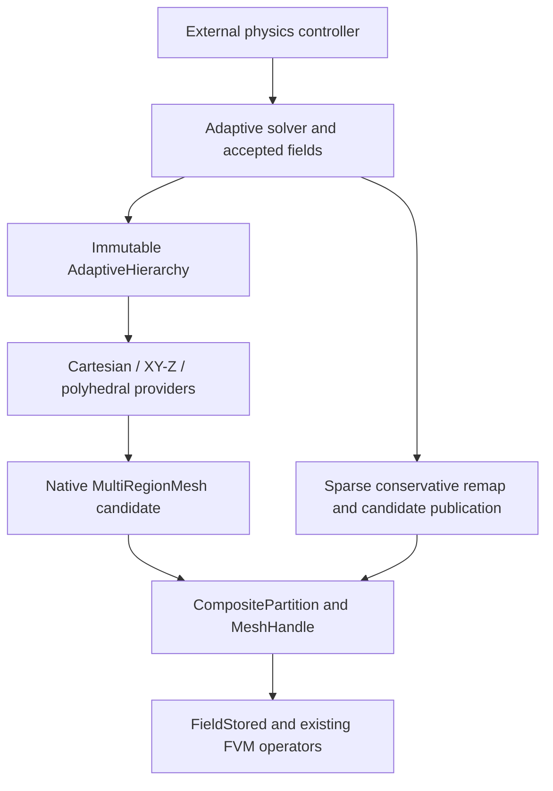

# AMR for extruded, polyhedral, and mixed-region meshes

AMR hierarchy, ancestry, overlap and adaptation modules live in `src/geometry/mesh/AMR/` and namespace `SimpleFluid::Meshes::AMR`.

## Design Overview
The AMR architecture provides a unified framework for adaptive meshes, supporting Cartesian, extruded (XY-Z), and polyhedral grid types. Its core design principles are:

*   **Unified Hierarchy:** Provides an abstraction seam via `AdaptiveHierarchy` for provider-specific implementations (e.g., `CartesianAMR`, `ExtrudedAMR`, `PolyhedralAMR`).
*   **Owner-Local Consistency:** Supports local closure and migration instead of relying on global directories, facilitating distributed operations.
*   **Geometric Decoupling:** Geometric algorithms (like PLIC/clipping) interface with the framework through standardized `ConvexCellGeometry` contracts.

### Integration
The framework integrates with core solvers and FVM consumers through:
- **Native Providers:** `SimpleFluid::Meshes` and provider-specific AMR grids.
- **Geometric Interfaces:** `SimpleFluid::PLIC` for geometric transport/clipping.

For detailed status, roadmap, and current validation coverage, please refer to:
*   **Active Roadmap:** [TODO.md](../../TODO.md#current-priorities)
*   **Verification Contracts:** [vof_solver_contracts.md](../verification/vof_solver_contracts.md)

## Native Hierarchy and Identities

### Persistent geometry-demand storage and prepared-page policy

A hierarchy keeps immutable geometry snapshots by arithmetic mode and purpose. A warm State request authenticates
the source, layout and arithmetic controls, looks up each selected leaf, and imports the exact owner subset for the
matching root. The cache maintains the union of physical owners across its roots and admits old and new storage
together before replacement. A rejected update preserves the accepted roots and lease. Fresh and matching
predecessor ledgers can import through the maintained owner indexes. A whole-union import into an unrelated
populated ledger enumerates owners and index controls to establish its exact overlap. When GeneralVoF receives a
previous State, it admits the previous snapshot and evaluation catalogs while assembling the next selection,
including when the evaluations cannot be reused.

For a one-row Ordinary OriginalSources extension after 512 and 1,024 selected cells, the owner-union test compares
physical edge visits and first and last ownership transitions with an independent traversal. It bounds affected
index copies and lookups and checks that fresh and predecessor-credited ledgers perform no fallback enumeration.

For a trusted Cartesian Ordinary State request of up to four cells, each newly demanded eligible cell can prepare
its source block of up to 64 owned ordinals. Demand in the last four ordinal positions can also prepare the next
block. Each attempt requires a compatible current snapshot and enough operation, hierarchy and residency-arena
headroom for publication and retirement. In the two-block boundary fixture, required demand succeeds with zero,
one or two optional blocks as headroom increases. The serial four-cell stream covers all 256 and 512 cells under
the default 64 MiB hierarchy budget and a 256 MiB snapshot operation limit.

### Persistent owner-local topology with certified contact/subface reuse

Refinement replaces the affected ordered leaf pages. The two-size fixed-edit fixtures verify that untouched leaves
keep their original page controls and backing storage. Directory fact pages keep ancestry, owner and revision
independently of current GIDs. Contact and subface snapshots retain exact witnesses and face incidence, share
unaffected pages across edits, and keep older views readable. A validated answer that cannot be represented by
a certified compact recipe retains its explicit witnesses. Missing or stale authority controls reject the
candidate. [Spatial adaptive closure](spatial_adaptive_closure.md)

The serial, two-rank and four-rank scaling fixtures cover Cartesian, Product, convex Polyhedral, Static with a
Cartesian companion, and Mixed. The Static fixture migrates a Static cell and refines and coarsens its Cartesian
companion.
The 512 MiB fixture limits apply to scaling and owner-union admission. The Product fixed edit bounds physical
geometry constructions across its two patch counts. In these fixtures an unchanged repeat through the qualified
native publisher records zero new PLIC constructions, source imports, source-proof issues, remote source decodes
and ordered-page creations. Publication still emits sparse cell routes, visits owner indexes and can exchange data.
Exact partition binding still validates each owned row. The heap trace measures successful C++ allocation requests,
including unattributed bytes. Direct C allocation, allocator overhead, process RSS and device memory fall outside
that measurement. [AMR heap attribution](amr_heap_attribution.md)

Contact and subface snapshots exercise all five providers in serial and at two and four ranks. The distributed
native-operator, adaptive-state and finite VoF remap checks exercise both MPI sizes, including empty owners.
Conservative, Product, Polyhedral and Mixed remap have dedicated two-rank registrations. The four-rank cubic
storage probes use 64 MiB per rank for canonical N16, explicit-row N32 and full canonical N32. A separate
registration exercises full canonical N32 at 96 MiB.
The default Cartesian hierarchy retains its 64 MiB budget. [Cubic halo measurements](spatial_adaptive_closure.md#cubic-halo-storage)

## Architectural Components

- **AdaptiveHierarchy:** The abstract seam for hierarchical providers, defining methods for querying mesh structure, materials, and fragments.
- **Provider Implementations:**
    - `ExtrudedAMR`: Handles extruded products using base and axial ancestry.
    - `PolyhedralAMR`: Manages planar-faced convex polyhedra via oriented halfspace clipping and canonical subdivision.
    - `MixedAMRGrid`: Facilitates mixed-region assemblies through conservative interfaces and nonconforming join operators.

The opt-in [procedural Cartesian contact path](spatial_adaptive_closure.md#opt-in-procedural-cartesian-contact)
also pins this exact layout. Its detached contact and subface queries derive
uniform nonperiodic incidence without a second authoritative geometry catalog.
Operation-local selection witnesses must be rebound before a reader escapes.

For implementation details on specific algorithms, refer to:
- **Heap attribution:** [AMR requested-heap attribution](amr_heap_attribution.md) distinguishes allocation domains, admission budgets, and retained generations.
- **PLIC/Clipping:** [plic.md](../modeling/plic.md)
- **VoF/Flow Algorithms:** [adaptive_vof.md](../modeling/adaptive_vof.md)
