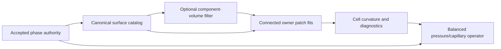

# General-native capillary geometry

Ordinary general-native flow obtains capillary curvature from an immutable
surface catalog. The catalog is independent of `SweptPartition`, `DonorCell`,
and `GeometricFace` transport. Surface preparation changes no accepted cell
inventory, phase history, transport declaration, density, or transported fraction.
The existing balanced pressure/capillary operator consumes the resulting cell
curvature and its original fraction field.



## Models and identities

`GeneralVoFSolverOptions::capillary` selects the geometry model. The default
`Reconstructed` combines mixed-cell sections and opposite-pure native faces.
`FilteredBinary` additionally replaces eligible enclosed binary components with
volume-constrained filtered surfaces. Unrelated reconstructed components remain
in the same catalog.

```cpp
GeneralVoFSolverOptions options;
options.capillary.model = VoF::GeneralVoFCapillaryModel::FilteredBinary;
options.capillary.filter_width = 2;
GeneralVoFSolver solver(phases, material, options);
```

`GeneralVoF::capillary_surface(options)` exposes the detached catalog directly.
Each key contains a patch kind, canonical cell or face ID, and an extraction
ordinal. Several patches may belong to one cell. Mixed sections, aligned faces,
and filtered simplex sections therefore have distinct identities even when their
numeric cell/face IDs coincide. Catalogs bind the accepted source control.

An opposite-pure face follows geometric declarations and retained pure geometry;
a permitted physical trace does not create a second geometric interface. Mixed
sections require actual positive polygon geometry. Scalar transport-volume
admission does not establish surface-area or curvature accuracy.

Mixed-cell capillary orientation is reconstructed by the cell owner from every
complete configured face-neighbor ring. This fixed physical support is independent
of the smaller complete ring selected for a transport plane's directional fit.
Both estimators retain the same independent minority-volume, model, conditioning
and arithmetic gates. A full-rank local transport stencil alone does not establish
that its normal resolves surface bending. Retained adopted interface geometry
remains authoritative. Missing capillary support rejects before fitting; it does
not trigger a switch to a smaller stencil. Unused transport planes are not a
prerequisite for constructing this catalog.

For planar transitions, the capillary reconstruction may use an authenticated
aligned-face plane instead of the transport normal fit. The canonical cell owner
must verify a complete reconstruction stencil: declared-pure cells retain
structural full/empty halfspace support, and every mixed cell independently
matches its positive minority target within the existing phase-volume tolerance,
including its numerical measure estimate. Ambiguous or inadmissible candidates
retain the original reconstruction. The selected capillary plane is imported with
source, topology, partition, cell revision and face identity; transport planes
remain unchanged.

## Connected curvature fitting

Catalog adjacency uses authenticated native incidence. Mixed sections connect
through common native faces reached by their section traces. Mixed/aligned and
aligned/aligned patches connect through a positive shared native edge segment.
The same-edge roundoff admission uses the existing planar representation scale;
it moves no geometry and cannot turn a point contact into a segment.

A patch is fitted only by its canonical owner. Its neighborhood must be connected
in this graph and remain inside the source's admitted cell support. Area and
physical-distance weights feed a coordinate-scaled, column-pivoted Householder
QR fit of a quadratic Monge surface. Normals point from gas to carrier; curvature
is `div(n)`, positive for a convex gas drop. The fit retains sample, conditioning,
normalized residual, slope and normal-consistency gates.

Conservative scalar phase transfer alone does not authenticate gas connectivity
across the donor face. A positive minority receipt can produce a newly mixed cell
whose independently volume-fitted gas is separated from the donor's reconstructed
gas by carrier. Its inventory and mixed declaration remain intact. If that
reconstructed component has too few connected physical patches, continuation
rejects with the measured sample count; nearby patches across the carrier gap
cannot supply the fit. Complete native cell support and a successful target-volume
oracle do not establish this missing surface support. Its condition indicator
is the squared infinity-norm estimate of the scaled QR factor, not the former
normal-equation matrix condition or a certified bound.

A represented plane may use zero curvature only with coherent normals, planar
polygon placement and two independent tangent directions. A nonplanar raw binary
staircase requires the explicit filtered model or additional resolution; dropping
perpendicular facets from a fit cannot justify zero curvature.

Owned patch curvatures are exchanged by full patch key, with source/epoch/model
and cell-revision authentication. Incident patches contribute area-weighted cell
curvature. Extension to cells without an incident patch remains within admitted
support and rejects ambiguous disconnected sheets when the projection needs that
curvature. A workspace query skips only proven inactive exact-0/1 bulk cells:
their face ring is constant, and every neighbor gradient is either zero by its
own constant-ring evidence or has an exactly zero cached tangential coefficient.
This uses the same projection geometry, including skew corrections. Nonbinary
traces are not classified as inactive by a magnitude threshold. No global
explicit-geometry gather is used.

## Conservative binary filtering

Filtering is a geometry model for eligible, enclosed, wholly binary gas
components. Face-connected gas components touching mixed geometry retain their
reconstructed surfaces. Distinct filter supports may not overlap or merge.
Geometric gas volume is the sum of original gas-cell volumes; it excludes
independently retained physical traces.

Let `V_i` be the actual native cell volume, `h_i = cbrt(V_i)`, and `w` the selected
width in local cell lengths. The model takes `N = ceil(w)` simultaneous graph
steps. For each interior canonical face, with area `A_ij` and centroid distance
`d_ij`, define

\[
 C_{ij}=\frac{(h_i^2+h_j^2)A_{ij}}{2d_{ij}},\qquad
 r_i=\sum_j C_{ij}/V_i,\qquad
 K_{ij}=\frac{(w/N)C_{ij}}{2\max(r_i,r_j)}.
\]

Starting with the component's geometric indicator, each step applies

\[
 q_i^{m+1}=q_i^m+\frac{1}{V_i}\sum_j K_{ij}(q_j^m-q_i^m).
\]

`K_ij` is symmetric and each row's exchanged fraction is at most one half.
Pair transfers cancel in the extensive sum, including on unequal-volume cells;
updates are convex combinations without clipping. A separate compensated check
requires `sum(V_i q_i)` to preserve the component's original volume. Default width
2 means two face-neighbor propagation steps, not a Gaussian standard deviation.
Physical widths decrease with mesh refinement.

Known physical boundaries have zero filter flux and retain their complete source
face geometry. Unknown interior halo frontiers are not boundaries of the model
and reject incomplete support. Nodal interpolation uses complete authenticated
cell fans and volume weights. Missing halo fans are imported from an incident
cell's owner, with source, node-identity and member-revision checks. No extra
cell geometry is imported: missing positive support still requests resolution.
Additional inferred fans require a closed connected interior star; physical
boundary stars always require owner authority.
Face-center values use positive triangle-area weights of their boundary nodes.
Cell-center values use positive tetrahedron-volume weights of boundary node and
face-center values. These geometric centroid identities reproduce affine nodal
fields; the independently conserved cell averages are not inserted as new
interior peaks. Canonical face fans produce a continuous piecewise-linear scalar
on tetrahedra.

Each component solves its own isovalue so the extracted gas volume matches its
original geometric volume. No per-cell plane shift or inventory renormalization
is used. An actual nodal level may be selected when it independently meets the
same volume equation. On-level vertices retain canonical native identities;
strictly crossing edges produce new cuts. Proven point/edge contacts have no
surface area, and opposite full facets cancel by source identity. Finite-volume
plateaus whose superlevel-volume jump contains the target, and inconsistent facet
incidences, reject. An isolated one-cell indicator can reach this resolution
boundary even when its smoothed volume is conserved. Original and extracted
boundaries must be connected oriented two-manifolds, with single-cycle vertex
links and spherical topology. Cavities, unsupported handles, edge/vertex contacts,
merging and deficient support request resolution.

The extracted gas must remain away from physical walls: every boundary-triangle
scalar vertex must be below the selected isovalue. Surface vertices are then
published in binary64, polygon metrics are recomputed, and the closed published
surface volume must satisfy the same component-volume tolerance. Wide internal
volume agreement cannot authorize a collapsed or volume-changing publication.

## Publication, diagnostics and limits

`capillary_diagnostics()` reports the accepted model, owned patch fit residuals,
condition indicators and sample counts, plus owned component target, smoothed and
published extracted volumes, filter-width range and isovalue. Candidate diagnostics
publish with the accepted solver state. Rejected work preserves the previous
fields, time, phase authority and diagnostics.

Resolution failures carry a structured reason, including incomplete support,
ambiguous topology, component merging, unsupported cavities, volume constraints
or deficient fitting. Collective failures preserve the reason on every rank,
including empty owners. Resource exhaustion remains a separate rejection.

The complete component and its required support must fit the retained halo and
configured allocation limits. Wider support is not silently imported, boundaries
are not extrapolated, and no Exact fallback is selected. The new catalog/filter
path is Ordinary-only; explicit BoundedCertification and Exact retain their
separate mixed-surface paths and qualification boundaries.

This model does not establish interface or capillary accuracy at arbitrary
resolution. Kernel sphere/cylinder reports and focused conservation/transaction
checks are separate from complete motion, pressure-jump, spurious-current and
capillary-time qualification. Relevant native-cylinder and curvature prerequisites
remain required for the declared short-horizon capillary scope. A broader
static-equilibrium or dynamic-response claim activates the conditional algebraic
follow-ons: area-weighted curvature and pressure-jump errors at most 5% on the
finest resolved uniform mesh, spurious velocity at most `1e-3` of the declared
capillary velocity, and dynamic period and amplitude/decay errors at most 5%.
For those claims, observation covers at least five capillary times and extends
when viscous relaxation controls.
See the [capillary manifest](../../verification/vof/algebraic_capillary_manifest.json)
and [qualification gates](../verification/vof_solver_contracts.md#algebraic-face-volume-qualification).
These unchanged thresholds apply to the stated claims; they are not completed
validation or a requirement to implement every capillary model for the scoped
fixed-mesh default. Record cleanup policy and sensitivity separately.

The filtered uniform-sphere study holds the filter at two cell lengths, so its
physical width decreases with refinement. Reconstructed mixed surfaces and
filtered binary surfaces remain separate studies. The existing native cylinder
keeps its complete `.02` endpoint and original pressure, velocity, conservation
and divergence checks under explicit face-backend selection; that short
prerequisite does not satisfy the five-capillary-time gate. Larger distributed
components still require complete retained component/halo support; incomplete
support is a resolution rejection rather than a local curvature approximation.
`SpatialPartitionRetainsCompleteCurvedSupport` supplies a positive case inside
that boundary: the existing three-layer native cylinder uses axial ownership
slabs, two halo rings, twelve owned curved patches and an asserted empty owner
at four ranks. It checks initial curvature and unchanged inventories for both
face backends. This initialization-only component check does not advance the
capillary clock or close the continuation gate.
