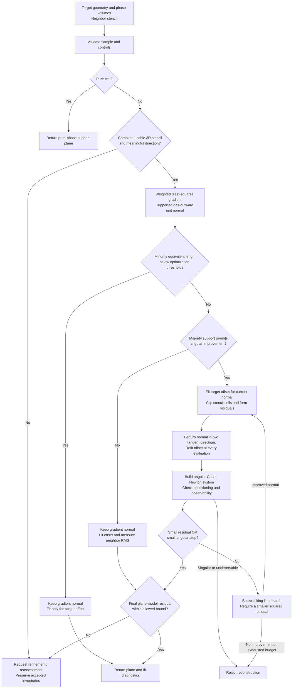
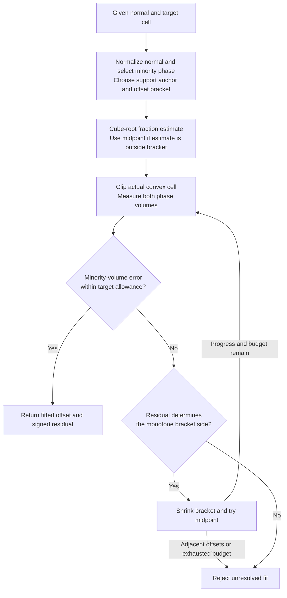

# Piecewise-linear interface reconstruction (PLIC)

The opt-in `measure_only` Ordinary reconstruction path uses original-boundary
face integration and a safeguarded minority-phase offset solve; see
[the face transport contract](../architecture/conservative_face_vof.md#measure-only-plic-and-geometric-candidates).
Its numerical error estimates are not certified bounds. The legacy scalar and
explicit surface construction paths described below remain available.

PLIC represents the gas/liquid interface inside a cell by a plane. This guide
describes the finite `PLIC::PolyhedralReconstruction<Mode>` used by `GeneralVoF` on
actual convex native cells. It covers the geometric model, normal and offset
fits, and their acceptance checks. The [uniform Cartesian](vof.md) and
[adaptive Cartesian](adaptive_vof.md) backends retain specialized reconstruction
and directional transport; the algorithm below is the general-native path.

Reconstruction supplies geometry to phase transport and curvature evaluation.
It does not advance phase inventories, solve momentum, or project pressure.
Those operations follow the [VoF transport contract](../architecture/vof_transport.md).
The [general AMR contract](../architecture/general_amr.md) owns mesh support and
qualification limits. Optional exact arithmetic has its separate
[ExactVoF contract](../architecture/exact_vof.md).

## Plane convention and state

For a convex cell $K$, the reconstructed gas region is

$$
K_g = K \cap \{\mathbf{x}:\mathbf{n}\cdot(\mathbf{x}-\mathbf{a})\le d\},
\qquad |\mathbf{n}|=1.
$$

The normal $\mathbf{n}$ points out of gas into liquid. The anchor $\mathbf{a}$
and offset $d$ have units of length; volumes have units of length cubed. In
solver SI units these are metres and cubic metres. The liquid, named `carrier`
in the reconstruction API, occupies the complementary region. Keeping an
anchor and a separate signed offset avoids encoding a small cut solely as the
difference between large global coordinates. Clipping uses the actual cell,
including its physical centroid and supporting planes, rather than a box
approximation.

The reconstruction sample contains geometry and gas/carrier volumes. Direct
sample validation requires finite, nonnegative phase amounts, positive cell
volume, and agreement between their sum and the cell volume within the
implemented input/geometry allowance.

`GeneralVoF` retains independent physical gas and carrier inventories. Its
`reconstruction_sample<Mode>` adapter preserves the smaller physical amount and forms the
dominant **geometric fitting amount** as represented cell volume minus that
minority amount. This sample is a geometric view; it does not overwrite either
physical inventory. Occupancy differences and fit/transfer accounting remain
part of the surrounding phase-state contract. A fitted plane alone is not a
certificate of physical phase conservation.

## Entry and resolution admission

Before requesting a new fit, `GeneralVoF` validates the cell and can reuse a
retained finite interface or an explicitly declared pure-phase geometry.
Declared geometry is distinct from inventory: a declaration does not authorize
deleting a trace amount. For inferred geometry, an exactly zero phase amount
selects the pure-cell offset path. A mixed cell gathers neighbors through the
configured topology support rings and enters reconstruction.

Mixed-cell admission checks the target and stencil before selecting an orientation method:

- At least four stencil cells and a full-rank, sufficiently conditioned
  three-dimensional centroid arrangement are required.
- The phase differences must supply a directional signal larger than its
  propagated numerical uncertainty estimate. A well-conditioned arrangement of
  identical fractions supplies no direction; normalizing roundoff is insufficient.
- Majority support is assessed only after directional validity. Each phase
  reaching `minimum_phase_support_fraction` somewhere in the target-plus-stencil
  neighborhood makes angular improvement eligible. The default remains `0.5`;
  absence of a majority sample does not by itself reject a usable gradient.
- Sample validity, arithmetic compatibility, and stencil-size limits apply.

Insufficient sample count, rank deficiency, excessive conditioning, absent
directional signal and a rejected selected plane model have distinct assessment
reasons. They raise `PolyhedralResolutionRequired` without changing the amounts.
The assessment requests a maximum cell span of half the target's current
maximum axis span. The caller must refine or recover missing initial geometry
and reassess; reconstruction does not run an adaptation controller. This is a
generic refinement hint, not a measured resolution requirement or proof of resolved interface thickness or spatial
convergence. It never converts a mixed inventory to pure by applying a cutoff.

## Reconstruction flow

The diagram describes a fresh inferred reconstruction; retained interfaces and
explicit geometry declarations are handled by the caller as described above.
Input, arithmetic, and work-limit failures can reject at any stage.

### Initial normal and angular objective

Let $\alpha_i=V_{g,i}/(V_{g,i}+V_{l,i})$ be the independently supplied sample
fraction and $\mathbf{r}_i=(\mathbf{x}_i-\mathbf{x}_0)/h$ the centroid displacement
normalized by the target's largest span. The initial direction solves

$$
\left(\sum_i\frac{\mathbf{r}_i\mathbf{r}_i^T}{|\mathbf{r}_i|^2}\right)\mathbf{q}
=-\sum_i\frac{\mathbf{r}_i(\alpha_i-\alpha_0)}{|\mathbf{r}_i|^2},
\qquad \mathbf{n}_0=\frac{\mathbf{q}}{|\mathbf{q}|}.
$$

The minus sign gives the gas-outward convention. The finite implementation selects the
target's smaller phase for the whole solve, reversing the carrier-gradient sign
so it never recovers a tiny carrier signal by subtracting gas fractions near one.
It assembles in wider finite arithmetic and estimates fraction, assembly and solve
roundoff. The matrix infinity-norm condition and propagated gradient uncertainty
are separate diagnostics; the dimensionless Euclidean gradient strength must
exceed the uncertainty estimate. These estimates are not geometric certificates
or bounds on interface-orientation accuracy. There is no arbitrary-axis fallback.

The provisional small-phase policy uses volume-equivalent characteristic lengths:

$$
\ell_m=\sqrt[3]{\min(V_g,V_l)},\qquad h_K=\sqrt[3]{V_K},\qquad
\ell_m/h_K < \texttt{minimum\_optimized\_phase\_length\_ratio}.
$$

The default ratio is `0.05`; it is a configurable modeling choice, not a measured
interface thickness or a certified resolution bound. It is invariant under unit
scaling and exchanging the phase labels. Values in `[0,1]` are accepted; zero
explicitly disables this exclusion. Equality receives no small-phase exclusion;
angular improvement still requires the finite majority-support eligibility.

Below the threshold, the supported gradient determines the orientation. Only the
target-cell offset is fitted: no neighboring-cell volume objective, angular
iterations or plane-model RMS gate is evaluated. The original target minority
volume accuracy and offset-work limits still apply. An unresolved offset rejects;
the policy neither deletes a phase inventory nor declares a mixed cell pure.
Ordinary, BoundedCertification and explicit Exact reconstruction share this
orientation-selection policy while retaining their separate arithmetic and support
contracts. The finite tiny-phase branch depends on directional validity and the
existing size threshold, not on majority eligibility. It does not claim that the
neighborhood is accurately represented by its plane. Other finite mixed cells
with weak majority support retain the gradient, strictly fit the target offset,
and evaluate neighboring-volume RMS against `maximum_model_residual`. Eligible
cells initialize the angular fit below. A later angular or arithmetic failure
never automatically selects the gradient fallback.

`PolyhedralInterface::orientation_method` distinguishes `Gradient`,
`AngularVolumeFit` and `SuppliedNormal`. Gradient results report zero angular
iterations and leave `fit_converged` false because no angular optimizer ran.
`stencil_volume_residual_measured` distinguishes an evaluated residual from the
unmeasured zero on the tiny-phase branch. Moderate weak-support gradients publish
their measured RMS; angular fits and measured supplied-plane paths set the same
flag. The flag survives plane exchange and transfer. A large RMS for a gradient
plane shows poor agreement for that selected plane, not that every possible
orientation is incompatible.
Target-volume residual diagnostics remain available on every fitted-offset path.

For each candidate normal, the inner solve fits the target offset anew. That
same anchored plane is then applied to each stencil cell. For cell $i$, select
its smaller sample phase $m_i$ (gas on a tie) and define

$$
r_i(\mathbf{n})=
\frac{\widehat V_{m_i,i}(\mathbf{n},d(\mathbf{n}))-V_{m_i,i}}{V_i},
\qquad J(\mathbf{n})=\sum_i r_i(\mathbf{n})^2.
$$

The target cell supplies the offset constraint; the neighboring cells supply
the angular objective. Each neighbor can select a different minority phase.
Residuals are normalized by that neighbor's full cell volume.

The optimizer constructs two tangent directions at the current unit normal.
Centered perturbations of size `1e-4` estimate derivatives of the residual
vector, including a fresh offset solve at every perturbed direction. A
two-variable Gauss-Newton system gives the proposed angular step. Singular,
ill-conditioned, or unobservable orientation systems reject.

After those checks, angular convergence requires either the stencil RMS
residual to meet `fit_tolerance` or the proposed step norm to meet
`orientation_tolerance`. Otherwise, a line search tries scales from `1` down to
`1/128` by successive halving, renormalizes the candidate normal, and accepts
only a strict decrease in $J$. No improving candidate or an exhausted iteration
budget rejects the fit.

A converged optimizer must also satisfy `maximum_model_residual`. Curved
interfaces can have a nonzero plane-model defect even at an angular optimum.
Exceeding this separate bound produces an `UnresolvedPlaneModel` refinement
request. Optimizer convergence therefore does not establish adequate spatial
resolution.

### Inner plane-offset solve

For a given normal, the target is the smaller of the sample gas and carrier
volumes, $V_m$. The fit uses this phase directly to avoid judging a small
minority cut solely through the dominant phase's volume.

The anchor is chosen near the appropriate extreme projected vertex. A full
support query establishes the offset bracket; the chosen anchor does not imply
that either bracket endpoint is exactly zero. The initial estimate uses the
cube root of $V_m/V_K$ measured from the gas-minimum or carrier-maximum side.
Subsequent steps bisect the bracket. Increasing the offset increases gas volume
and decreases carrier volume, so the residual-to-bracket update depends on
which phase is fitted.

In ordinary arithmetic, offset acceptance is

$$
|\widehat V_m-V_m|\le
\texttt{volume\_tolerance}\,V_m.
$$

This is a relative **minority-volume** requirement, separate from the
dimensionless stencil residual. The best evaluated offset is retained. Failure
to establish the tolerance before the bracket loses representable progress or
the work budget expires rejects reconstruction. Pure cells instead return the
appropriate support endpoint without a mixed-cell volume iteration.

## Arithmetic and controls

`ArithmeticMode::Ordinary` is the general-VoF default. It uses represented scalar
residuals. `BoundedCertification` is explicit opt-in: target acceptance includes
the residual uncertainty, bracket updates require an enclosure wholly on one
side of zero, and RMS acceptance includes the propagated residual bounds. The
angular search uses nominal squared residuals for improvement. Certification
failure does not switch arithmetic policy or relax physical tolerances.

The caller selects a mode at the VoF operation boundary and supplies
`PolyhedralPhaseSample<Mode>` to the compiled `PolyhedralReconstruction<Mode>` entries.
Target and stencil geometry retain that type throughout offset and normal
fitting. The former runtime sample and reconstruction overloads are removed;
geometry operations cannot re-enter runtime selection during a fit.

Defaults in `PolyhedralReconstructionOptions` are:

| Control | Default | Meaning |
| --- | --- | --- |
| `volume_tolerance` | `8e-15` | Relative target minority-volume allowance |
| `fit_tolerance` | `2e-9` | Dimensionless stencil RMS convergence threshold |
| `orientation_tolerance` | `2e-8` | Tangent-step norm convergence threshold |
| `maximum_model_residual` | `0.2` | Maximum accepted dimensionless stencil RMS defect |
| `minimum_phase_support_fraction` | `0.5` | Majority-support eligibility for angular improvement after directional admission |
| `minimum_optimized_phase_length_ratio` | `0.05` | Below this volume-equivalent length ratio, use the supported gradient without angular fitting |
| `maximum_condition` | `1e8` | Conditioning limit for normal estimation and angular fitting |
| `maximum_offset_iterations` | `192` | Iteration cap per target-offset fit |
| `maximum_fit_iterations` | `24` | Outer angular iteration cap |
| `maximum_stencil_cells` | `128` | Reconstruction stencil-size cap |
| `maximum_clip_evaluations` | `32768` | Shared target/stencil evaluation cap for one reconstruction |

The finite initial linear solve uses `||A||inf * ||inverse(A)||inf` and a
directional-signal uncertainty check; the angular system uses its eigenvalue
ratio and separate observability check. Geometry
operations and the enclosing `GeneralVoF` transaction also impose their own
resource limits. These caps are failure conditions, not permissions to discard
phase amounts or return an unconverged fit.

## Result, integration, and limitations

`PolyhedralInterface` returns the gas halfspace, pure-phase flags, signed target
volume residual, finite residual evidence, stencil RMS residual, condition
diagnostic, orientation method, angular step, iteration count, convergence flag, RMS-measured flag, and resolution
assessment. The signed target residual refers to the selected minority phase,
which need not be gas. Pure or reused geometry does not necessarily carry a
fresh angular-fit convergence record. Local assessments retain directional strength,
uncertainty and eligibility; existing plane exchange/transfer formats carry the
plane's method, condition and measured-RMS flag, rather than the full assessment.

`solve_offset` validates a supplied normal's numerical volume fit; it does not
perform the neighborhood support and angular-model admission of `reconstruct`.
A successful offset solve alone does not qualify an interface representation.

GeneralVoF reconstructs on cell owners and imports owner planes for halo use.
The transport operation uses these labels to split geometric transfers, then
checks donor availability, recipient occupancy, and independent phase
conservation. Reconstruction failure propagates through the collective trial;
the accepted state remains unchanged. No reconstruction retry, automatic
refinement, or timestep subcycling occurs inside this kernel.

One plane per cell cannot encode arbitrary disconnected subcell interfaces or
unresolved thin films. This fit does not prescribe contact angles or evaluate
curvature; those require separate models and stencils. Component acceptance
does not establish full-flow accuracy, production-scale performance, or
physical application validation. Spatial and temporal convergence remain
separate qualification tasks.

## Implementation and verification map

- [Public samples, options and results](../../src/geometry/PLIC/PolyhedralReconstruction.hh)
  define the fixed-mode reconstruction interfaces.
- [Finite reconstruction kernels](../../src/geometry/PLIC/details/PolyhedralReconstruction.tcc)
  implement support admission, offset fitting and angular optimization.
- [GeneralVoF state integration](../../src/FVM/details/GeneralVoFState.cc)
  owns geometric fitting samples, stencil assembly, retained interfaces and
  owner-plane imports.
- [Reconstruction tests](../../src/FVM/unitTests/testPolyhedralReconstruction.cc)
  cover finite mode entries, minority-volume fits, support/model gates,
  refinement requests, scaling, conditioning and rejection without inventory
  mutation. The owning target is `testPolyhedralReconstruction`, registered by
  [FVM test CMake](../../src/FVM/unitTests/CMakeLists.txt).
- [VoF verification contracts](../verification/vof_solver_contracts.md) describe
  broader numerical acceptance requirements. Source coverage and successful
  local fits do not substitute for those gates.
