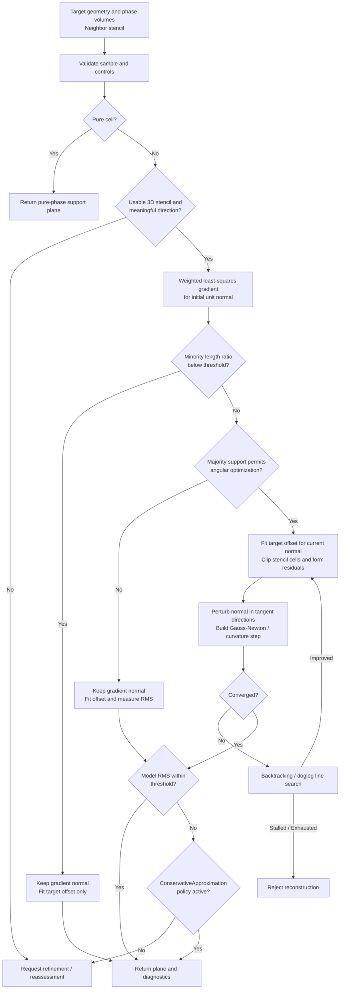
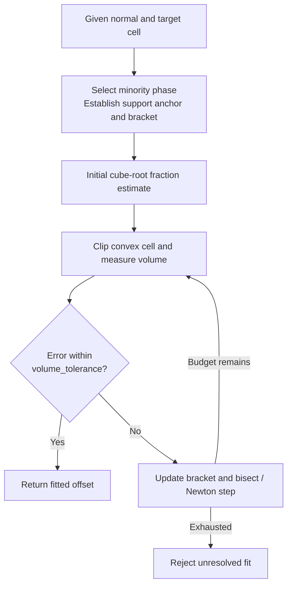

# Piecewise-Linear Interface Reconstruction (PLIC)

PLIC represents the gas/liquid interface inside a cell as a plane. This guide describes the `PLIC::PolyhedralReconstruction<Mode>` model used by `GeneralVoF` on convex native cells, covering the geometric representation, normal and offset fitting, and acceptance criteria.

*(Note: Uniform and adaptive Cartesian backends retain specialized box-based reconstruction; see [vof.md](vof.md) and [adaptive_vof.md](adaptive_vof.md). For architectural integration, see [general_amr.md](../architecture/general_amr.md).)*

## Plane Convention and State

For a convex cell $K$, the reconstructed gas region is defined as:

$$
K_g = K \cap \{\mathbf{x} : \mathbf{n} \cdot (\mathbf{x} - \mathbf{a}) \le d\}, \qquad |\mathbf{n}| = 1
$$

- **Normal ($\mathbf{n}$):** Points out of the gas phase into the liquid (`carrier`) phase.
- **Anchor ($\mathbf{a}$) and Offset ($d$):** Have units of length. Maintaining a local anchor and separate signed offset avoids precision loss when representing small cuts in large global coordinates.
- **Volume Conservation:** The reconstruction fits the smaller physical phase volume ($V_m = \min(V_g, V_l)$) directly, while the dominant phase occupies the complementary geometric volume of the cell.

## Entry and Resolution Admission

Before fitting a plane for a mixed cell, the model gathers a local neighbor stencil and evaluates admissibility:
1. **Geometric Conditioning:** Requires at least four stencil cells and a well-conditioned 3D centroid arrangement.
2. **Directional Signal:** Phase differences across the stencil must exceed numerical uncertainty.
3. **Angular Support:** Angular optimization requires sufficient mixed-neighbor support in the tangent plane and adequate majority-phase availability (`minimum_phase_support_fraction`).

If the local stencil is under-resolved or ill-conditioned, the model raises `PolyhedralResolutionRequired` to request mesh refinement rather than producing a degenerate fit.

## Reconstruction Workflow

### 1. Initial Normal and Small-Phase Policy

Let $\alpha_i$ be the minority phase fraction in cell $i$, and $\mathbf{r}_i = (\mathbf{x}_i - \mathbf{x}_0)/h$ be the normalized centroid displacement. The initial normal $\mathbf{n}_0$ is obtained via weighted least-squares:

$$
\left(\sum_i \frac{\mathbf{r}_i \mathbf{r}_i^T}{|\mathbf{r}_i|^2}\right)\mathbf{q} = -\sum_i \frac{\mathbf{r}_i(\alpha_i - \alpha_0)}{|\mathbf{r}_i|^2}, \qquad \mathbf{n}_0 = \frac{\mathbf{q}}{|\mathbf{q}|}
$$

**Small-Phase Policy:** If the characteristic minority length ratio $\ell_m / h_K = \sqrt[3]{\min(V_g, V_l) / V_K}$ is below `minimum_optimized_phase_length_ratio`, angular optimization is skipped. The solver retains the gradient normal $\mathbf{n}_0$ and fits only the target offset.

### 2. Angular Optimization

When eligible, the normal is refined by minimizing the squared volume residuals across the neighbor stencil:

$$
r_i(\mathbf{n}) = \frac{\widehat{V}_{m_i, i}(\mathbf{n}, d(\mathbf{n})) - V_{m_i, i}}{V_i}, \qquad J(\mathbf{n}) = \sum_i r_i(\mathbf{n})^2
$$

- For each candidate normal $\mathbf{n}$, the target offset $d(\mathbf{n})$ is re-solved exactly on the target cell.
- The optimizer Perturbs $\mathbf{n}$ along two orthogonal tangent directions to form a 2D Gauss-Newton step (supplemented by dogleg trust-region and curvature directions when necessary).
- Under the default `RequireModelAgreement` policy, the final converged plane must satisfy `maximum_model_residual`; otherwise, refinement is requested. Under the opt-in `ConservativeApproximation` policy, high-RMS stationary fits are admitted with quality telemetry recorded.

### 3. Inner Plane-Offset Solve

For a fixed normal $\mathbf{n}$, the offset $d$ is found by matching the target cell's minority volume $V_m$:

Acceptance requires:

$$
|\widehat{V}_m - V_m| \le \texttt{volume\_tolerance} \cdot V_m
$$

## Controls and Defaults

Key parameters in `PolyhedralReconstructionOptions`:

| Control | Default | Meaning |
| --- | --- | --- |
| `volume_tolerance` | `8e-15` | Relative target minority-volume tolerance |
| `fit_tolerance` | `2e-9` | Dimensionless stencil RMS convergence threshold |
| `orientation_tolerance` | `2e-8` | Tangent-step norm convergence threshold |
| `model_policy` | `RequireModelAgreement` | Strict model admission (`ConservativeApproximation` is opt-in) |
| `maximum_model_residual` | `0.2` | Stencil RMS threshold for model agreement |
| `minimum_phase_support_fraction` | `0.5` | Majority-support threshold for enabling angular optimization |
| `minimum_optimized_phase_length_ratio` | `0.05` | Characteristic length ratio below which gradient normal is kept |
| `maximum_condition` | `1e8` | Conditioning limit for linear/angular systems |
| `maximum_offset_iterations` | `192` | Iteration cap per target-offset solve |
| `maximum_fit_iterations` | `24` | Outer angular optimization iteration cap |
| `maximum_stencil_cells` | `128` | Stencil size cap |

## Implementation References

- **Interfaces & Options:** `src/geometry/PLIC/PolyhedralReconstruction.hh`
- **Reconstruction Kernels:** `src/geometry/PLIC/details/PolyhedralReconstruction.tcc`
- **VoF State Integration:** `src/FVM/details/GeneralVoFState.cc`
- **Unit Tests:** `src/FVM/unitTests/testPolyhedralReconstruction.cc`
